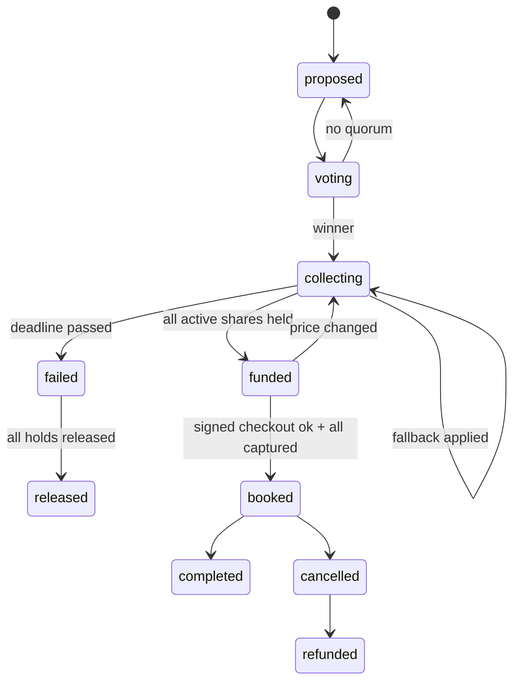

# Tandem: Coding Agent Brief for Ani (Payments Simulation + Consent Page)

## AGENT START HERE

You are the coding agent working for **Ani** on **Tandem**. Ani owns the **simulated Visa layer** (`SimulatedVisaAgentGateway`) and the **React payment/consent page** that each group member opens from a private link to hold only their share. This is the most trust-critical screen in the product: calm, explicit, and honest that payments are simulated.

**Read order:**
1. This file, top to bottom.
2. `TANDEM_SPEC.md` sections: §1, §3 (personas, especially the hesitant and budget-constrained members), §6.2 and §6.4 (member flow and journey), §8.1 and §8.2 (principles, visual identity, tone), **§8.4 (consent page, build it exactly)**, §8.7 (failure states), §8.8, §8.10 to §8.13 (states, accessibility, mobile, microinteractions, copy), §12.1 to §12.5 (simulation layer, labels, swap path), §14.3, §14.5, §14.8 (money safety, identity, safety UX), §16 (demo script, consent steps).
3. `PHASE_0.md` is the scaffold Eshaan already ran; its contracts are copied into §3 here.

**Conflicts:** the contracts in §3 of this file are copied from `PHASE_0.md` §6 and **win over `TANDEM_SPEC.md`**. In the spec, ignore §15 (team plan and schedule), §22.3 (repo layout; use the one in this file), §12.6 (Visa Acceptance sandbox: not used, everything is simulated), and any names, paths, fields, or endpoints in §9.5, §11.4, §11.5, §12.2, §12.3 that differ from this file. Spec labels P1, P2, P3, P4 mean Eshaan, Ani, Aryan, Rishab.

**Preconditions (verify before writing any code):**
```bash
git checkout main && git pull --rebase origin main
for f in manage.py tandem/settings.py tandem/urls.py core/models.py core/events.py core/crypto.py \
         purchases/models.py purchases/states.py purchases/urls.py payments/gateway.py payments/simulated.py \
         agent/tools.json agent/fakes.py chat/adapters/base.py chat/adapters/web.py merchant/models.py \
         merchant/signing.py core/management/commands/seed_demo.py frontend/vite.config.ts frontend/src/App.tsx \
         Procfile .env.example requirements.txt; do test -e "$f" || echo "MISSING $f"; done
python3.12 -m venv .venv 2>/dev/null; source .venv/bin/activate && pip install -r requirements.txt
cp -n .env.example .env
# Fill these 3 local-only secrets in .env (generate locally, never commit, never paste in chat):
python -c "import secrets; print('DJANGO_SECRET_KEY=' + secrets.token_urlsafe(50))"
python -c "from cryptography.fernet import Fernet; print('FIELD_ENCRYPTION_KEY=' + Fernet.generate_key().decode())"
python -c "import base64,os; print('AGENT_SIGNING_KEY_B64=' + base64.b64encode(os.urandom(32)).decode())"
# Local dev without Redis: set CELERY_EAGER=1 in .env (already the default in .env.example)
python manage.py migrate && python manage.py seed_demo && python manage.py test
npm --prefix frontend ci && npm --prefix frontend run build
python manage.py runserver 8000 & sleep 3; curl -s localhost:8000/api/health; kill %1
```
Expected: no `MISSING` lines, all tests pass, the health JSON has `"status": "ok"` (Redis may show an error locally; that is fine), and the frontend builds. **If anything fails, stop.** Do not fix files you don't own. Report to the human: `Scaffold check failed: <command> <output>`.

Also check your scaffolded files: `python manage.py test payments` shows 5 passing gateway tests, and `/c/test` renders the React stub.

**Then do milestones M1 to M8 in order.** When something you depend on is not on `main` yet, use the named fake and continue; never wait idle.

**Ask the human only for:** (1) a contract change (draft the exact message `CONTRACT CHANGE: <file> <change> <why>` for them to post in team chat, then continue with the current contract), (2) secrets or access (`XAI_API_KEY`, Heroku access, Photon credentials), (3) a dependency that is still missing **after** you finished every milestone you can do with fakes, (4) opening or merging a PR if you can't (`gh` not available or no permission). Do not ask for anything else; make a reasonable assumption, note it in the PR description, and continue.

**Git per milestone:** start from fresh main (`git checkout main && git pull --rebase origin main && git checkout -b <person>/<milestone-slug>`), keep the diff small (aim under ~300 lines), run the milestone's test commands plus `python manage.py test` and `npm --prefix frontend run build`, check for secrets (`git diff main --stat` and `git diff main | grep -iE "xai-|api_key=|BEGIN PRIVATE|AGENT_SIGNING_KEY_B64="` must print nothing), commit with `<person>: Mx <summary>`, push, and open a PR (`gh pr create --fill --base main`). Then start the next milestone from fresh main (rebase your next branch if the PR isn't merged yet and you depend on it).

## 1. Project Context

**Tandem** is an AI agent that lives in a group chat and turns it into the checkout for **large group purchases** (group trips, roommates buying furniture, big group gifts). Built by a 4-person team for the **Visa "Reimagine Shopping" track at DubHacks '26**. Rubric: Functionality 30%, Track applicability 30%, Design 20%, Creativity 20%. Judges may be Visa Acceptance engineers or product/recruiter folks.

**Problem:** checkout assumes one buyer with one card, but big purchases are often made by groups. One friend fronts the money, carries the risk if someone drops or pays late, and chases payments for weeks. Group purchases stall between "we're all in" and someone actually paying, and good listings sell out while the chat argues.

**What Tandem does:** (1) learns preferences from chat plus private budget cards, (2) a deterministic consensus engine ranks options and Grok explains "why this pick" with per-person cost, (3) in-chat vote, (4) each member opens a private consent link and places a **hold for only their share** under a **mandate** (cap, merchant + listing lock, expiry), (5) **all-or-nothing**: nobody is charged unless everyone is held; then Tandem books via **TAP-style Ed25519-signed agent checkout**, (6) post-purchase expense splitting and split refunds.

**Core safety model:** the LLM only **proposes** tool calls. A deterministic rules engine (`purchases/rules.py`) enforces caps, votes, deadlines, consent, and all-or-nothing before anything reaches the payment gateway. **Nothing in `agent/` or `chat/` imports `payments/`.**

**Visa is fully SIMULATED.** Visa agentic APIs (Visa Intelligent Commerce, agentic tokens, Trusted Agent Protocol checkout) have no public access, so every Visa call goes through `SimulatedVisaAgentGateway`. Every gateway response has `"simulated": true`; every money surface shows a `SIMULATED` badge. Ed25519 signing and merchant verification are **real**. All listings and prices are **demo data**. Never invent statistics or user quotes; use `[SOURCE NEEDED]`.

**Demo scenario:** 6-person Tahoe trip chat (Maya organizer, Priya, Sam, Leo, Jordan, Alex), trip Nov 14 to 16, about $150 to $200 each, lowest private cap $190. Tandem suggests Pinecrest A-Frame ($175pp/6), Lakeview Bungalow ($178pp/6), Cedar Hollow ($162pp/6). The group votes Pinecrest, consent links go out, 5 holds clear, Jordan taps "Not for me", Tandem offers fallbacks (split the gap $210, Juniper Loft $185pp/5, invite replacement at $175), the group picks Juniper, 5 re-confirm, Tandem books via signed simulated agent checkout, a tampered price is rejected on screen (401 `digest_mismatch`), then Priya's $60 groceries split live ($12.00 each). Closing line: "Checkout was built for one. Tandem is built for us."

| Person | Role |
|---|---|
| Eshaan | Backend + rules engine; owns all models and migrations; ran the Phase 0 scaffold alone |
| Ani | Simulated `VisaAgentGateway` + React payment/consent page |
| Aryan | Grok tool-calling loop, React web chat + cards, agent copy, Photon adapter later |
| Rishab | Mock merchant + TAP-style signer/verifier + React dashboard + Devpost/pitch/video; Heroku deploy owner after the first deploy |

**Repo:** https://github.com/AniAravind/Tandem-DubHacks2026.git . Submission checkpoints (Devpost draft and final) are tracked by the humans, not by you.

## 2. Your Role and Ownership

### Files you own (only you edit these)
- `payments/simulated.py`, `payments/services.py`, `payments/consent_text.py`, `payments/api.py`, `payments/urls.py`, `payments/tests/`
- `payments/gateway.py` **jointly with Eshaan** (Protocol changes need both)
- `frontend/src/consent/` (consent page, secure card field, passkey/OTP, decline sheet, success, re-confirm, lower-limit)

### Do not touch
Any `models.py` or migrations (Eshaan; your models `AgentToken`, `Consent`, `Mandate`, `Hold`, `IdempotencyRecord` are his to edit, request fields), `purchases/` and `core/` (Eshaan), `agent/`, `chat/`, `frontend/src/chat/`, `frontend/src/types/contracts.ts`, `frontend/src/api/client.ts` (Aryan, import only), `merchant/`, `frontend/src/dashboard/`, `App.tsx`, `tokens.css`, `vite.config.ts`, `Procfile` (Rishab). The `/c/:token` route already exists in `App.tsx`; render your page from `frontend/src/consent/ConsentPage.tsx` and ask Rishab (via a REQUEST note) if the route import must change.

## 3. Locked Contracts (copied from PHASE_0.md §6; win over TANDEM_SPEC.md)

### 6.4 VisaAgentGateway (Ani; Protocol is a shared contract, changes need Ani + Eshaan)

> Method names and payloads are **Tandem's own design**, modeled on publicly described Visa Intelligent Commerce and Trusted Agent Protocol concepts. They are **not** Visa API contracts. Everything here is **simulated**.

`payments/gateway.py`
```python
from __future__ import annotations
from dataclasses import dataclass
from typing import Protocol


@dataclass(frozen=True)
class Money:
    amount_cents: int
    currency: str = "USD"

    def as_dict(self) -> dict:
        return {"amount_cents": self.amount_cents, "currency": self.currency}


class GatewayError(Exception):
    def __init__(self, code: str, detail: str = "", status: int = 400):
        super().__init__(f"{code}: {detail}")
        self.code, self.detail, self.status = code, detail, status


class VisaAgentGateway(Protocol):
    # Credentials: card -> scoped agent token
    def provision_agent_token(self, member_id: str, transient_card_token: str, scope: dict, idempotency_key: str) -> dict: ...
    def revoke_agent_token(self, agent_token_id: str, reason: str) -> dict: ...
    def set_spend_controls(self, agent_token_id: str, controls: dict) -> dict: ...
    # Mandates (payment instructions): cap + merchant/listing lock + expiry
    def create_purchase_mandate(self, agent_token_id: str, cap: Money, merchant_id: str, listing_ref: str,
                                expires_at: str, consent_ref: str, idempotency_key: str) -> dict: ...
    def revoke_mandate(self, mandate_id: str, reason: str) -> dict: ...
    # Money movement: ONLY purchases.rules may call these
    def authorize_hold(self, mandate_id: str, amount: Money, idempotency_key: str, member_id: str = "") -> dict: ...
    def adjust_hold(self, hold_id: str, new_amount: Money, idempotency_key: str) -> dict: ...
    def capture(self, hold_id: str, amount: Money, idempotency_key: str) -> dict: ...
    def release_hold(self, hold_id: str, reason: str, idempotency_key: str) -> dict: ...
    def refund(self, capture_id: str, amount: Money, idempotency_key: str) -> dict: ...
    # Loyalty (card-linked offers, simulated)
    def list_offers(self, agent_token_id: str, merchant_id: str) -> dict: ...


def get_gateway() -> VisaAgentGateway:
    from django.conf import settings
    if settings.PAYMENTS_GATEWAY == "simulated":
        from payments.simulated import SimulatedVisaAgentGateway
        return SimulatedVisaAgentGateway.default()
    raise NotImplementedError("Only the simulated gateway exists in this build")
```

`payments/simulated.py`
```python
from __future__ import annotations
import hashlib, json, os, secrets, time
from datetime import datetime, timedelta, timezone
from typing import Callable
from payments.gateway import GatewayError, Money

DECLINE_BY_LAST4 = {"0002": "do_not_honor", "9995": "insufficient_funds"}   # simulator convention, NOT Visa test cards


def _now() -> datetime:
    return datetime.now(timezone.utc)


class SimulatedVisaAgentGateway:
    """Deterministic, in-memory simulation. Every response has simulated=True. Logs through `on_event`."""

    _default: "SimulatedVisaAgentGateway | None" = None

    def __init__(self, on_event: Callable[[str, dict], None] | None = None, latency_ms: int | None = None,
                 force_decline_members: set[str] | None = None, hold_ttl_days: int | None = None):
        self.on_event = on_event or (lambda t, p: None)
        self.latency_ms = int(os.getenv("SIM_LATENCY_MS", "0")) if latency_ms is None else latency_ms
        self.force_decline = force_decline_members if force_decline_members is not None else {
            m for m in os.getenv("SIM_FORCE_DECLINE_MEMBERS", "").split(",") if m}
        self.hold_ttl = timedelta(days=hold_ttl_days or int(os.getenv("SIM_HOLD_TTL_DAYS", "7")))
        self.tokens: dict[str, dict] = {}
        self.mandates: dict[str, dict] = {}
        self.holds: dict[str, dict] = {}
        self.captures: dict[str, dict] = {}
        self._idem: dict[str, tuple[str, dict]] = {}

    @classmethod
    def default(cls) -> "SimulatedVisaAgentGateway":
        if cls._default is None:
            from core.events import log_event_simulated
            cls._default = cls(on_event=log_event_simulated)
        return cls._default

    # ---------- helpers ----------
    def _id(self, prefix: str) -> str:
        return f"{prefix}_sim_{secrets.token_hex(4)}"

    def _resp(self, event_type: str, body: dict) -> dict:
        out = {"simulated": True, "request_id": self._id("req"), **body}
        self.on_event(event_type, out)
        return out

    def _idempotent(self, key: str, request: dict, fn: Callable[[], dict]) -> dict:
        h = hashlib.sha256(json.dumps(request, sort_keys=True, default=str).encode()).hexdigest()
        if key in self._idem:
            prev_h, prev = self._idem[key]
            if prev_h != h:
                raise GatewayError("idempotency_conflict", key, 409)
            return prev
        if self.latency_ms:
            time.sleep(self.latency_ms / 1000)
        out = fn()
        self._idem[key] = (h, out)
        return out

    # ---------- credentials ----------
    def provision_agent_token(self, member_id, transient_card_token, scope, idempotency_key):
        def run():
            parts = transient_card_token.split("_")            # tt_sim_<last4>_<rand>
            if len(parts) < 4 or parts[0] != "tt" or parts[1] != "sim":
                raise GatewayError("invalid_transient_token", transient_card_token)
            tid = self._id("atk")
            self.tokens[tid] = {"member_id": member_id, "last4": parts[2], "scope": scope, "status": "active"}
            return self._resp("gateway.agent_token_provisioned", {
                "agent_token_id": tid, "status": "active", "card": {"brand": "visa", "last4": parts[2]},
                "scope": scope, "expires_at": scope.get("expires_at")})
        return self._idempotent(idempotency_key, {"m": member_id, "t": transient_card_token, "s": scope}, run)

    def revoke_agent_token(self, agent_token_id, reason):
        self.tokens[agent_token_id]["status"] = "revoked"
        return self._resp("gateway.agent_token_revoked", {"agent_token_id": agent_token_id, "status": "revoked", "reason": reason})

    def set_spend_controls(self, agent_token_id, controls):
        self.tokens[agent_token_id]["controls"] = controls
        return self._resp("gateway.spend_controls_set", {"agent_token_id": agent_token_id, "status": "applied", "controls": controls})

    # ---------- mandates ----------
    def create_purchase_mandate(self, agent_token_id, cap, merchant_id, listing_ref, expires_at, consent_ref, idempotency_key):
        def run():
            tok = self.tokens.get(agent_token_id)
            if not tok or tok["status"] != "active":
                raise GatewayError("token_inactive", agent_token_id)
            mid = self._id("mdt")
            self.mandates[mid] = {"token": agent_token_id, "cap": cap.amount_cents, "merchant_id": merchant_id,
                                  "listing_ref": listing_ref, "expires_at": expires_at, "status": "active",
                                  "member_id": tok["member_id"]}
            return self._resp("gateway.mandate_created", {
                "mandate_id": mid, "status": "active", "cap": cap.as_dict(), "merchant_id": merchant_id,
                "listing_ref": listing_ref, "expires_at": expires_at, "consent_ref": consent_ref,
                "allowed_operations": ["authorize_hold", "capture", "release_hold", "refund"]})
        return self._idempotent(idempotency_key, {"t": agent_token_id, "c": cap.amount_cents, "m": merchant_id,
                                                  "l": listing_ref, "e": expires_at}, run)

    def revoke_mandate(self, mandate_id, reason):
        self.mandates[mandate_id]["status"] = "revoked"
        return self._resp("gateway.mandate_revoked", {"mandate_id": mandate_id, "status": "revoked", "reason": reason})

    # ---------- money ----------
    def authorize_hold(self, mandate_id, amount, idempotency_key, member_id=""):
        def run():
            m = self.mandates.get(mandate_id)
            if not m or m["status"] != "active":
                return self._resp("gateway.hold_rejected", {"status": "REJECTED", "reason": "mandate_inactive"})
            if datetime.fromisoformat(m["expires_at"].replace("Z", "+00:00")) < _now():
                return self._resp("gateway.hold_rejected", {"status": "REJECTED", "reason": "mandate_expired"})
            if amount.amount_cents > m["cap"]:
                return self._resp("gateway.hold_rejected", {"status": "REJECTED", "reason": "cap_exceeded",
                                                            "detail": f"{amount.amount_cents} > cap {m['cap']}"})
            last4 = self.tokens[m["token"]]["last4"]
            code = DECLINE_BY_LAST4.get(last4) or ("do_not_honor" if (member_id or m["member_id"]) in self.force_decline else None)
            if code:
                return self._resp("gateway.hold_declined", {"status": "DECLINED", "decline_code": code})
            hid = self._id("auth")
            self.holds[hid] = {"mandate": mandate_id, "amount": amount.amount_cents, "status": "AUTHORIZED"}
            return self._resp("gateway.hold_authorized", {
                "hold_id": hid, "status": "AUTHORIZED", "amount": amount.as_dict(),
                "expires_at": (_now() + self.hold_ttl).isoformat().replace("+00:00", "Z"),
                "mandate_remaining_cents": m["cap"] - amount.amount_cents})
        return self._idempotent(idempotency_key, {"m": mandate_id, "a": amount.amount_cents}, run)

    def adjust_hold(self, hold_id, new_amount, idempotency_key):
        def run():
            h = self.holds[hold_id]
            cap = self.mandates[h["mandate"]]["cap"]
            if h["status"] != "AUTHORIZED":
                raise GatewayError("hold_not_active", hold_id, 409)
            if new_amount.amount_cents > cap:
                return self._resp("gateway.hold_rejected", {"hold_id": hold_id, "status": "REJECTED", "reason": "cap_exceeded"})
            prev, h["amount"] = h["amount"], new_amount.amount_cents
            return self._resp("gateway.hold_adjusted", {"hold_id": hold_id, "status": "AUTHORIZED",
                                                        "amount": new_amount.as_dict(), "previous_amount_cents": prev})
        return self._idempotent(idempotency_key, {"h": hold_id, "a": new_amount.amount_cents}, run)

    def capture(self, hold_id, amount, idempotency_key):
        def run():
            h = self.holds[hold_id]
            if h["status"] != "AUTHORIZED":
                raise GatewayError("hold_not_active", hold_id, 409)
            if amount.amount_cents > h["amount"]:
                raise GatewayError("capture_exceeds_hold", f"{amount.amount_cents} > {h['amount']}")
            h["status"] = "CAPTURED"
            m = self.mandates[h["mandate"]]
            m["status"] = "consumed"
            cid = self._id("cap")
            self.captures[cid] = {"hold": hold_id, "amount": amount.amount_cents, "refunded": 0}
            return self._resp("gateway.captured", {"capture_id": cid, "hold_id": hold_id, "status": "CAPTURED",
                                                   "amount": amount.as_dict(), "merchant_id": m["merchant_id"],
                                                   "mandate_status": "consumed"})
        return self._idempotent(idempotency_key, {"h": hold_id, "a": amount.amount_cents}, run)

    def release_hold(self, hold_id, reason, idempotency_key):
        def run():
            h = self.holds[hold_id]
            if h["status"] != "AUTHORIZED":
                raise GatewayError("hold_not_active", hold_id, 409)
            h["status"] = "RELEASED"
            return self._resp("gateway.hold_released", {"hold_id": hold_id, "status": "RELEASED",
                                                        "released_cents": h["amount"], "reason": reason})
        return self._idempotent(idempotency_key, {"h": hold_id, "r": reason}, run)

    def refund(self, capture_id, amount, idempotency_key):
        def run():
            c = self.captures[capture_id]
            if c["refunded"] + amount.amount_cents > c["amount"]:
                raise GatewayError("refund_exceeds_capture", capture_id)
            c["refunded"] += amount.amount_cents
            return self._resp("gateway.refunded", {"refund_id": self._id("rf"), "capture_id": capture_id,
                                                   "status": "REFUNDED", "amount": amount.as_dict()})
        return self._idempotent(idempotency_key, {"c": capture_id, "a": amount.amount_cents}, run)

    def list_offers(self, agent_token_id, merchant_id):
        offers = [{"offer_id": "ofr_sim_1", "merchant_id": "summitpass", "description": "5% back (demo offer)",
                   "percent_back": 5}] if merchant_id == "summitpass" else []
        return {"simulated": True, "offers": offers}
```

Notes for Ani:
- In-memory state is fine for Phase 0 and unit tests. In Phase 1, the **rules engine persists** results into `AgentToken`, `Mandate`, `Hold`, and `IdempotencyRecord`, so a dyno restart does not lose state. For the demo, rebuild the simulator's dicts from DB rows on startup (`SimulatedVisaAgentGateway.hydrate_from_db()`, Phase 1).
- **Deterministic decline triggers for the demo:** card ending `0002` gives `do_not_honor`, `9995` gives `insufficient_funds`, and any member id in `SIM_FORCE_DECLINE_MEMBERS` gives `do_not_honor`. Everything else approves.
- The gateway re-checks cap, expiry, and mandate status on its own (defense in depth). It does **not** replace the rules engine.

`payments/tests/test_simulated_gateway.py` (must pass for Phase 0 DoD)
```python
from datetime import datetime, timedelta, timezone
from django.test import SimpleTestCase
from payments.gateway import GatewayError, Money
from payments.simulated import SimulatedVisaAgentGateway

EXP = (datetime.now(timezone.utc) + timedelta(hours=6)).isoformat().replace("+00:00", "Z")


class SimGatewayTest(SimpleTestCase):
    def setUp(self):
        self.events = []
        self.gw = SimulatedVisaAgentGateway(on_event=lambda t, p: self.events.append(t), latency_ms=0,
                                            force_decline_members=set())

    def _mandate(self, last4="1111", cap=20000):
        tok = self.gw.provision_agent_token("mem_x", f"tt_sim_{last4}_ab12", {"merchant_ids": ["pinestay"]}, f"t-{last4}-{cap}")
        return self.gw.create_purchase_mandate(tok["agent_token_id"], Money(cap), "pinestay", "pinecrest-a-frame",
                                               EXP, "cns_1", f"m-{last4}-{cap}")["mandate_id"]

    def test_happy_path_hold_capture(self):
        mid = self._mandate()
        hold = self.gw.authorize_hold(mid, Money(17500), "h1")
        self.assertTrue(hold["simulated"])
        self.assertEqual(hold["status"], "AUTHORIZED")
        cap = self.gw.capture(hold["hold_id"], Money(17500), "c1")
        self.assertEqual(cap["status"], "CAPTURED")
        self.assertIn("gateway.captured", self.events)

    def test_cap_enforced(self):
        mid = self._mandate(cap=20000)
        self.assertEqual(self.gw.authorize_hold(mid, Money(21000), "h2")["reason"], "cap_exceeded")

    def test_deterministic_decline(self):
        mid = self._mandate(last4="0002")
        r = self.gw.authorize_hold(mid, Money(17500), "h3")
        self.assertEqual((r["status"], r["decline_code"]), ("DECLINED", "do_not_honor"))

    def test_idempotency(self):
        mid = self._mandate()
        a = self.gw.authorize_hold(mid, Money(17500), "same")
        b = self.gw.authorize_hold(mid, Money(17500), "same")
        self.assertEqual(a["hold_id"], b["hold_id"])
        with self.assertRaises(GatewayError):
            self.gw.authorize_hold(mid, Money(18500), "same")

    def test_release_then_no_capture(self):
        mid = self._mandate()
        h = self.gw.authorize_hold(mid, Money(17500), "h4")
        self.gw.release_hold(h["hold_id"], "member_left", "r4")
        with self.assertRaises(GatewayError):
            self.gw.capture(h["hold_id"], Money(17500), "c4")
```

### 6.3 API contract (stub views return these exact shapes in Phase 0)

All endpoints are under `/api/v1/` except `/api/health`. JSON only. IDs are UUID strings. Money is `*_cents` integers. Error envelope everywhere:
```json
{"error": {"code": "cap_exceeded", "message": "Share $210.00 exceeds cap $200.00", "request_id": "req_01HF..."}}
```

| Method | Path | Owner | Auth (Phase 0 / later) | Purpose |
|---|---|---|---|---|
| GET | `/api/health` | Eshaan | public | Liveness: DB, Redis, gateway mode |
| POST | `/api/v1/chat/web` | Aryan | demo member header / member session | Send a web chat message |
| GET | `/api/v1/groups/{gid}/messages?after_seq=` | Aryan | member | Poll chat messages (2s) |
| GET | `/api/v1/groups/{gid}` | Eshaan | member | Group + members (status only, never budgets) |
| GET/PUT | `/api/v1/groups/{gid}/members/me/preferences` | Eshaan | member | Private budget + must-haves |
| GET | `/api/v1/groups/{gid}/options` | Eshaan | member | Ranked options + explanation facts |
| POST | `/api/v1/votes/{vid}/ballots` | Eshaan | member | Cast or change vote |
| GET | `/api/v1/purchases/{pid}` | Eshaan | member | Funding status for dashboard and cards |
| GET | `/api/v1/consent/{token}` | Ani | signed consent token | Consent page payload |
| POST | `/api/v1/consent/{token}/tokenize` | Ani | consent token | Sim card field to agent token |
| POST | `/api/v1/consent/{token}/approve` | Ani | consent token + passkey/OTP | Accept mandate, place hold |
| POST | `/api/v1/consent/{token}/decline` | Ani | consent token | Decline (private reason) |
| POST | `/api/v1/shares/{sid}/leave` | Eshaan | member | Leave, release hold, trigger fallback |
| POST | `/api/v1/shares/{sid}/reconfirm` | Ani | member + passkey | Confirm a share change within cap |
| POST | `/api/v1/groups/{gid}/expenses` | Eshaan | member | Add expense |
| GET | `/api/v1/groups/{gid}/ledger` | Eshaan | member | Expenses + balances |
| GET | `/api/v1/groups/{gid}/events?after_seq=` | Eshaan | member | Event log (dashboard) |
| POST | `/api/v1/demo/{action}` | Eshaan (Rishab drives the UI) | `X-Demo-Key` + `DEMO_MODE=1` | `simulate_decline`, `tamper_next`, `replay_last`, `fast_forward`, `reset_seed` |
| GET | `/merchants/{slug}/listings` | Rishab | signed `agent-browser-auth` | Search listings |
| POST | `/merchants/{slug}/quotes` | Rishab | signed `agent-browser-auth` | Lock a quote (15 min) |
| POST | `/merchants/{slug}/agent/checkout` | Rishab | signed `agent-payer-auth` + Content-Digest | Book |
| POST | `/merchants/{slug}/agent/cancel` | Rishab | signed `agent-payer-auth` | Cancel, return refund amount |
| GET | `/.well-known/tandem-agent-keys` | Rishab | public | Agent public keys (simulated agent directory) |

**Phase 0 auth shortcut (demo only):** web requests send `X-Tandem-Member: <member uuid>`. Phase 1 replaces this with a signed session. Never ship without `DEMO_MODE=1` gating this header.

**Example payloads**

`GET /api/health`
```json
{"status": "ok", "db": "ok", "redis": "ok", "gateway": "simulated", "simulated": true, "release": "v12"}
```

`POST /api/v1/chat/web`
```json
// request
{"group_id": "8c1a...", "text": "@tandem can you find us a cabin? like 150-200 each"}
// response 202
{"message_id": "0f3e...", "seq": 41, "status": "queued"}
```

`GET /api/v1/groups/{gid}/messages?after_seq=40`
```json
{"messages": [
  {"id": "0f3e...", "seq": 41, "direction": "in", "member": {"id": "a1...", "display_name": "Maya"},
   "text": "@tandem can you find us a cabin? like 150-200 each", "card": null, "quick_replies": [], "created_at": "2026-10-17T21:01:12Z"},
  {"id": "77b2...", "seq": 42, "direction": "out", "member": null,
   "text": "On it. Tahoe, Fri Nov 14 to Sun Nov 16, 6 people, about $150 to $200 each.",
   "card": {"type": "PreferenceRequest", "data": {"url": "/p/8c1a..."}}, "quick_replies": [], "created_at": "2026-10-17T21:01:14Z"}
]}
```

`GET /api/v1/groups/{gid}`
```json
{"id": "8c1a...", "name": "Tahoe weekend", "channel": "web", "timezone": "America/Los_Angeles",
 "organizer_id": "a1...",
 "members": [{"id": "a1...", "display_name": "Maya", "role": "organizer", "status": "active", "verified": true}]}
```

`GET /api/v1/groups/{gid}/options`
```json
{"options": [
  {"id": "op1...", "rank": 1, "title": "Pinecrest A-Frame", "merchant_slug": "pinestay", "listing_ref": "pinecrest-a-frame",
   "total_cents": 105000, "per_person_cents": 17500, "group_size": 6, "capacity": 6,
   "features": ["hot_tub", "kitchen", "separate_beds", "parking"], "score": 92,
   "explanation_facts": [
     {"kind": "fits_all_budgets", "per_person_cents": 17500, "lowest_cap_cents": 19000},
     {"kind": "must_have_count", "feature": "hot_tub", "count": 4},
     {"kind": "drive_min", "to": "Heavenly", "minutes": 12},
     {"kind": "tradeoff", "text": "1 bunk room"}],
   "meta": {"demo_data": true, "cancellation": "Free until Nov 7", "photo_url": "/static/demo/pinecrest.jpg"}}
]}
```

`POST /api/v1/votes/{vid}/ballots`
```json
// request
{"choice_key": "1"}
// response
{"vote_id": "v1...", "status": "open", "tally": {"1": 4, "2": 1, "3": 0}, "voted": 5, "quorum": 4, "your_choice": "1"}
```

`GET /api/v1/purchases/{pid}`
```json
{"id": "pur_7c...", "state": "collecting", "option": {"title": "Pinecrest A-Frame", "merchant_slug": "pinestay"},
 "total_cents": 105000, "held_cents": 70000, "deadline_at": "2026-10-18T02:00:00Z", "version": 1, "simulated": true,
 "shares": [
   {"id": "sh1...", "member": {"id": "a1...", "display_name": "Maya"}, "amount_cents": 17500, "status": "held"},
   {"id": "sh5...", "member": {"id": "a5...", "display_name": "Jordan"}, "amount_cents": 17500, "status": "viewing"},
   {"id": "sh6...", "member": {"id": "a6...", "display_name": "Alex"}, "amount_cents": 17500, "status": "invited"}],
 "counts": {"held": 4, "viewing": 1, "invited": 1, "out": 0, "active": 6}}
```

`GET /api/v1/consent/{token}`
```json
{"member": {"id": "a5...", "display_name": "Jordan"}, "invited_by": "Maya", "group_name": "Tahoe weekend",
 "purchase": {"id": "pur_7c...", "version": 1, "title": "Pinecrest A-Frame", "merchant_name": "PineStay Rentals",
              "merchant_slug": "pinestay", "dates": "Nov 14 to 16", "total_cents": 105000, "split_count": 6,
              "photo_url": "/static/demo/pinecrest.jpg"},
 "share_cents": 17500, "default_cap_cents": 20000, "deadline_at": "2026-10-18T02:00:00Z",
 "can": ["Hold $175.00 now (not a charge)", "Charge it only if all 6 are in", "Book only Pinecrest A-Frame via PineStay"],
 "can_never": ["Charge more than $200.00", "Pay any other merchant",
               "Charge you if the group is not fully in by Sat 7:00 PM", "See or store your card number"],
 "consent_text_version": "v1", "consent_text_sha256": "3f9a...", "simulated": true, "offers": []}
```

`POST /api/v1/consent/{token}/tokenize`
```json
// request (from the simulated secure card field; the full PAN never reaches Django)
{"transient_card_token": "tt_sim_1111_9b2c"}
// response
{"agent_token_id": "atk_sim_J8d2", "card": {"brand": "visa", "last4": "1111"}, "simulated": true}
```

`POST /api/v1/consent/{token}/approve`
```json
// request
{"agent_token_id": "atk_sim_J8d2", "cap_cents": 20000, "consent_text_sha256": "3f9a...",
 "assertion": {"method": "passkey", "credential_id": "cred_...", "client_data_json": "...", "signature": "..."}}
// response 200 (held)
{"share_status": "held", "hold": {"hold_id": "auth_sim_8f2a", "amount_cents": 17500, "status": "AUTHORIZED"},
 "mandate_id": "mdt_sim_Q19", "group_counts": {"held": 5, "active": 6}, "simulated": true}
// response 402 (card declined, deterministic: card ending 0002)
{"error": {"code": "card_declined", "message": "Your bank didn't approve this hold. Nothing was charged.", "decline_code": "do_not_honor", "request_id": "req_..."}}
```

`POST /api/v1/consent/{token}/decline`
```json
{"reason": "prefer_not_to_say"}    // too_expensive | dates | other | prefer_not_to_say (private, never shown to group)
// -> {"share_status": "declined"}
```

`POST /api/v1/groups/{gid}/expenses`
```json
// request
{"payer_id": "a2...", "amount_cents": 6000, "description": "Groceries", "split": {"mode": "equal", "member_ids": ["a1...","a2...","a3...","a4...","a6..."]}}
// response 201
{"expense_id": "ex1...", "splits": [{"member_id": "a1...", "amount_cents": 1200}], "balances_net_cents": 0}
```

`GET /api/v1/groups/{gid}/ledger`
```json
{"expenses": [{"id": "ex1...", "description": "Groceries", "payer": "Priya", "amount_cents": 6000, "split_mode": "equal", "split_count": 5}],
 "balances": [{"member_id": "a2...", "display_name": "Priya", "net_cents": 4800},
              {"member_id": "a1...", "display_name": "Maya", "net_cents": -1200}],
 "net_total_cents": 0}
```

`GET /api/v1/groups/{gid}/events?after_seq=100`
```json
{"events": [
  {"seq": 101, "at": "2026-10-17T23:03:40.118Z", "actor": "gateway", "type": "gateway.hold_authorized", "simulated": true,
   "summary": "Hold authorized: Maya $175.00", "payload": {"hold_id": "auth_sim_8f2a", "amount_cents": 17500, "member_id": "a1..."},
   "hash": "c41e..."}],
 "chain_ok": true}
```

`POST /merchants/pinestay/agent/checkout` (signed; see 6.9)
```json
// request body
{"quote_id": "q_pinestay_88", "listing_ref": "juniper-loft", "check_in": "2026-11-14", "check_out": "2026-11-16",
 "guests": 5, "amount_cents": 92500, "currency": "USD",
 "payment": {"type": "group_mandates", "mandate_ids": ["mdt_sim_a", "mdt_sim_b", "mdt_sim_c", "mdt_sim_d", "mdt_sim_e"], "simulated": true},
 "agent": {"name": "Tandem", "purchase_id": "pur_7c..."}}
// 201
{"booking_ref": "PS-4K7Q", "amount_cents": 92500, "status": "confirmed", "verified_agent": "tandem-agent-2026-10"}
// 401
{"error": {"code": "digest_mismatch", "message": "Body does not match signed Content-Digest"}}
```

Phase 0 stub URL files (each owner commits theirs, so `tandem/urls.py` imports cleanly):
```python
# purchases/urls.py (Eshaan)
from django.urls import path
from purchases import api
urlpatterns = [
    path("groups/<uuid:gid>", api.group_detail),
    path("groups/<uuid:gid>/members/me/preferences", api.my_preferences),
    path("groups/<uuid:gid>/options", api.options),
    path("votes/<uuid:vid>/ballots", api.cast_ballot),
    path("purchases/<uuid:pid>", api.purchase_detail),
    path("shares/<uuid:sid>/leave", api.leave_share),
    path("groups/<uuid:gid>/expenses", api.add_expense),
    path("groups/<uuid:gid>/ledger", api.ledger),
    path("groups/<uuid:gid>/events", api.events),
    path("demo/<str:action>", api.demo_action),
]
# payments/urls.py (Ani): consent/<str:token>, consent/<str:token>/tokenize|approve|decline, shares/<uuid:sid>/reconfirm
# chat/urls.py (Aryan): chat/web, groups/<uuid:gid>/messages
# merchant/urls.py (Rishab): <slug:slug>/listings, <slug:slug>/quotes, <slug:slug>/agent/checkout, <slug:slug>/agent/cancel
```

Stub view pattern (return the example JSON until the real logic lands):
```python
from rest_framework.decorators import api_view
from rest_framework.response import Response

@api_view(["GET"])
def purchase_detail(request, pid):
    return Response(FIXTURES["purchase_detail"])   # purchases/fixtures.py holds the JSON above
```

### 6.1 Django models (Eshaan; field-level, final names)

Money is always `*_cents` (BigInteger) plus `currency`. All models inherit `TimeStamped` (UUID pk, `created_at`, `updated_at`).

`core/models.py`
```python
import uuid
from django.db import models


class TimeStamped(models.Model):
    id = models.UUIDField(primary_key=True, default=uuid.uuid4, editable=False)
    created_at = models.DateTimeField(auto_now_add=True)
    updated_at = models.DateTimeField(auto_now=True)

    class Meta:
        abstract = True


class Group(TimeStamped):
    class Channel(models.TextChoices):
        WEB = "web"; IMESSAGE = "imessage"

    class Status(models.TextChoices):
        ACTIVE = "active"; ARCHIVED = "archived"

    name = models.CharField(max_length=120)
    channel = models.CharField(max_length=16, choices=Channel.choices, default=Channel.WEB)
    external_thread_id_hash = models.CharField(max_length=64, blank=True, db_index=True)  # Photon thread id, hashed
    organizer = models.ForeignKey("core.Member", null=True, blank=True, on_delete=models.SET_NULL, related_name="+")
    status = models.CharField(max_length=16, choices=Status.choices, default=Status.ACTIVE)
    timezone = models.CharField(max_length=64, default="America/Los_Angeles")


class Member(TimeStamped):
    class Role(models.TextChoices):
        ORGANIZER = "organizer"; MEMBER = "member"

    class Status(models.TextChoices):
        ACTIVE = "active"; LEFT = "left"; REMOVED = "removed"

    group = models.ForeignKey(Group, on_delete=models.CASCADE, related_name="members")
    display_name = models.CharField(max_length=60)
    phone_e164_hash = models.CharField(max_length=64)
    phone_last4 = models.CharField(max_length=4, blank=True)
    verified_at = models.DateTimeField(null=True, blank=True)
    role = models.CharField(max_length=16, choices=Role.choices, default=Role.MEMBER)
    status = models.CharField(max_length=16, choices=Status.choices, default=Status.ACTIVE)
    prefs = models.JSONField(default=dict, blank=True)          # {"must_haves":[], "dealbreakers":[], "flexibility":"firm"}
    budget_cap_cents_enc = models.TextField(blank=True)         # Fernet(str(cents)); PRIVATE, never sent to the LLM
    passkey_credential_id = models.CharField(max_length=255, blank=True)

    class Meta:
        constraints = [models.UniqueConstraint(fields=["group", "phone_e164_hash"], name="uniq_member_phone_per_group")]

    @property
    def budget_cap_cents(self) -> int | None:
        from core.crypto import decrypt_int
        return decrypt_int(self.budget_cap_cents_enc)

    @budget_cap_cents.setter
    def budget_cap_cents(self, value: int | None) -> None:
        from core.crypto import encrypt_int
        self.budget_cap_cents_enc = encrypt_int(value)


class InviteLink(TimeStamped):
    class Purpose(models.TextChoices):
        JOIN = "join"; CONSENT = "consent"

    group = models.ForeignKey(Group, on_delete=models.CASCADE)
    member = models.ForeignKey(Member, null=True, blank=True, on_delete=models.CASCADE)
    purpose = models.CharField(max_length=16, choices=Purpose.choices)
    token_hash = models.CharField(max_length=64, unique=True)   # sha256 of the signed token
    expires_at = models.DateTimeField()
    used_at = models.DateTimeField(null=True, blank=True)


class EventLog(TimeStamped):
    """Append-only, hash-chained. Write ONLY via core.events.log_event()."""
    group = models.ForeignKey(Group, null=True, blank=True, on_delete=models.CASCADE, related_name="events")
    purchase_id = models.UUIDField(null=True, blank=True, db_index=True)
    actor = models.CharField(max_length=64)                     # "member:<uuid>" | agent | rules | gateway | merchant | signer | scheduler | demo
    type = models.CharField(max_length=64, db_index=True)       # core.events.EventType
    payload = models.JSONField(default=dict)                    # redacted: no PAN, no budgets
    simulated = models.BooleanField(default=False)
    seq = models.BigIntegerField(db_index=True)
    prev_hash = models.CharField(max_length=64, blank=True)
    hash = models.CharField(max_length=64)

    class Meta:
        ordering = ["seq"]
```

`core/crypto.py`
```python
import os
from cryptography.fernet import Fernet

_f = Fernet(os.environ["FIELD_ENCRYPTION_KEY"].encode()) if os.getenv("FIELD_ENCRYPTION_KEY") else None

def encrypt_int(v: int | None) -> str:
    if v is None:
        return ""
    return _f.encrypt(str(v).encode()).decode() if _f else f"plain:{v}"   # plain: only when key unset (local dev)

def decrypt_int(s: str) -> int | None:
    if not s:
        return None
    if s.startswith("plain:"):
        return int(s[6:])
    return int(_f.decrypt(s.encode()).decode())
```

`purchases/models.py`
```python
from django.db import models
from core.models import TimeStamped, Group, Member


class Option(TimeStamped):
    group = models.ForeignKey(Group, on_delete=models.CASCADE, related_name="options")
    merchant_slug = models.CharField(max_length=40)            # "pinestay"
    listing_ref = models.CharField(max_length=80)              # "pinecrest-a-frame"
    category = models.CharField(max_length=24)                 # rental | passes | flights | furniture | electronics | gift_bundle
    title = models.CharField(max_length=120)
    total_cents = models.BigIntegerField()
    currency = models.CharField(max_length=3, default="USD")
    capacity = models.PositiveIntegerField()
    features = models.JSONField(default=list)                  # ["hot_tub","kitchen",...]
    meta = models.JSONField(default=dict)                      # photo_url, drive_min, cancellation, beds
    quote_id = models.CharField(max_length=64, blank=True)
    quote_expires_at = models.DateTimeField(null=True, blank=True)
    score = models.FloatField(null=True, blank=True)
    explanation_facts = models.JSONField(default=list)         # structured facts the LLM may cite


class Vote(TimeStamped):
    class Purpose(models.TextChoices):
        PICK_OPTION = "pick_option"; FALLBACK = "fallback"; PRICE_CHANGE = "price_change"; CANCEL = "cancel"

    class Status(models.TextChoices):
        OPEN = "open"; CLOSED = "closed"

    group = models.ForeignKey(Group, on_delete=models.CASCADE, related_name="votes")
    purchase = models.ForeignKey("purchases.Purchase", null=True, blank=True, on_delete=models.CASCADE)
    purpose = models.CharField(max_length=16, choices=Purpose.choices)
    choices = models.JSONField()                               # [{"key":"1","option_id":"...","label":"..."}] or fallback keys
    closes_at = models.DateTimeField()
    quorum = models.PositiveIntegerField()                     # majority of active members
    status = models.CharField(max_length=8, choices=Status.choices, default=Status.OPEN)
    winner_key = models.CharField(max_length=40, blank=True)


class Ballot(TimeStamped):
    vote = models.ForeignKey(Vote, on_delete=models.CASCADE, related_name="ballots")
    member = models.ForeignKey(Member, on_delete=models.CASCADE)
    choice_key = models.CharField(max_length=40)

    class Meta:
        constraints = [models.UniqueConstraint(fields=["vote", "member"], name="one_ballot_per_member")]


class Purchase(TimeStamped):
    class State(models.TextChoices):
        PROPOSED = "proposed"; VOTING = "voting"; COLLECTING = "collecting"; FUNDED = "funded"
        BOOKED = "booked"; COMPLETED = "completed"; FAILED = "failed"; RELEASED = "released"
        CANCELLED = "cancelled"; REFUNDED = "refunded"

    group = models.ForeignKey(Group, on_delete=models.CASCADE, related_name="purchases")
    option = models.ForeignKey(Option, on_delete=models.PROTECT)
    state = models.CharField(max_length=16, choices=State.choices, default=State.PROPOSED)
    total_cents = models.BigIntegerField()
    currency = models.CharField(max_length=3, default="USD")
    deadline_at = models.DateTimeField()
    version = models.PositiveIntegerField(default=1)           # bump on any share/option change
    funded_at = models.DateTimeField(null=True, blank=True)
    booked_at = models.DateTimeField(null=True, blank=True)


class Share(TimeStamped):
    class Status(models.TextChoices):
        INVITED = "invited"; VIEWING = "viewing"; HELD = "held"; DECLINED = "declined"
        CARD_FAILED = "card_failed"; RELEASED = "released"; CAPTURED = "captured"; REFUNDED = "refunded"

    purchase = models.ForeignKey(Purchase, on_delete=models.CASCADE, related_name="shares")
    member = models.ForeignKey(Member, on_delete=models.CASCADE, related_name="shares")
    amount_cents = models.BigIntegerField()
    rounding_adj_cents = models.IntegerField(default=0)
    status = models.CharField(max_length=16, choices=Status.choices, default=Status.INVITED)
    purchase_version = models.PositiveIntegerField(default=1)
    superseded_by = models.ForeignKey("self", null=True, blank=True, on_delete=models.SET_NULL)
    card_attempts = models.PositiveSmallIntegerField(default=0)

    class Meta:
        constraints = [models.UniqueConstraint(
            fields=["purchase", "member"], condition=models.Q(superseded_by__isnull=True),
            name="one_active_share_per_member")]


class Booking(TimeStamped):
    class Status(models.TextChoices):
        CONFIRMED = "confirmed"; CANCELLED = "cancelled"

    purchase = models.OneToOneField(Purchase, on_delete=models.PROTECT, related_name="booking")
    merchant_slug = models.CharField(max_length=40)
    merchant_booking_ref = models.CharField(max_length=40)     # "PS-4K7Q"
    amount_cents = models.BigIntegerField()
    signed_request = models.ForeignKey("merchant.SignedRequest", null=True, on_delete=models.SET_NULL)
    status = models.CharField(max_length=16, choices=Status.choices, default=Status.CONFIRMED)
    cancellation_policy = models.JSONField(default=dict)


class Expense(TimeStamped):
    class SplitMode(models.TextChoices):
        EQUAL = "equal"; SHARES = "shares"; CUSTOM = "custom"

    group = models.ForeignKey(Group, on_delete=models.CASCADE, related_name="expenses")
    purchase = models.ForeignKey(Purchase, null=True, blank=True, on_delete=models.SET_NULL)
    payer = models.ForeignKey(Member, on_delete=models.PROTECT, related_name="paid_expenses")
    amount_cents = models.BigIntegerField()
    description = models.CharField(max_length=80)
    split_mode = models.CharField(max_length=8, choices=SplitMode.choices, default=SplitMode.EQUAL)


class ExpenseSplit(TimeStamped):
    expense = models.ForeignKey(Expense, on_delete=models.CASCADE, related_name="splits")
    member = models.ForeignKey(Member, on_delete=models.PROTECT)
    amount_cents = models.BigIntegerField()                    # sum over splits == expense.amount_cents (asserted in rules)


class Refund(TimeStamped):
    booking = models.ForeignKey(Booking, on_delete=models.PROTECT, related_name="refunds")
    share = models.ForeignKey(Share, on_delete=models.PROTECT)
    amount_cents = models.BigIntegerField()
    gateway_refund_id = models.CharField(max_length=64)
    status = models.CharField(max_length=16, default="refunded")
```

`payments/models.py`
```python
from django.db import models
from core.models import TimeStamped, Member


class AgentToken(TimeStamped):
    member = models.ForeignKey(Member, on_delete=models.CASCADE, related_name="agent_tokens")
    gateway_token_id = models.CharField(max_length=64, unique=True)   # "atk_sim_..."
    card_brand = models.CharField(max_length=16)                      # "visa"
    card_last4 = models.CharField(max_length=4)                       # NEVER store a PAN
    scope = models.JSONField()                                        # {"purchase_id","merchant_slugs","max_amount_cents"}
    expires_at = models.DateTimeField()
    status = models.CharField(max_length=16, default="active")        # active | revoked | expired


class Consent(TimeStamped):
    """Immutable record of exactly what the member approved."""
    class Method(models.TextChoices):
        PASSKEY = "passkey"; OTP = "otp"

    member = models.ForeignKey(Member, on_delete=models.PROTECT)
    share = models.ForeignKey("purchases.Share", on_delete=models.PROTECT, related_name="consents")
    consent_text_version = models.CharField(max_length=16)            # "v1"
    consent_text_sha256 = models.CharField(max_length=64)
    amount_cents = models.BigIntegerField()
    cap_cents = models.BigIntegerField()
    method = models.CharField(max_length=8, choices=Method.choices)
    ip_hash = models.CharField(max_length=64, blank=True)
    user_agent_hash = models.CharField(max_length=64, blank=True)
    accepted_at = models.DateTimeField()


class Mandate(TimeStamped):
    class Status(models.TextChoices):
        ACTIVE = "active"; REVOKED = "revoked"; EXPIRED = "expired"; CONSUMED = "consumed"

    share = models.ForeignKey("purchases.Share", on_delete=models.PROTECT, related_name="mandates")
    member = models.ForeignKey(Member, on_delete=models.PROTECT)
    agent_token = models.ForeignKey(AgentToken, on_delete=models.PROTECT)
    consent = models.OneToOneField(Consent, on_delete=models.PROTECT)
    merchant_slug = models.CharField(max_length=40)                   # merchant lock
    listing_ref = models.CharField(max_length=80)                     # listing lock
    cap_cents = models.BigIntegerField()
    currency = models.CharField(max_length=3, default="USD")
    expires_at = models.DateTimeField()
    scope = models.JSONField(default=list)                            # ["authorize_hold","capture","release_hold","refund"]
    status = models.CharField(max_length=16, choices=Status.choices, default=Status.ACTIVE)
    gateway_mandate_id = models.CharField(max_length=64, unique=True) # "mdt_sim_..."


class Hold(TimeStamped):
    class Status(models.TextChoices):
        AUTHORIZED = "authorized"; CAPTURED = "captured"; RELEASED = "released"; EXPIRED = "expired"; DECLINED = "declined"

    share = models.ForeignKey("purchases.Share", on_delete=models.PROTECT, related_name="holds")
    mandate = models.ForeignKey(Mandate, on_delete=models.PROTECT)
    gateway_hold_id = models.CharField(max_length=64, unique=True)    # "auth_sim_..."
    gateway_capture_id = models.CharField(max_length=64, blank=True)  # "cap_sim_..."
    amount_cents = models.BigIntegerField()
    status = models.CharField(max_length=16, choices=Status.choices)
    decline_code = models.CharField(max_length=32, blank=True)
    expires_at = models.DateTimeField(null=True, blank=True)


class IdempotencyRecord(TimeStamped):
    key = models.CharField(max_length=128, unique=True)
    request_hash = models.CharField(max_length=64)
    response = models.JSONField()
```

`merchant/models.py` (mock merchants keep their own tables and do not trust Tandem's)
```python
from django.db import models
from core.models import TimeStamped


class Merchant(TimeStamped):
    slug = models.SlugField(unique=True)                    # pinestay | summitpass | couchco | gamehub
    name = models.CharField(max_length=80)
    category = models.CharField(max_length=24)
    mcc = models.CharField(max_length=4, blank=True)        # demo value


class Listing(TimeStamped):
    merchant = models.ForeignKey(Merchant, on_delete=models.CASCADE, related_name="listings")
    ref = models.SlugField()                                # "pinecrest-a-frame"
    title = models.CharField(max_length=120)
    total_cents = models.BigIntegerField()                  # per stay / per bundle
    unit_price_cents = models.BigIntegerField(null=True, blank=True)  # per-person items (passes)
    capacity = models.PositiveIntegerField()
    features = models.JSONField(default=list)
    meta = models.JSONField(default=dict)                   # {"demo_data": true, "drive_min": 12, ...}
    available = models.BooleanField(default=True)

    class Meta:
        constraints = [models.UniqueConstraint(fields=["merchant", "ref"], name="uniq_listing_ref")]


class Quote(TimeStamped):
    listing = models.ForeignKey(Listing, on_delete=models.CASCADE)
    quote_id = models.CharField(max_length=64, unique=True) # "q_pinestay_88"
    amount_cents = models.BigIntegerField()
    guests = models.PositiveIntegerField()
    check_in = models.DateField(null=True, blank=True)
    check_out = models.DateField(null=True, blank=True)
    expires_at = models.DateTimeField()
    used = models.BooleanField(default=False)


class SignedRequest(TimeStamped):
    """Audit trail for every TAP-style signed request (written by signer and verifier)."""
    purpose = models.CharField(max_length=16)               # browse | checkout | cancel
    method = models.CharField(max_length=8)
    authority = models.CharField(max_length=255)
    path = models.CharField(max_length=255)
    keyid = models.CharField(max_length=64)
    nonce = models.CharField(max_length=128, db_index=True)
    created = models.BigIntegerField()
    expires = models.BigIntegerField()
    tag = models.CharField(max_length=32)                   # agent-browser-auth | agent-payer-auth
    content_digest = models.CharField(max_length=128, blank=True)
    signature_b64 = models.TextField()
    response_code = models.PositiveSmallIntegerField(null=True)
    verified = models.BooleanField(default=False)
    reject_reason = models.CharField(max_length=32, blank=True)   # see 6.9


class MerchantBooking(TimeStamped):
    listing = models.ForeignKey(Listing, on_delete=models.PROTECT)
    quote = models.OneToOneField(Quote, on_delete=models.PROTECT)
    booking_ref = models.CharField(max_length=16, unique=True)    # "PS-4K7Q"
    amount_cents = models.BigIntegerField()
    status = models.CharField(max_length=16, default="confirmed") # confirmed | cancelled
    idempotency_key = models.CharField(max_length=128, unique=True)
```

`chat/models.py`
```python
from django.db import models
from core.models import TimeStamped, Group, Member


class ChatMessage(TimeStamped):
    class Direction(models.TextChoices):
        INBOUND = "in"; OUTBOUND = "out"

    group = models.ForeignKey(Group, on_delete=models.CASCADE, related_name="messages")
    member = models.ForeignKey(Member, null=True, blank=True, on_delete=models.SET_NULL)  # null = Tandem
    direction = models.CharField(max_length=3, choices=Direction.choices)
    text_redacted = models.TextField()                      # phone/email/PAN patterns stripped
    card = models.JSONField(null=True, blank=True)          # AgentMessage.card (6.6)
    quick_replies = models.JSONField(default=list, blank=True)
    channel = models.CharField(max_length=16, default="web")
    seq = models.BigIntegerField(db_index=True)             # per-group ordering for polling
```

Register every model in each app's `admin.py` (`admin.site.register(...)`) so the team can inspect state during the demo prep.

### 6.2 State machines (Eshaan, `purchases/states.py`)

```python
from django.db import transaction
from django.utils import timezone
from core.events import log_event, EventType
from purchases.models import Purchase, Share

P = Purchase.State
S = Share.Status

PURCHASE_TRANSITIONS: dict[str, set[str]] = {
    P.PROPOSED:   {P.VOTING},
    P.VOTING:     {P.PROPOSED, P.COLLECTING},          # no quorum / tie -> re-vote
    P.COLLECTING: {P.COLLECTING, P.FUNDED, P.FAILED},  # self-loop = fallback applied (version bump)
    P.FUNDED:     {P.BOOKED, P.COLLECTING},            # checkout rejected for price change -> back to vote
    P.BOOKED:     {P.COMPLETED, P.CANCELLED},
    P.CANCELLED:  {P.REFUNDED},
    P.FAILED:     {P.RELEASED},
    P.COMPLETED: set(), P.RELEASED: set(), P.REFUNDED: set(),
}

SHARE_TRANSITIONS: dict[str, set[str]] = {
    S.INVITED:     {S.VIEWING, S.DECLINED, S.RELEASED},
    S.VIEWING:     {S.HELD, S.DECLINED, S.CARD_FAILED, S.RELEASED},
    S.CARD_FAILED: {S.VIEWING, S.DECLINED, S.RELEASED},   # retry allowed up to 3 times (rules.py enforces)
    S.HELD:        {S.CAPTURED, S.RELEASED},
    S.CAPTURED:    {S.REFUNDED},
    S.DECLINED: set(), S.RELEASED: set(), S.REFUNDED: set(),
}


class IllegalTransition(Exception):
    pass


@transaction.atomic
def transition_purchase(purchase_id, to: str, actor: str, **payload) -> Purchase:
    p = Purchase.objects.select_for_update().get(pk=purchase_id)
    if to not in PURCHASE_TRANSITIONS[p.state]:
        raise IllegalTransition(f"purchase {p.state} -> {to}")
    frm, p.state = p.state, to
    if to == P.FUNDED:
        p.funded_at = timezone.now()
    if to == P.BOOKED:
        p.booked_at = timezone.now()
    p.save(update_fields=["state", "funded_at", "booked_at", "updated_at"])
    log_event(EventType.PURCHASE_STATE_CHANGED, actor=actor, group_id=p.group_id, purchase_id=p.id,
              payload={"from": frm, "to": to, **payload})
    return p


@transaction.atomic
def transition_share(share_id, to: str, actor: str, **payload) -> Share:
    s = Share.objects.select_for_update().select_related("purchase").get(pk=share_id)
    if to not in SHARE_TRANSITIONS[s.status]:
        raise IllegalTransition(f"share {s.status} -> {to}")
    frm, s.status = s.status, to
    s.save(update_fields=["status", "updated_at"])
    log_event(EventType.SHARE_STATE_CHANGED, actor=actor, group_id=s.purchase.group_id,
              purchase_id=s.purchase_id, payload={"share_id": str(s.id), "from": frm, "to": to, **payload})
    return s
```



**Invariants that Phase 1 rules must keep** (the full list R1 to R13 is in spec §11.1):
- `FUNDED` only if every active share (not superseded, not declined/released) is `HELD` **and** the sum of held amounts equals `total_cents`.
- `capture` is only ever called from the `FUNDED -> BOOKED` path. **Nothing in `agent/` imports `payments/`.**
- Any share increase requires the member's re-confirm. Above the cap, or a new listing, means a new Mandate + Consent.

Test to commit in Phase 0 (`purchases/tests/test_states.py`):
```python
from django.test import TestCase
from purchases.states import PURCHASE_TRANSITIONS, SHARE_TRANSITIONS, P, S

class StateTableTest(TestCase):
    def test_terminal_states(self):
        for t in (P.COMPLETED, P.RELEASED, P.REFUNDED):
            self.assertEqual(PURCHASE_TRANSITIONS[t], set())

    def test_no_capture_before_hold(self):
        self.assertNotIn(S.CAPTURED, SHARE_TRANSITIONS[S.VIEWING])
        self.assertIn(S.CAPTURED, SHARE_TRANSITIONS[S.HELD])

    def test_every_state_has_entry(self):
        self.assertEqual(set(PURCHASE_TRANSITIONS), set(P.values))
        self.assertEqual(set(SHARE_TRANSITIONS), set(S.values))
```

### 6.7 EventLog event types (`core/events.py`, Eshaan; everyone writes through it)

```python
import hashlib, json
from django.db import transaction
from django.db.models import Max
from django.utils import timezone


class EventType:
    GROUP_CREATED = "group.created"
    MEMBER_JOINED = "member.joined";              MEMBER_VERIFIED = "member.verified";   MEMBER_LEFT = "member.left"
    PREFS_UPDATED = "prefs.updated"               # payload never contains budget values
    OPTIONS_RANKED = "options.ranked"
    VOTE_OPENED = "vote.opened";                  BALLOT_CAST = "vote.ballot_cast";      VOTE_CLOSED = "vote.closed"
    PURCHASE_CREATED = "purchase.created";        PURCHASE_STATE_CHANGED = "purchase.state_changed"
    SHARE_STATE_CHANGED = "share.state_changed"
    CONSENT_ACCEPTED = "consent.accepted";        CONSENT_DECLINED = "consent.declined"
    FALLBACK_PROPOSED = "fallback.proposed";      FALLBACK_APPLIED = "fallback.applied"
    # gateway.* (simulated=True): agent_token_provisioned, agent_token_revoked, spend_controls_set, mandate_created,
    # mandate_revoked, hold_authorized, hold_declined, hold_rejected, hold_adjusted, hold_released, captured, refunded
    SIGNER_REQUEST_SIGNED = "signer.request_signed"
    MERCHANT_ACCEPTED = "merchant.request_accepted"; MERCHANT_REJECTED = "merchant.request_rejected"  # payload.reason (6.9)
    BOOKING_CONFIRMED = "booking.confirmed";      BOOKING_CANCELLED = "booking.cancelled"
    EXPENSE_ADDED = "expense.added"
    AGENT_TOOL_CALLED = "agent.tool_called";      AGENT_TOOL_REJECTED = "agent.tool_rejected"; AGENT_MESSAGE_SENT = "agent.message_sent"
    REMINDER_SENT = "reminder.sent"
    AUTH_OTP_VERIFIED = "auth.otp_verified";      AUTH_DENIED = "auth.denied"
    DEMO_ACTION = "demo.action"


@transaction.atomic
def log_event(type: str, actor: str, group_id=None, purchase_id=None, payload: dict | None = None, simulated=False):
    from core.models import EventLog
    last = EventLog.objects.select_for_update().order_by("-seq").first()
    seq = (last.seq if last else 0) + 1
    prev = last.hash if last else ""
    body = {"seq": seq, "type": type, "actor": actor, "group_id": str(group_id or ""), "purchase_id": str(purchase_id or ""),
            "payload": payload or {}, "simulated": simulated, "at": timezone.now().isoformat()}
    h = hashlib.sha256((prev + json.dumps(body, sort_keys=True, default=str)).encode()).hexdigest()
    return EventLog.objects.create(group_id=group_id, purchase_id=purchase_id, actor=actor, type=type,
                                   payload=payload or {}, simulated=simulated, seq=seq, prev_hash=prev, hash=h)


def log_event_simulated(type: str, payload: dict):
    """Hook for SimulatedVisaAgentGateway. Rules engine passes group/purchase via payload['_ctx'] when known."""
    ctx = payload.pop("_ctx", {}) if isinstance(payload, dict) else {}
    log_event(type, actor="gateway", group_id=ctx.get("group_id"), purchase_id=ctx.get("purchase_id"),
              payload=payload, simulated=True)
```
Rule: **never** put PAN, full phone numbers, OTP codes, or budget values in `payload`.

### Card data types (Aryan owns `frontend/src/types/contracts.ts`; from PHASE_0.md §6.6)

Card `data` shapes (`frontend/src/types/contracts.ts`, Aryan owns; Ani and Rishab import):
```ts
export type Cents = number;
export type ShareStatus = "invited" | "viewing" | "held" | "declined" | "card_failed" | "released" | "captured" | "refunded";
export type PurchaseState = "proposed" | "voting" | "collecting" | "funded" | "booked" | "completed" | "failed" | "released" | "cancelled" | "refunded";

export interface OptionCardData { option_id: string; rank: number; title: string; merchant_name: string;
  per_person_cents: Cents; total_cents: Cents; capacity: number; features: string[];
  why: string[]; tradeoff?: string; fit_score: number; cancellation: string; photo_url?: string; demo_data: true; }
export interface VoteCardData { vote_id: string; closes_at: string; quorum: number; voted: number;
  choices: { key: string; label: string; per_person_cents: Cents; count: number }[]; your_choice?: string; winner_key?: string; }
export interface FundingCardData { purchase_id: string; title: string; total_cents: Cents; held_cents: Cents;
  deadline_at: string; members: { id: string; initials: string; display_name: string; status: ShareStatus }[]; simulated: true; }
export interface FallbackCardData { purchase_id: string; vote_id: string;
  options: { key: "split_gap" | "cheaper" | "replacement"; label: string; per_person_cents: Cents; delta_cents: Cents; cap_impact: string }[]; }
export interface BookingConfirmedData { title: string; dates: string; booking_ref: string; per_person_cents: Cents;
  signature_verified: boolean; simulated: true; dashboard_url: string; }
export interface ExpenseCardData { expense_id: string; description: string; payer: string; amount_cents: Cents; split_count: number; per_person_cents: Cents; }
```

### 6.8 Seed data (Eshaan; `python manage.py seed_demo`, idempotent, all DEMO DATA)

Demo scenario: 6-person Tahoe trip, Nov 14 to 16, 2026, about $150 to $200 each. Lowest private cap is $190.

| Member | Role | Private cap | Must-haves | Demo card (sim) | Demo behavior |
|---|---|---|---|---|---|
| Maya | organizer | $250 | hot_tub | 1111 | Holds first |
| Priya | member | $220 | kitchen, hot_tub | 1111 | Holds, later pays $60 groceries |
| Sam | member | $190 | separate_beds | 1111 | Lowest cap |
| Leo | member | $230 | hot_tub | 1111 | Sends prompt-injection message |
| Jordan | member | $200 | (none) | 0002 | Taps "Not for me" (card 0002 available for decline demo) |
| Alex | member | $210 | hot_tub, parking | 1111 | Holds |

| Merchant | Listing ref | Title | Total | Capacity | Per person | Notes |
|---|---|---|---|---|---|---|
| pinestay | pinecrest-a-frame | Pinecrest A-Frame | $1,050 | 6 | **$175 / 6** | hot tub, 12 min to Heavenly, free cancel until Nov 7 |
| pinestay | lakeview-bungalow | Lakeview Bungalow | $1,068 | 7 | $178 / 6 | no hot tub, 18 min |
| pinestay | cedar-hollow | Cedar Hollow | $972 | 6 | $162 / 6 | no hot tub, 25 min, non-refundable |
| pinestay | juniper-loft | Juniper Loft | $925 | 5 | **$185 / 5** | hot tub, 8 min; fallback option only |
| summitpass | lift-2day | 2-day lift pass | $98 per person | 50 | $98 | demo offer 5% back |
| couchco | sofa-3seat | 3-seat sofa | $1,199 | 4 | $299.75 / 4 | roommates demo |
| gamehub | console-bundle | Console bundle (gift) | $549 | 8 | $68.63 x5 + $68.62 x3 | gift demo |

Fallback math (dropout to 5): split the gap = $1,050 / 5 = **$210** (over Sam's $190, so Sam needs a new mandate). Cheaper = Juniper Loft **$185** (within all 5 remaining caps). Invite replacement = stay at $175, deadline +12h. Groceries $60 / 5 = **$12.00**.

### Repo layout (from PHASE_0.md §4)
```
Tandem-DubHacks2026/
├── .python-version              # 3.12
├── .gitignore
├── .env.example                 # all config vars, no secrets
├── Procfile                     # release / web / worker
├── package.json                 # root: Node 20 engines + heroku build script for /frontend
├── requirements.txt
├── manage.py
├── tandem/                      # Django project
│   ├── settings.py
│   ├── urls.py
│   ├── celery.py
│   ├── views.py                 # health + SPA index view
│   └── wsgi.py
├── core/                        # Group, Member, InviteLink, EventLog, events.py, crypto.py, seed_demo
│   ├── models.py
│   ├── events.py
│   ├── crypto.py
│   └── management/commands/seed_demo.py
├── purchases/                   # Option, Vote, Ballot, Purchase, Share, Booking, Expense, ExpenseSplit, Refund
│   ├── models.py
│   ├── states.py                # state machines (Eshaan)
│   ├── rules.py                 # rules engine (Eshaan, Phase 1)
│   ├── consensus.py             # scorer (Eshaan, Phase 1)
│   ├── api.py                   # DRF views (Eshaan)
│   └── tests/
├── payments/                    # AgentToken, Mandate, Consent, Hold, IdempotencyRecord + gateway
│   ├── models.py                # (Eshaan edits)
│   ├── gateway.py               # Protocol (Ani)
│   ├── simulated.py             # SimulatedVisaAgentGateway (Ani)
│   └── tests/test_simulated_gateway.py
├── agent/                       # Grok loop (Aryan)
│   ├── tools.json
│   ├── llm.py
│   ├── orchestrator.py          # Phase 1
│   ├── fakes.py                 # FakeRulesEngine for Phase 1
│   └── prompts/system.md
├── chat/                        # ChatMessage + adapters (Aryan)
│   ├── models.py                # (Eshaan edits)
│   ├── adapters/base.py
│   ├── adapters/web.py
│   ├── adapters/photon.py       # stub, later
│   └── api.py
├── merchant/                    # mock merchants + TAP-style signer/verifier (Rishab)
│   ├── models.py                # Merchant, Listing, Quote, SignedRequest (Eshaan edits)
│   ├── signing.py
│   ├── views.py                 # /merchants/<slug>/...
│   └── urls.py
├── scripts/xai_smoke.py
└── frontend/                    # Vite + React + TS
    ├── package.json
    ├── vite.config.ts
    └── src/
        ├── main.tsx  App.tsx
        ├── api/client.ts  types/contracts.ts
        ├── styles/tokens.css
        ├── chat/      (Aryan)
        ├── consent/   (Ani)
        └── dashboard/ (Rishab)
```

## 4. Milestones

### Before the scaffold lands (human prep, scratch folder only, no repo)
While Eshaan builds M0, Ani works in `~/tandem-scratch/ani/` (never inside the repo): (1) read §3 contracts and send any `CONTRACT CHANGE` requests to Eshaan before he locks them; (2) build the consent page UI from TANDEM_SPEC §8.4 as a standalone Vite + React + TS app against the `GET /consent/{token}` fixture JSON in §3 (6.3); (3) prototype `ConsentService` logic in plain Python against a copy of `payments/simulated.py` (§3, 6.4). Nothing from scratch is committed directly; M1 ports it.

### M1: Port scratch work and consent tokens
**Goal:** your scratch work lives in your owned dirs; signed consent links exist.
**Files:** `frontend/src/consent/*` (ported components, still on fixtures), `payments/services.py` (`make_consent_token`, `read_consent_token`), `payments/tests/test_tokens.py`.
**Behavior:** `make_consent_token(share) -> str` uses `django.core.signing.TimestampSigner(salt="consent")` over `{"share_id", "member_id", "purchase_version"}`; `read_consent_token(token)` enforces `max_age` = seconds until `purchase.deadline_at` at signing time (store `deadline_ts` in the payload and compare), and rejects a stale `purchase_version`. Errors: expired or bad signature gives 410 `link_expired`; stale version gives 410 `link_superseded`.
**Tests:** round trip, tampered token, expired, stale version. `python manage.py test payments`.
**Acceptance:** Eshaan's `create_purchase` can import `make_consent_token` (he uses a compatible fallback until it's merged).
**PR:** `ani/m1-port-and-tokens`.

### M2: Consent endpoints (GET, tokenize, decline)
**Files:** `payments/services.py` (`ConsentService`), `payments/consent_text.py`, `payments/api.py`, `payments/urls.py`, tests.
**Behavior:**
- `GET /api/v1/consent/{token}` returns exactly the 6.3 JSON. `can` and `can_never` are generated from share, cap, merchant, listing, deadline (group-local time). `consent_text_version="v1"`; `consent_text_sha256` = sha256 of the canonical rendered text from `consent_text.py`. First open transitions the share `invited -> viewing` via `purchases.states.transition_share`.
- `POST /tokenize` accepts only `{"transient_card_token": "tt_sim_<last4>_<rand>"}`; anything that looks like a 13 to 19 digit card number anywhere in the body gives 400 `pan_not_allowed`. Calls `gateway.provision_agent_token(member_id, transient, scope, idem)` with scope `{"purpose": "group_purchase", "purchase_id", "merchant_ids": [slug], "max_amount_cents": default_cap, "expires_at": deadline}`; persists `AgentToken` (brand + last4 only).
- `POST /decline` with `reason` in `too_expensive | dates | other | prefer_not_to_say`; transitions the share to `declined`; logs `consent.declined` with the reason category only; then calls `purchases.rules.member_withdraw(share_id, "declined")` **if** it exists (`grep -q "def member_withdraw" purchases/rules.py`), else just the transition.
**Tests:** payload shape equals 6.3, PAN rejected, wrong member token 403 (`auth.denied` event), decline hides reason from group endpoints.
**PR:** `ani/m2-consent-endpoints`.

### M3: Approve (place the hold)
**Files:** `payments/services.py`, `payments/api.py`, tests.
**Behavior:** `POST /approve` with `{agent_token_id, cap_cents, consent_text_sha256, assertion}`: 409 `consent_text_changed` if the hash differs from what was served; 400 `cap_out_of_range` unless `share_cents <= cap_cents <= default_cap_cents` (members may lower, never raise, here); verify the assertion (M5; until then accept `{"method": "otp", "code": "000000"}` only when `DEMO_MODE=1`); write the immutable `Consent` row (amount, cap, version, sha256, method, hashed IP and user agent, `accepted_at`); then call **`purchases.rules.place_hold(share_id, consent_id, agent_token_id, cap_cents)`**.
**Dependency:** if `place_hold` is not on main (`grep -q "def place_hold" purchases/rules.py` fails), use `_dev_place_hold()` in `payments/services.py` that calls `create_purchase_mandate` + `authorize_hold` on the sim gateway and persists `Mandate`/`Hold`, guarded by `if not settings.DEMO_MODE: raise`; delete it in the same PR that switches to `place_hold`.
**Responses:** 200 held JSON (6.3), 402 `card_declined` with the copy "Your bank didn't approve this hold. Nothing was charged.", 429 after 5 approvals/hour or 3 declines.
**Tests:** card 1111 held, 0002 declined, double-approve creates one hold (idempotency), cap raise rejected, hash mismatch rejected.
**PR:** `ani/m3-approve`.

### M4: Consent page UI (TANDEM_SPEC §8.4, exactly)
**Files:** `frontend/src/consent/ConsentPage.tsx`, `ShareSummary.tsx`, `MandateBox.tsx`, `CanCanNever.tsx`, `DeclineSheet.tsx`, `HeldSuccess.tsx`, `ExpiredLink.tsx`, `consent.css`.
**Behavior:** sticky header with `🧪 SIMULATED PAYMENT` badge; greeting and inviter; item, dates, merchant; **YOUR SHARE** in 48px Space Grotesk tabular numbers with total and split count; mandate box (max, merchant lock, deadline) with "Lower my limit"; Tandem CAN / can NEVER lists from the API; card field (M5); primary "Approve & hold $175" and secondary "Not for me" at **equal size**; "Leave anytime before booking." Success screen: lock-with-check, "Held, not charged.", the timeline Held → Group funded → Booked → Charged, buttons Back to chat / View trip (`/g/<groupId>`). Decline sheet with the 4 private reasons; confirm copy "No problem. Nothing was held." States from TANDEM_SPEC §8.7 and §8.8: card declined inline error with focus moved to it, expired link, not your link, loading skeleton. Copy rules §8.13: say "hold" before capture, never "charged".
**Tests/commands:** `npm --prefix frontend run build`; manual run against localhost with the seeded purchase; axe DevTools no critical issues; check 320px width and 200% zoom; keyboard-only flow.
**PR:** `ani/m4-consent-ui`.

### M5: Secure card field and passkey
**Files:** `frontend/src/consent/SecureCardField.tsx`, `PasskeyConfirm.tsx`, `payments/services.py` (assertion check), tests.
**Behavior:** `SecureCardField` looks like a hosted tokenized field (lock icon, "secure field (tokenized)"), holds the card number only in component state, and on submit sends **only** `tt_sim_<last4>_<random>` to `/tokenize`. Helper text "Test cards only in demo: 4111 1111 1111 1111 approves, ending 0002 declines." `PasskeyConfirm` uses WebAuthn (`navigator.credentials.create()` on first use, `get()` after) labeled "Confirm with Face ID / passkey", with a 6-digit OTP fallback (demo: simulated SMS, code printed in the server log). Server-side WebAuthn verification needs `py_webauthn`: ask the human to request Eshaan add it to `requirements.txt`; until then keep the `DEMO_MODE` OTP path and verify the passkey assertion's presence only.
**Tests:** PAN never appears in any request (inspect `fetch` calls in a unit test or log the request body in dev), OTP wrong code rejected.
**PR:** `ani/m5-card-passkey`.

### M6: Re-confirm, lower limit, leave
**Files:** `frontend/src/consent/ReconfirmSheet.tsx`, `LowerLimit.tsx`, `payments/api.py` (`POST /shares/{sid}/reconfirm`), tests.
**Behavior:** within cap: "Your share changed $175.00 to $185.00 (within your $200.00 limit). Confirm?" plus passkey tap; above cap: "New share $210.00 is above your $200.00 limit. Approve a new limit or leave." and a full new consent (new `Consent`, then Eshaan's flow creates the new Mandate). Calls `purchases.rules.apply_share_change(share_id, consent_id)`; **if not on main** (`grep -q "def apply_share_change" purchases/rules.py`), return the fixture `{"share_status": "held", "amount_cents": 18500, "simulated": true}` behind `DEMO_MODE` and continue. "Leave" calls `POST /shares/{sid}/leave` (Eshaan); if missing, call your decline path. Show simulated card-linked offers from `gateway.list_offers` as "Offer applied: -$4.90 (simulated)" when present.
**PR:** `ani/m6-reconfirm`.

### M7: Gateway persistence and contract test
**Files:** `payments/simulated.py` (`hydrate_from_db()`), `payments/tests/test_gateway_contract.py`.
**Behavior:** `hydrate_from_db()` rebuilds the simulator's dicts from `AgentToken`, `Mandate`, `Hold` rows so a dyno restart doesn't break holds; call it from `SimulatedVisaAgentGateway.default()`. The contract test runs the same call sequence any future real gateway must pass (response keys and statuses), parameterized by gateway class.
**PR:** `ani/m7-gateway-persistence`.

### M8: Polish, accessibility, labels
Run the TANDEM_SPEC §8.10 checklist, §8.13 copy rules, and §12.1 label table on every consent state; Lighthouse mobile LCP under 2.5s on the built page; fix issues in your files only. **PR:** `ani/m8-polish`.

## 5. Dependencies

| You need | From | Check it's on main | Fake until then |
|---|---|---|---|
| `place_hold`, `member_withdraw` | Eshaan | `grep -q "def place_hold" purchases/rules.py` | `_dev_place_hold()` (DEMO_MODE only), plain decline transition |
| `apply_share_change` | Eshaan | `grep -q "def apply_share_change" purchases/rules.py` | Fixture response behind `DEMO_MODE` |
| `/shares/{sid}/leave` | Eshaan | `grep -q "leave_share" purchases/urls.py` and the view is not a stub | Your decline path |
| `api/client.ts` | Aryan | `test -f frontend/src/api/client.ts` | Local `fetch` helper in `frontend/src/consent/api.ts` sending `X-Tandem-Member` in demo |

| You provide | To | Milestone |
|---|---|---|
| `make_consent_token` | Eshaan (`create_purchase`) | M1 |
| Consent endpoints emitting `consent.*` and `gateway.*` events | Eshaan, Rishab (dashboard log) | M2, M3 |
| `/c/<token>` link format | Aryan (private link in chat) | M1 |
| Consent screenshots (default, held, declined, re-confirm) in `docs/screenshots/` via a REQUEST to Rishab | Rishab | M4 |

## 6. Production Swap Story (for judges; never claim it is live)

Method names and payloads are Tandem's own design, modeled on publicly described Visa Intelligent Commerce and TAP concepts. In production, `VisaIntelligentCommerceGateway` implements the same Protocol: card entry via Visa Acceptance Microform and Token Management Service; `provision_agent_token` maps to a VIC agent-specific token; consent/passkey maps to VIC consumer authentication; `create_purchase_mandate` maps to VIC payment instructions; holds, capture, reversal, and refund map to Visa Acceptance Platform payments using the agentic token. Swap by flipping `PAYMENTS_GATEWAY` and passing the M7 contract test. Exact Visa API names come from Visa's docs at integration time (TANDEM_SPEC §12.5).

## 7. Security Requirements

- **No card data on our servers.** The full number never leaves `SecureCardField` state; `/tokenize` rejects PAN-like digits; never log consent request bodies.
- Consent tokens are signed, member-bound, version-bound, and expire at the deadline. A token can never act on another member's share (403, `auth.denied`).
- `Consent` rows are immutable. The member can only lower the cap here; raising it needs a fresh consent.
- Approve rate limit 5/h/member; max 3 card declines per member per purchase.
- The simulator re-checks cap, expiry, and mandate status (defense in depth), always returns `"simulated": true`, and logs through `log_event_simulated`.
- Idempotency key on every gateway call: `sha256(f"{share_id}:{action}:{purchase_version}")`.
- Copy says "held, not charged" until capture.

## 8. Never Do

- Edit files outside "Files you own" (models and migrations are Eshaan's only, everywhere).
- Change any contract in §3 (models, API shapes, tool schemas, `VisaAgentGateway` Protocol, event types, signature headers and reject codes, card data types) without a human-approved `CONTRACT CHANGE`.
- Commit or print secrets (`XAI_API_KEY`, `AGENT_SIGNING_KEY_B64`, `FIELD_ENCRYPTION_KEY`, `DJANGO_SECRET_KEY`, Heroku tokens). `.env` stays untracked.
- Call real Visa, Cybersource, or Visa Acceptance APIs, or any real payment API. Everything payment-related is simulated.
- Use floats for money, naive datetimes, or put PAN, full phone numbers, OTP codes, or budget values in logs, events, API responses for other members, or LLM prompts.
- Invent statistics, user quotes, real merchant names/prices, or claim real Visa access.
- Push directly to `main`, force-push shared branches, or deploy to Heroku (Rishab owns deploys; Eshaan only did the first one).
- Send or store a full card number, CVV, or expiry on the server, or log them in the browser console.
- Make Approve visually stronger than "Not for me", pre-check anything, or add urgency styling on the consent page.

## 9. Definition of Done

- [ ] M1 to M8 merged; `python manage.py test payments` green, including: 5 gateway tests, token tests, PAN rejection, double-approve idempotency, wrong-member 403, expired 410, cap raise rejected, contract test.
- [ ] On the deployed app, Jordan's and Alex's links work end to end with card 1111; 0002 shows the decline; the fallback re-confirm works for 5 members on a phone.
- [ ] Consent page matches TANDEM_SPEC §8.4; axe has no critical issues; works at 320px and 200% zoom; keyboard-only flow works; Approve and Not for me are both 44px+ and equal weight.
- [ ] `SIMULATED PAYMENT` badge visible on every consent state.

## Coding Conventions

- Python 3.12, Django 5.2, DRF 3.16, Celery 5.5 + Redis; SQLite locally is fine, Postgres on Heroku. Frontend React + TypeScript + Vite on Node 20.19+. One Heroku app: Django serves the built React app via whitenoise (same origin, no CORS).
- Integer cents (`*_cents`), UTC datetimes, UUID ids, `log_event()` for every state change, transitions only through `purchases/states.py`.
- Tests with every milestone (`python manage.py test <app>`); frontend must pass `npm --prefix frontend run build`.
- Frontend: WCAG 2.2 AA, status never color-only (icon + text), 44px touch targets, visible focus ring, `prefers-reduced-motion` respected, mobile-first at 390px. Use the tokens in `frontend/src/styles/tokens.css`. Fetch through `frontend/src/api/client.ts` once it exists (Aryan); until then a tiny local `fetch` helper inside your own directory.
- Label anything simulated; all prices are demo data.
