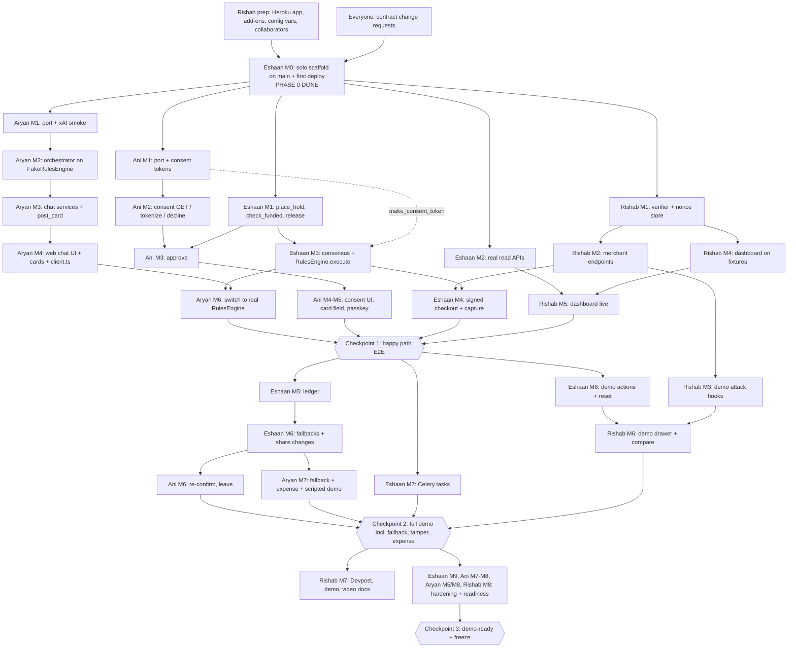

# Tandem: Collaboration Plan

**Team:** Eshaan (backend + rules engine, owns models, runs Phase 0 alone), Ani (payments simulation + consent page), Aryan (Grok agent + web chat), Rishab (mock merchant + signer + dashboard + Devpost/pitch, deploy owner after the first deploy).
**Repo:** https://github.com/AniAravind/Tandem-DubHacks2026.git
**What each coding agent gets:** its person file in `team/` + `TANDEM_SPEC.md` + the repo. Contracts are copied into every person file from `PHASE_0.md` §6 and win over the spec.
**Visa:** fully simulated (`SimulatedVisaAgentGateway`). Every money surface is labeled `SIMULATED`. All listings and prices are demo data.
**Submissions:** the Devpost draft and the final submission have fixed hackathon dates. The humans track them; nothing in this plan is scheduled by the clock. Sequencing is by milestones and dependencies only.

---

## 1. How Phase 0 Works

1. **Eshaan alone** runs the scaffold (his M0 checklist, built from `PHASE_0.md` §5 and §6). Nobody else commits to the repo until he posts `PHASE 0 DONE`.
2. **While M0 runs**, the others work outside the repo:
   - Everyone first reads the contracts section of their own person file and sends any `CONTRACT CHANGE` request to Eshaan **before he locks the contracts** (his step M0.1).
   - **Ani:** consent page UI and `ConsentService` logic in `~/tandem-scratch/ani/` against copies of the fixtures and the simulated gateway.
   - **Aryan:** confirms the exact Grok 4.1 Fast model id, drafts the system prompt, and tests a tool-calling loop directly against the xAI API in `~/tandem-scratch/aryan/`; sets `XAI_API_KEY` on Heroku once added as a collaborator.
   - **Rishab:** **creates the Heroku app, buildpacks, Postgres and Redis add-ons, and config vars, and adds Eshaan and Aryan as collaborators** (Eshaan does the first deploy; Rishab owns every deploy after that); sketches the dashboard and starts the Devpost draft in `~/tandem-scratch/rishab/`; starts collecting real user quotes with consent.
3. **When `PHASE 0 DONE` is posted:** everyone pulls `main`, runs the scaffold check in their file's AGENT START HERE block, branches off `main`, and hands their person file + `TANDEM_SPEC.md` to their coding agent. Each agent's M1 ports the scratch work into owned directories. From then on, all four run concurrently.

---

## 2. Ownership Map (agents never edit outside their owner's paths)

| Path | Owner | Others may... |
|---|---|---|
| `*/models.py`, `*/migrations/` (every app) | **Eshaan** | Request changes only |
| `core/` (`events.py`, `crypto.py`, `management/commands/seed_demo.py`) | **Eshaan** | Call `log_event()` |
| `purchases/` (`states.py`, `rules.py`, `consensus.py`, `fallbacks.py`, `ledger.py`, `api.py`, `urls.py`, `fixtures.py`, `tasks.py`, `tests/`) | **Eshaan** | Call via API or `RulesEngine.execute()` |
| `tandem/` (settings, urls, celery, views), `requirements*.txt`, `Makefile` | **Eshaan** | Request changes |
| `payments/gateway.py` (Protocol) | **Ani + Eshaan jointly** | Read only |
| `payments/simulated.py`, `services.py`, `consent_text.py`, `api.py`, `urls.py`, `tests/` | **Ani** | Read only |
| `frontend/src/consent/` | **Ani** | Read only |
| `agent/` (all), `scripts/xai_smoke.py` | **Aryan** | Read only |
| `chat/adapters/`, `chat/api.py`, `chat/urls.py`, `chat/services.py`, `chat/tests/` | **Aryan** | Call `post_card()` |
| `frontend/src/chat/`, `frontend/src/components/cards/`, `frontend/src/types/contracts.ts`, `frontend/src/api/client.ts` | **Aryan** | Import only |
| `merchant/` (`signing.py`, `verify.py`, `nonce_store.py`, `demo_hooks.py`, `views.py`, `urls.py`, `management/`, `tests/`) | **Rishab** | Call `sign_request()` |
| `frontend/src/dashboard/`, `frontend/src/compare/`, `App.tsx`, `main.tsx`, `styles/tokens.css`, `vite.config.ts`, `frontend/package.json` | **Rishab** | Request a route change |
| `Procfile`, root `package.json`, `.python-version`, Heroku app, config vars, deploys | **Rishab** (Eshaan did the first deploy) | Ask Rishab |
| `docs/` | **Rishab** | Contribute screenshots or notes via a REQUEST |

During M0 only, Eshaan creates scaffold versions of files in everyone's directories (copied verbatim from the contracts). Ownership passes to the listed owner when `PHASE 0 DONE` is posted.

## 3. Shared Contracts and Change Process

| Contract | Lives in | Owner | Consumers |
|---|---|---|---|
| Django models | `*/models.py` | Eshaan | Everyone |
| Purchase/Share state machines | `purchases/states.py` | Eshaan | Everyone |
| REST API shapes | `PHASE_0.md` §6.3, `purchases/fixtures.py` | Eshaan (Ani: consent endpoints; Aryan: chat endpoints; Rishab: merchant endpoints) | Frontends, agent |
| `VisaAgentGateway` Protocol | `payments/gateway.py` | Ani + Eshaan | Eshaan's rules engine only |
| Grok tool schemas + result envelope | `agent/tools.json` | Aryan | Eshaan (implements `execute`) |
| Chat adapter + card data types | `chat/adapters/base.py`, `frontend/src/types/contracts.ts` | Aryan | Eshaan, Ani, Rishab |
| Event types + `log_event()` | `core/events.py` | Eshaan | Everyone writes; Rishab renders |
| Seed data | `seed_demo` | Eshaan | Everyone |
| Signature headers + reject codes | `merchant/signing.py`, `PHASE_0.md` §6.9 | Rishab | Eshaan, dashboard |

**Change process**
1. The requester's agent drafts `CONTRACT CHANGE: <file> <change> <why>` with the exact diff or JSON; the human posts it in team chat. The agent keeps working on the current contract meanwhile.
2. Every affected owner approves (thumbs-up).
3. The **owner** makes the change in a tiny PR titled `contract: ...`. Model changes are **always** made by Eshaan.
4. After merge everyone runs `git pull --rebase origin main && python manage.py migrate`, and tells their agent: "A contract PR landed; re-read the changed contract and update your copy in §3 of your person file."

## 4. Dependency Graph (milestones)

**Unblocking rule:** every arrow into a milestone has a named fake in the consumer's person file. If the producer milestone isn't merged, the consumer uses the fake and keeps going; the arrow only means "switch from fake to real when it lands".

## 5. Git and PR Workflow

- **M0 is the only direct commit to `main`** (Eshaan, solo). Everything after goes through PRs.
- **Branches:** `<person>/<milestone>-<slug>`, for example `eshaan/m1-money-core`, `ani/m3-approve`, `aryan/m2-orchestrator`, `rishab/m1-verifier`.
- **One milestone per PR**, small diffs (aim under ~300 lines), rebased on `main` before opening.
- **Checks before merge:** `python manage.py test` green, `npm --prefix frontend run build` green, secret scan on the diff prints nothing (`git diff main | grep -iE "xai-|api_key=|BEGIN PRIVATE|AGENT_SIGNING_KEY_B64="`).
- **Reviewers** (quick review, then squash-merge):

| Author | Reviewer | Plus required owner when touching |
|---|---|---|
| Eshaan | Ani | Aryan if `RulesEngine.execute` result shapes change |
| Ani | Eshaan | Both for `payments/gateway.py` |
| Aryan | Rishab | Eshaan if code calls rules or posts cards from backend paths |
| Rishab | Aryan | Eshaan for anything that would need `tandem/settings.py` |

  If the reviewer is unavailable, self-merge is allowed **except** model/migration changes (Eshaan only) and `payments/gateway.py`.
- **`main` is always deployable.** Rishab deploys `main` (`git push heroku main` or GitHub auto-deploy) and posts the `/api/health` output after each deploy.
- **Broken main:** whoever notices posts `MAIN BROKEN`; the last merger reverts first (`git revert <sha>`), fixes second.
- **Migrations:** generated only by Eshaan; others pull and `migrate`. Heroku's `release` phase migrates on deploy.

## 6. Integration Checkpoints

Run each checkpoint together (one screen share), on the deployed app, after its incoming milestones in §4 are merged.

### Checkpoint 0: scaffold (after Eshaan M0)
- [ ] `/api/health` ok on Heroku; `/` serves the React shell; `/.well-known/tandem-agent-keys` returns a public key only
- [ ] `seed_demo` ran on Heroku; `python manage.py test` green locally for everyone
- [ ] Each person's scaffold check (AGENT START HERE) passes on their laptop

### Checkpoint 1: happy path (after Eshaan M4, Ani M4/M5, Aryan M6, Rishab M5)
- [ ] Maya's message in web chat produces 3 OptionCards with per-person cost and "why this pick"
- [ ] Vote card tallies; vote closes at a majority of active members
- [ ] 6 consent links open `/c/<token>` with the right member, share ($175), cap, deadline
- [ ] Card 1111 gives `held`; card 0002 gives the decline message and nothing held
- [ ] Funding card and dashboard ring update within 2s of each hold
- [ ] All 6 held gives `funded`, signed checkout 201, 6 SIM captures, `booked`
- [ ] Event log `chain_ok: true`; `grep -rn "payments" agent/ chat/` finds no imports

### Checkpoint 2: full demo (after Eshaan M6 to M8, Ani M6, Aryan M7, Rishab M3/M6)
- [ ] Jordan "Not for me" gives "1 spot opened up" (no name) and the FallbackCard with $210 / $185 / $175
- [ ] Group picks Juniper Loft; 5 re-confirms; holds adjusted to $185; booked at $925
- [ ] Tamper gives 401 `digest_mismatch` red row; replay gives 401 `nonce_replayed`; no capture on either
- [ ] Leo's injection message gives the refusal and no state change
- [ ] "@tandem I paid $60 for groceries, split with everyone" gives $12.00 each, net $0.00
- [ ] Deadline fast-forward on a fresh purchase releases every hold and posts "Nobody was charged"
- [ ] SIMULATED labels on consent page, dashboard, booking card, and the first payment chat message

### Checkpoint 3: demo-ready (after hardening milestones)
- [ ] `make demo-reset` restores the exact seed; the full demo runs twice in a row on the deployed app
- [ ] `DEMO_SCRIPTED=1` backup works; a backup screen recording exists
- [ ] axe: no critical issues on chat, consent, dashboard; 390px layouts usable
- [ ] `docs/devpost.md` has the real-vs-simulated table; no unfilled `[SOURCE NEEDED]` in public copy (fill with real sources or drop the claim)
- [ ] After this checkpoint: **code freeze** (fixes only, with a second person's OK), then the humans record the video and submit

## 7. Demo-Readiness Checklist

- [ ] Deployed URL bookmarked on 2 laptops and 1 phone; `?demo=1` drawer works with the demo key
- [ ] `make demo-reset` run just before presenting
- [ ] xAI key valid; `DEMO_SCRIPTED=1` toggle tested
- [ ] Backup screen recording playable offline
- [ ] Phone ready for the consent steps (brightness up, notifications muted)
- [ ] Narration follows TANDEM_SPEC §16; closing line "Checkout was built for one. Tandem is built for us."
- [ ] Q&A owners: rules/state (Eshaan), signing (Rishab), gateway and swap path (Ani), agent and injection defenses (Aryan), product story (Rishab, Aryan)
- [ ] Every money screen visibly says SIMULATED; nobody claims real Visa API access

## 8. Blocked Protocol

1. An agent that hits a missing dependency switches to the fake named in its person file and continues with the next milestone it can do.
2. If every remaining milestone is blocked, the agent reports `BLOCKED: <milestone> | waiting on: <owner + milestone> | tried: <x>`; the human posts it in team chat.
3. The dependency owner prioritizes the blocking milestone next.
4. External failures (xAI, Heroku, Photon): fall back first (scripted agent, local run, web chat), debug second. Never block the demo path on an external service.
5. Security doubts (secrets, money paths, signing): stop and ask Eshaan (money rules) or Rishab (signing, deploy) before merging.

## 9. Keeping 4 AI Coding Agents Consistent

1. **Inputs:** each agent gets exactly its person file + `TANDEM_SPEC.md` + the repo. The person file's AGENT START HERE block sets the read order and preconditions.
2. **Contracts win:** the §3 contracts in the person file (copied from `PHASE_0.md` §6) override the spec. Spec sections on schedule, repo layout, and the Visa sandbox are ignored.
3. **Ownership is hard:** agents edit only their owned paths and otherwise emit `REQUEST FOR <OWNER>: <file> <change> <why>` for the human to relay.
4. **Fakes first:** consumers use the named fakes (`FakeRulesEngine`, fixtures, `_dev_place_hold`, `MERCHANT_MODE=direct`, `demo_flag`) and check for the real dependency with the grep commands in their file before switching.
5. **Contracts are read-only to agents:** any change goes through §3's process; after a `contract:` PR, each agent re-reads the changed contract.
6. **Same conventions:** Python 3.12, Django 5.2, DRF; React + TS + Vite on Node 20.19+; integer cents; UTC; UUIDs; `log_event()` for every state change; transitions only via `purchases/states.py`; tests with every milestone.
7. **Re-sync after merges:** agents start each milestone from fresh `main` (`git pull --rebase origin main`).
8. **Secrets stay out of agents:** keys live in `.env` and Heroku config vars only; never pasted into prompts, code, or PRs.
9. **Honesty rules in every brief:** simulated labels, demo data, no invented stats or quotes, no claims of real Visa access.
