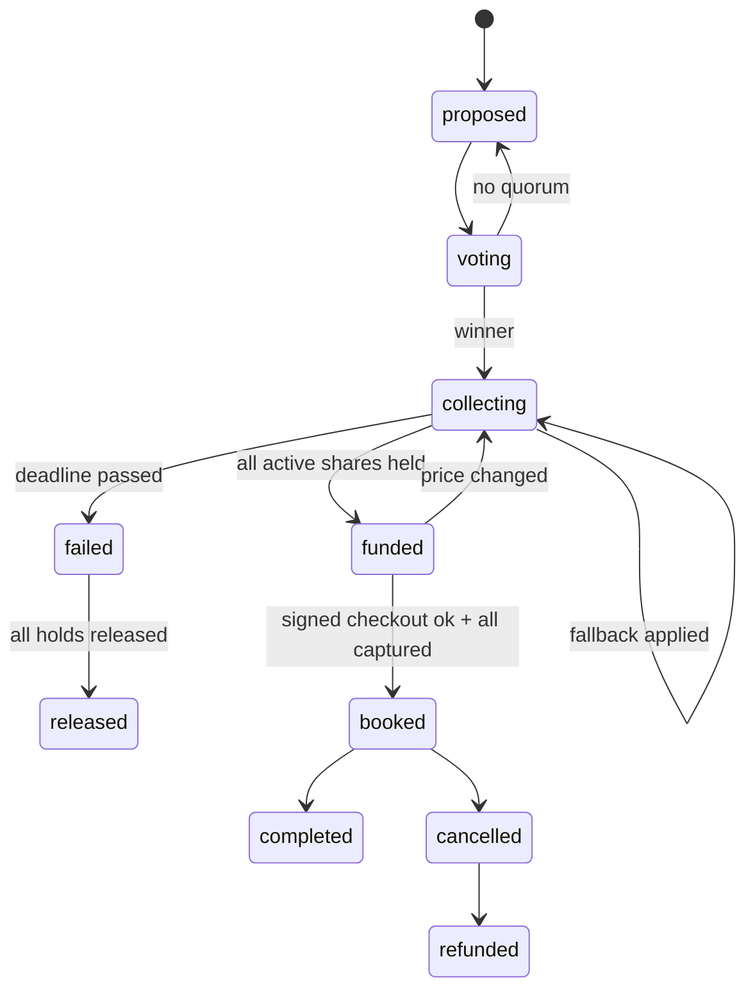

# Tandem: Coding Agent Brief for Eshaan (Backend + Rules Engine)

## AGENT START HERE

You are the coding agent working for **Eshaan** (backend + rules engine) on **Tandem**. Eshaan runs the entire **Phase 0 scaffold alone** (milestone **M0**); nobody else touches the repo until M0 is announced. After M0 you build the rules engine, consensus, real APIs, Celery tasks, and demo tooling (M1 to M9), while Ani, Aryan, and Rishab work in parallel against the contracts and fakes you scaffolded.

**Read order:**
1. This file, top to bottom.
2. `TANDEM_SPEC.md` sections: §1 (TL;DR), §5 (user stories), §6.1 (organizer flow), §7.2 (consensus engine), §7.5 (ethical nudges), §7.9 (post-purchase), §9 (architecture and sequences), §10.2 (tool allowlist), §11.1 to §11.3 (rules, state machines), §12.1 (honesty labels), §14.1 to §14.5 (security), §16 (demo script).
3. `PHASE_0.md` is the scaffold you run in M0. Its contracts are copied into §3 and §3b of this file; use these copies. **Ignore the clock times and the who-does-what in `PHASE_0.md` §2 and §7**: in this plan you do all of Phase 0 yourself, sequenced by the M0 checklist below.

**Conflicts:** the contracts in §3 of this file are copied from `PHASE_0.md` §6 and **win over `TANDEM_SPEC.md`**. In the spec, ignore §15 (team plan and schedule), §22.3 (repo layout; use the one in this file), §12.6 (Visa Acceptance sandbox: not used, everything is simulated), and any names, paths, fields, or endpoints in §9.5, §11.4, §11.5, §12.2, §12.3 that differ from this file. Spec labels P1, P2, P3, P4 mean Eshaan, Ani, Aryan, Rishab.

**Preconditions for M0:**
```bash
python3.12 --version            # 3.12.x
node -v                         # v20.19 or newer
heroku --version && heroku auth:whoami
git ls-remote https://github.com/AniAravind/Tandem-DubHacks2026.git   # you have access
```
If a tool is missing, install it; if repo or Heroku access is missing, ask the human. **Preconditions for M1 onward:** M0 is merged on `main` and the scaffold check passes:

**Preconditions (verify before writing any code):**
```bash
git checkout main && git pull --rebase origin main
for f in manage.py tandem/settings.py tandem/urls.py core/models.py core/events.py core/crypto.py \
         purchases/models.py purchases/states.py purchases/urls.py payments/gateway.py payments/simulated.py \
         agent/tools.json agent/fakes.py chat/adapters/base.py chat/adapters/web.py merchant/models.py \
         merchant/signing.py core/management/commands/seed_demo.py frontend/vite.config.ts frontend/src/App.tsx \
         Procfile .env.example requirements.txt; do test -e "$f" || echo "MISSING $f"; done
python3.12 -m venv .venv 2>/dev/null; source .venv/bin/activate && pip install -r requirements.txt
cp -n .env.example .env
# Fill these 3 local-only secrets in .env (generate locally, never commit, never paste in chat):
python -c "import secrets; print('DJANGO_SECRET_KEY=' + secrets.token_urlsafe(50))"
python -c "from cryptography.fernet import Fernet; print('FIELD_ENCRYPTION_KEY=' + Fernet.generate_key().decode())"
python -c "import base64,os; print('AGENT_SIGNING_KEY_B64=' + base64.b64encode(os.urandom(32)).decode())"
# Local dev without Redis: set CELERY_EAGER=1 in .env (already the default in .env.example)
python manage.py migrate && python manage.py seed_demo && python manage.py test
npm --prefix frontend ci && npm --prefix frontend run build
python manage.py runserver 8000 & sleep 3; curl -s localhost:8000/api/health; kill %1
```
Expected: no `MISSING` lines, all tests pass, the health JSON has `"status": "ok"` (Redis may show an error locally; that is fine), and the frontend builds. **If anything fails, stop.** Do not fix files you don't own. Report to the human: `Scaffold check failed: <command> <output>`.

**Then do the milestones in order (M0, M1, ... M9).** When a milestone depends on someone else's work that is not on `main` yet, use the named fake and continue; never wait idle.

**Ask the human only for:** (1) a contract change (draft the exact message `CONTRACT CHANGE: <file> <change> <why>` for them to post in team chat, then continue with the current contract), (2) secrets or access (`XAI_API_KEY`, Heroku access, Photon credentials), (3) a dependency that is still missing **after** you finished every milestone you can do with fakes, (4) opening or merging a PR if you can't (`gh` not available or no permission). Do not ask for anything else; make a reasonable assumption, note it in the PR description, and continue.

**Git per milestone:** start from fresh main (`git checkout main && git pull --rebase origin main && git checkout -b <person>/<milestone-slug>`), keep the diff small (aim under ~300 lines), run the milestone's test commands plus `python manage.py test` and `npm --prefix frontend run build`, check for secrets (`git diff main --stat` and `git diff main | grep -iE "xai-|api_key=|BEGIN PRIVATE|AGENT_SIGNING_KEY_B64="` must print nothing), commit with `<person>: Mx <summary>`, push, and open a PR (`gh pr create --fill --base main`). Then start the next milestone from fresh main (rebase your next branch if the PR isn't merged yet and you depend on it).

## 1. Project Context

**Tandem** is an AI agent that lives in a group chat and turns it into the checkout for **large group purchases** (group trips, roommates buying furniture, big group gifts). Built by a 4-person team for the **Visa "Reimagine Shopping" track at DubHacks '26**. Rubric: Functionality 30%, Track applicability 30%, Design 20%, Creativity 20%. Judges may be Visa Acceptance engineers or product/recruiter folks.

**Problem:** checkout assumes one buyer with one card, but big purchases are often made by groups. One friend fronts the money, carries the risk if someone drops or pays late, and chases payments for weeks. Group purchases stall between "we're all in" and someone actually paying, and good listings sell out while the chat argues.

**What Tandem does:** (1) learns preferences from chat plus private budget cards, (2) a deterministic consensus engine ranks options and Grok explains "why this pick" with per-person cost, (3) in-chat vote, (4) each member opens a private consent link and places a **hold for only their share** under a **mandate** (cap, merchant + listing lock, expiry), (5) **all-or-nothing**: nobody is charged unless everyone is held; then Tandem books via **TAP-style Ed25519-signed agent checkout**, (6) post-purchase expense splitting and split refunds.

**Core safety model:** the LLM only **proposes** tool calls. A deterministic rules engine (`purchases/rules.py`) enforces caps, votes, deadlines, consent, and all-or-nothing before anything reaches the payment gateway. **Nothing in `agent/` or `chat/` imports `payments/`.**

**Visa is fully SIMULATED.** Visa agentic APIs (Visa Intelligent Commerce, agentic tokens, Trusted Agent Protocol checkout) have no public access, so every Visa call goes through `SimulatedVisaAgentGateway`. Every gateway response has `"simulated": true`; every money surface shows a `SIMULATED` badge. Ed25519 signing and merchant verification are **real**. All listings and prices are **demo data**. Never invent statistics or user quotes; use `[SOURCE NEEDED]`.

**Demo scenario:** 6-person Tahoe trip chat (Maya organizer, Priya, Sam, Leo, Jordan, Alex), trip Nov 14 to 16, about $150 to $200 each, lowest private cap $190. Tandem suggests Pinecrest A-Frame ($175pp/6), Lakeview Bungalow ($178pp/6), Cedar Hollow ($162pp/6). The group votes Pinecrest, consent links go out, 5 holds clear, Jordan taps "Not for me", Tandem offers fallbacks (split the gap $210, Juniper Loft $185pp/5, invite replacement at $175), the group picks Juniper, 5 re-confirm, Tandem books via signed simulated agent checkout, a tampered price is rejected on screen (401 `digest_mismatch`), then Priya's $60 groceries split live ($12.00 each). Closing line: "Checkout was built for one. Tandem is built for us."

| Person | Role |
|---|---|
| Eshaan | Backend + rules engine; owns all models and migrations; ran the Phase 0 scaffold alone |
| Ani | Simulated `VisaAgentGateway` + React payment/consent page |
| Aryan | Grok tool-calling loop, React web chat + cards, agent copy, Photon adapter later |
| Rishab | Mock merchant + TAP-style signer/verifier + React dashboard + Devpost/pitch/video; Heroku deploy owner after the first deploy |

**Repo:** https://github.com/AniAravind/Tandem-DubHacks2026.git . Submission checkpoints (Devpost draft and final) are tracked by the humans, not by you.

## 2. Your Role and Ownership

### Files you own (only you edit these)
- `*/models.py` and `*/migrations/` in **every** app. **Only Eshaan changes models.**
- `core/` (`events.py`, `crypto.py`, `management/commands/seed_demo.py`)
- `purchases/` (`states.py`, `rules.py`, `consensus.py`, `fallbacks.py`, `ledger.py`, `api.py`, `urls.py`, `fixtures.py`, `tasks.py`, `tests/`)
- `tandem/` (`settings.py`, `urls.py`, `celery.py`, `views.py`), `requirements.txt`, `requirements.lock.txt`, `Makefile`
- `payments/gateway.py` **jointly with Ani** (changes need both)

### Scaffold-only files (you create them in M0, then ownership passes to the named owner)
- Ani: `payments/simulated.py`, `payments/tests/test_simulated_gateway.py`, `payments/urls.py` (stub), `payments/api.py` (stub)
- Aryan: `agent/tools.json`, `agent/llm.py`, `agent/fakes.py`, `agent/prompts/system.md`, `scripts/xai_smoke.py`, `chat/adapters/*`, `chat/urls.py` + `chat/api.py` (stubs), `frontend/src/types/contracts.ts`
- Rishab: `merchant/signing.py`, `merchant/views.py`, `merchant/urls.py` (stubs), `frontend/` shell (`vite.config.ts`, `package.json`, `App.tsx`, `main.tsx`, `styles/tokens.css`), root `package.json`, `Procfile`, `.python-version`

After M0 you **do not touch** those files (plus `payments/services.py`, `frontend/src/consent/` for Ani; `agent/orchestrator.py`, `chat/services.py`, `frontend/src/chat/` for Aryan; `merchant/verify.py`, `merchant/nonce_store.py`, `frontend/src/dashboard/`, `docs/` for Rishab).

## 3. Locked Contracts (copied from PHASE_0.md §6; win over TANDEM_SPEC.md)

### 6.1 Django models (Eshaan; field-level, final names)

Money is always `*_cents` (BigInteger) plus `currency`. All models inherit `TimeStamped` (UUID pk, `created_at`, `updated_at`).

`core/models.py`
```python
import uuid
from django.db import models


class TimeStamped(models.Model):
    id = models.UUIDField(primary_key=True, default=uuid.uuid4, editable=False)
    created_at = models.DateTimeField(auto_now_add=True)
    updated_at = models.DateTimeField(auto_now=True)

    class Meta:
        abstract = True


class Group(TimeStamped):
    class Channel(models.TextChoices):
        WEB = "web"; IMESSAGE = "imessage"

    class Status(models.TextChoices):
        ACTIVE = "active"; ARCHIVED = "archived"

    name = models.CharField(max_length=120)
    channel = models.CharField(max_length=16, choices=Channel.choices, default=Channel.WEB)
    external_thread_id_hash = models.CharField(max_length=64, blank=True, db_index=True)  # Photon thread id, hashed
    organizer = models.ForeignKey("core.Member", null=True, blank=True, on_delete=models.SET_NULL, related_name="+")
    status = models.CharField(max_length=16, choices=Status.choices, default=Status.ACTIVE)
    timezone = models.CharField(max_length=64, default="America/Los_Angeles")


class Member(TimeStamped):
    class Role(models.TextChoices):
        ORGANIZER = "organizer"; MEMBER = "member"

    class Status(models.TextChoices):
        ACTIVE = "active"; LEFT = "left"; REMOVED = "removed"

    group = models.ForeignKey(Group, on_delete=models.CASCADE, related_name="members")
    display_name = models.CharField(max_length=60)
    phone_e164_hash = models.CharField(max_length=64)
    phone_last4 = models.CharField(max_length=4, blank=True)
    verified_at = models.DateTimeField(null=True, blank=True)
    role = models.CharField(max_length=16, choices=Role.choices, default=Role.MEMBER)
    status = models.CharField(max_length=16, choices=Status.choices, default=Status.ACTIVE)
    prefs = models.JSONField(default=dict, blank=True)          # {"must_haves":[], "dealbreakers":[], "flexibility":"firm"}
    budget_cap_cents_enc = models.TextField(blank=True)         # Fernet(str(cents)); PRIVATE, never sent to the LLM
    passkey_credential_id = models.CharField(max_length=255, blank=True)

    class Meta:
        constraints = [models.UniqueConstraint(fields=["group", "phone_e164_hash"], name="uniq_member_phone_per_group")]

    @property
    def budget_cap_cents(self) -> int | None:
        from core.crypto import decrypt_int
        return decrypt_int(self.budget_cap_cents_enc)

    @budget_cap_cents.setter
    def budget_cap_cents(self, value: int | None) -> None:
        from core.crypto import encrypt_int
        self.budget_cap_cents_enc = encrypt_int(value)


class InviteLink(TimeStamped):
    class Purpose(models.TextChoices):
        JOIN = "join"; CONSENT = "consent"

    group = models.ForeignKey(Group, on_delete=models.CASCADE)
    member = models.ForeignKey(Member, null=True, blank=True, on_delete=models.CASCADE)
    purpose = models.CharField(max_length=16, choices=Purpose.choices)
    token_hash = models.CharField(max_length=64, unique=True)   # sha256 of the signed token
    expires_at = models.DateTimeField()
    used_at = models.DateTimeField(null=True, blank=True)


class EventLog(TimeStamped):
    """Append-only, hash-chained. Write ONLY via core.events.log_event()."""
    group = models.ForeignKey(Group, null=True, blank=True, on_delete=models.CASCADE, related_name="events")
    purchase_id = models.UUIDField(null=True, blank=True, db_index=True)
    actor = models.CharField(max_length=64)                     # "member:<uuid>" | agent | rules | gateway | merchant | signer | scheduler | demo
    type = models.CharField(max_length=64, db_index=True)       # core.events.EventType
    payload = models.JSONField(default=dict)                    # redacted: no PAN, no budgets
    simulated = models.BooleanField(default=False)
    seq = models.BigIntegerField(db_index=True)
    prev_hash = models.CharField(max_length=64, blank=True)
    hash = models.CharField(max_length=64)

    class Meta:
        ordering = ["seq"]
```

`core/crypto.py`
```python
import os
from cryptography.fernet import Fernet

_f = Fernet(os.environ["FIELD_ENCRYPTION_KEY"].encode()) if os.getenv("FIELD_ENCRYPTION_KEY") else None

def encrypt_int(v: int | None) -> str:
    if v is None:
        return ""
    return _f.encrypt(str(v).encode()).decode() if _f else f"plain:{v}"   # plain: only when key unset (local dev)

def decrypt_int(s: str) -> int | None:
    if not s:
        return None
    if s.startswith("plain:"):
        return int(s[6:])
    return int(_f.decrypt(s.encode()).decode())
```

`purchases/models.py`
```python
from django.db import models
from core.models import TimeStamped, Group, Member


class Option(TimeStamped):
    group = models.ForeignKey(Group, on_delete=models.CASCADE, related_name="options")
    merchant_slug = models.CharField(max_length=40)            # "pinestay"
    listing_ref = models.CharField(max_length=80)              # "pinecrest-a-frame"
    category = models.CharField(max_length=24)                 # rental | passes | flights | furniture | electronics | gift_bundle
    title = models.CharField(max_length=120)
    total_cents = models.BigIntegerField()
    currency = models.CharField(max_length=3, default="USD")
    capacity = models.PositiveIntegerField()
    features = models.JSONField(default=list)                  # ["hot_tub","kitchen",...]
    meta = models.JSONField(default=dict)                      # photo_url, drive_min, cancellation, beds
    quote_id = models.CharField(max_length=64, blank=True)
    quote_expires_at = models.DateTimeField(null=True, blank=True)
    score = models.FloatField(null=True, blank=True)
    explanation_facts = models.JSONField(default=list)         # structured facts the LLM may cite


class Vote(TimeStamped):
    class Purpose(models.TextChoices):
        PICK_OPTION = "pick_option"; FALLBACK = "fallback"; PRICE_CHANGE = "price_change"; CANCEL = "cancel"

    class Status(models.TextChoices):
        OPEN = "open"; CLOSED = "closed"

    group = models.ForeignKey(Group, on_delete=models.CASCADE, related_name="votes")
    purchase = models.ForeignKey("purchases.Purchase", null=True, blank=True, on_delete=models.CASCADE)
    purpose = models.CharField(max_length=16, choices=Purpose.choices)
    choices = models.JSONField()                               # [{"key":"1","option_id":"...","label":"..."}] or fallback keys
    closes_at = models.DateTimeField()
    quorum = models.PositiveIntegerField()                     # majority of active members
    status = models.CharField(max_length=8, choices=Status.choices, default=Status.OPEN)
    winner_key = models.CharField(max_length=40, blank=True)


class Ballot(TimeStamped):
    vote = models.ForeignKey(Vote, on_delete=models.CASCADE, related_name="ballots")
    member = models.ForeignKey(Member, on_delete=models.CASCADE)
    choice_key = models.CharField(max_length=40)

    class Meta:
        constraints = [models.UniqueConstraint(fields=["vote", "member"], name="one_ballot_per_member")]


class Purchase(TimeStamped):
    class State(models.TextChoices):
        PROPOSED = "proposed"; VOTING = "voting"; COLLECTING = "collecting"; FUNDED = "funded"
        BOOKED = "booked"; COMPLETED = "completed"; FAILED = "failed"; RELEASED = "released"
        CANCELLED = "cancelled"; REFUNDED = "refunded"

    group = models.ForeignKey(Group, on_delete=models.CASCADE, related_name="purchases")
    option = models.ForeignKey(Option, on_delete=models.PROTECT)
    state = models.CharField(max_length=16, choices=State.choices, default=State.PROPOSED)
    total_cents = models.BigIntegerField()
    currency = models.CharField(max_length=3, default="USD")
    deadline_at = models.DateTimeField()
    version = models.PositiveIntegerField(default=1)           # bump on any share/option change
    funded_at = models.DateTimeField(null=True, blank=True)
    booked_at = models.DateTimeField(null=True, blank=True)


class Share(TimeStamped):
    class Status(models.TextChoices):
        INVITED = "invited"; VIEWING = "viewing"; HELD = "held"; DECLINED = "declined"
        CARD_FAILED = "card_failed"; RELEASED = "released"; CAPTURED = "captured"; REFUNDED = "refunded"

    purchase = models.ForeignKey(Purchase, on_delete=models.CASCADE, related_name="shares")
    member = models.ForeignKey(Member, on_delete=models.CASCADE, related_name="shares")
    amount_cents = models.BigIntegerField()
    rounding_adj_cents = models.IntegerField(default=0)
    status = models.CharField(max_length=16, choices=Status.choices, default=Status.INVITED)
    purchase_version = models.PositiveIntegerField(default=1)
    superseded_by = models.ForeignKey("self", null=True, blank=True, on_delete=models.SET_NULL)
    card_attempts = models.PositiveSmallIntegerField(default=0)

    class Meta:
        constraints = [models.UniqueConstraint(
            fields=["purchase", "member"], condition=models.Q(superseded_by__isnull=True),
            name="one_active_share_per_member")]


class Booking(TimeStamped):
    class Status(models.TextChoices):
        CONFIRMED = "confirmed"; CANCELLED = "cancelled"

    purchase = models.OneToOneField(Purchase, on_delete=models.PROTECT, related_name="booking")
    merchant_slug = models.CharField(max_length=40)
    merchant_booking_ref = models.CharField(max_length=40)     # "PS-4K7Q"
    amount_cents = models.BigIntegerField()
    signed_request = models.ForeignKey("merchant.SignedRequest", null=True, on_delete=models.SET_NULL)
    status = models.CharField(max_length=16, choices=Status.choices, default=Status.CONFIRMED)
    cancellation_policy = models.JSONField(default=dict)


class Expense(TimeStamped):
    class SplitMode(models.TextChoices):
        EQUAL = "equal"; SHARES = "shares"; CUSTOM = "custom"

    group = models.ForeignKey(Group, on_delete=models.CASCADE, related_name="expenses")
    purchase = models.ForeignKey(Purchase, null=True, blank=True, on_delete=models.SET_NULL)
    payer = models.ForeignKey(Member, on_delete=models.PROTECT, related_name="paid_expenses")
    amount_cents = models.BigIntegerField()
    description = models.CharField(max_length=80)
    split_mode = models.CharField(max_length=8, choices=SplitMode.choices, default=SplitMode.EQUAL)


class ExpenseSplit(TimeStamped):
    expense = models.ForeignKey(Expense, on_delete=models.CASCADE, related_name="splits")
    member = models.ForeignKey(Member, on_delete=models.PROTECT)
    amount_cents = models.BigIntegerField()                    # sum over splits == expense.amount_cents (asserted in rules)


class Refund(TimeStamped):
    booking = models.ForeignKey(Booking, on_delete=models.PROTECT, related_name="refunds")
    share = models.ForeignKey(Share, on_delete=models.PROTECT)
    amount_cents = models.BigIntegerField()
    gateway_refund_id = models.CharField(max_length=64)
    status = models.CharField(max_length=16, default="refunded")
```

`payments/models.py`
```python
from django.db import models
from core.models import TimeStamped, Member


class AgentToken(TimeStamped):
    member = models.ForeignKey(Member, on_delete=models.CASCADE, related_name="agent_tokens")
    gateway_token_id = models.CharField(max_length=64, unique=True)   # "atk_sim_..."
    card_brand = models.CharField(max_length=16)                      # "visa"
    card_last4 = models.CharField(max_length=4)                       # NEVER store a PAN
    scope = models.JSONField()                                        # {"purchase_id","merchant_slugs","max_amount_cents"}
    expires_at = models.DateTimeField()
    status = models.CharField(max_length=16, default="active")        # active | revoked | expired


class Consent(TimeStamped):
    """Immutable record of exactly what the member approved."""
    class Method(models.TextChoices):
        PASSKEY = "passkey"; OTP = "otp"

    member = models.ForeignKey(Member, on_delete=models.PROTECT)
    share = models.ForeignKey("purchases.Share", on_delete=models.PROTECT, related_name="consents")
    consent_text_version = models.CharField(max_length=16)            # "v1"
    consent_text_sha256 = models.CharField(max_length=64)
    amount_cents = models.BigIntegerField()
    cap_cents = models.BigIntegerField()
    method = models.CharField(max_length=8, choices=Method.choices)
    ip_hash = models.CharField(max_length=64, blank=True)
    user_agent_hash = models.CharField(max_length=64, blank=True)
    accepted_at = models.DateTimeField()


class Mandate(TimeStamped):
    class Status(models.TextChoices):
        ACTIVE = "active"; REVOKED = "revoked"; EXPIRED = "expired"; CONSUMED = "consumed"

    share = models.ForeignKey("purchases.Share", on_delete=models.PROTECT, related_name="mandates")
    member = models.ForeignKey(Member, on_delete=models.PROTECT)
    agent_token = models.ForeignKey(AgentToken, on_delete=models.PROTECT)
    consent = models.OneToOneField(Consent, on_delete=models.PROTECT)
    merchant_slug = models.CharField(max_length=40)                   # merchant lock
    listing_ref = models.CharField(max_length=80)                     # listing lock
    cap_cents = models.BigIntegerField()
    currency = models.CharField(max_length=3, default="USD")
    expires_at = models.DateTimeField()
    scope = models.JSONField(default=list)                            # ["authorize_hold","capture","release_hold","refund"]
    status = models.CharField(max_length=16, choices=Status.choices, default=Status.ACTIVE)
    gateway_mandate_id = models.CharField(max_length=64, unique=True) # "mdt_sim_..."


class Hold(TimeStamped):
    class Status(models.TextChoices):
        AUTHORIZED = "authorized"; CAPTURED = "captured"; RELEASED = "released"; EXPIRED = "expired"; DECLINED = "declined"

    share = models.ForeignKey("purchases.Share", on_delete=models.PROTECT, related_name="holds")
    mandate = models.ForeignKey(Mandate, on_delete=models.PROTECT)
    gateway_hold_id = models.CharField(max_length=64, unique=True)    # "auth_sim_..."
    gateway_capture_id = models.CharField(max_length=64, blank=True)  # "cap_sim_..."
    amount_cents = models.BigIntegerField()
    status = models.CharField(max_length=16, choices=Status.choices)
    decline_code = models.CharField(max_length=32, blank=True)
    expires_at = models.DateTimeField(null=True, blank=True)


class IdempotencyRecord(TimeStamped):
    key = models.CharField(max_length=128, unique=True)
    request_hash = models.CharField(max_length=64)
    response = models.JSONField()
```

`merchant/models.py` (mock merchants keep their own tables and do not trust Tandem's)
```python
from django.db import models
from core.models import TimeStamped


class Merchant(TimeStamped):
    slug = models.SlugField(unique=True)                    # pinestay | summitpass | couchco | gamehub
    name = models.CharField(max_length=80)
    category = models.CharField(max_length=24)
    mcc = models.CharField(max_length=4, blank=True)        # demo value


class Listing(TimeStamped):
    merchant = models.ForeignKey(Merchant, on_delete=models.CASCADE, related_name="listings")
    ref = models.SlugField()                                # "pinecrest-a-frame"
    title = models.CharField(max_length=120)
    total_cents = models.BigIntegerField()                  # per stay / per bundle
    unit_price_cents = models.BigIntegerField(null=True, blank=True)  # per-person items (passes)
    capacity = models.PositiveIntegerField()
    features = models.JSONField(default=list)
    meta = models.JSONField(default=dict)                   # {"demo_data": true, "drive_min": 12, ...}
    available = models.BooleanField(default=True)

    class Meta:
        constraints = [models.UniqueConstraint(fields=["merchant", "ref"], name="uniq_listing_ref")]


class Quote(TimeStamped):
    listing = models.ForeignKey(Listing, on_delete=models.CASCADE)
    quote_id = models.CharField(max_length=64, unique=True) # "q_pinestay_88"
    amount_cents = models.BigIntegerField()
    guests = models.PositiveIntegerField()
    check_in = models.DateField(null=True, blank=True)
    check_out = models.DateField(null=True, blank=True)
    expires_at = models.DateTimeField()
    used = models.BooleanField(default=False)


class SignedRequest(TimeStamped):
    """Audit trail for every TAP-style signed request (written by signer and verifier)."""
    purpose = models.CharField(max_length=16)               # browse | checkout | cancel
    method = models.CharField(max_length=8)
    authority = models.CharField(max_length=255)
    path = models.CharField(max_length=255)
    keyid = models.CharField(max_length=64)
    nonce = models.CharField(max_length=128, db_index=True)
    created = models.BigIntegerField()
    expires = models.BigIntegerField()
    tag = models.CharField(max_length=32)                   # agent-browser-auth | agent-payer-auth
    content_digest = models.CharField(max_length=128, blank=True)
    signature_b64 = models.TextField()
    response_code = models.PositiveSmallIntegerField(null=True)
    verified = models.BooleanField(default=False)
    reject_reason = models.CharField(max_length=32, blank=True)   # see 6.9


class MerchantBooking(TimeStamped):
    listing = models.ForeignKey(Listing, on_delete=models.PROTECT)
    quote = models.OneToOneField(Quote, on_delete=models.PROTECT)
    booking_ref = models.CharField(max_length=16, unique=True)    # "PS-4K7Q"
    amount_cents = models.BigIntegerField()
    status = models.CharField(max_length=16, default="confirmed") # confirmed | cancelled
    idempotency_key = models.CharField(max_length=128, unique=True)
```

`chat/models.py`
```python
from django.db import models
from core.models import TimeStamped, Group, Member


class ChatMessage(TimeStamped):
    class Direction(models.TextChoices):
        INBOUND = "in"; OUTBOUND = "out"

    group = models.ForeignKey(Group, on_delete=models.CASCADE, related_name="messages")
    member = models.ForeignKey(Member, null=True, blank=True, on_delete=models.SET_NULL)  # null = Tandem
    direction = models.CharField(max_length=3, choices=Direction.choices)
    text_redacted = models.TextField()                      # phone/email/PAN patterns stripped
    card = models.JSONField(null=True, blank=True)          # AgentMessage.card (6.6)
    quick_replies = models.JSONField(default=list, blank=True)
    channel = models.CharField(max_length=16, default="web")
    seq = models.BigIntegerField(db_index=True)             # per-group ordering for polling
```

Register every model in each app's `admin.py` (`admin.site.register(...)`) so the team can inspect state during the demo prep.

### 6.2 State machines (Eshaan, `purchases/states.py`)

```python
from django.db import transaction
from django.utils import timezone
from core.events import log_event, EventType
from purchases.models import Purchase, Share

P = Purchase.State
S = Share.Status

PURCHASE_TRANSITIONS: dict[str, set[str]] = {
    P.PROPOSED:   {P.VOTING},
    P.VOTING:     {P.PROPOSED, P.COLLECTING},          # no quorum / tie -> re-vote
    P.COLLECTING: {P.COLLECTING, P.FUNDED, P.FAILED},  # self-loop = fallback applied (version bump)
    P.FUNDED:     {P.BOOKED, P.COLLECTING},            # checkout rejected for price change -> back to vote
    P.BOOKED:     {P.COMPLETED, P.CANCELLED},
    P.CANCELLED:  {P.REFUNDED},
    P.FAILED:     {P.RELEASED},
    P.COMPLETED: set(), P.RELEASED: set(), P.REFUNDED: set(),
}

SHARE_TRANSITIONS: dict[str, set[str]] = {
    S.INVITED:     {S.VIEWING, S.DECLINED, S.RELEASED},
    S.VIEWING:     {S.HELD, S.DECLINED, S.CARD_FAILED, S.RELEASED},
    S.CARD_FAILED: {S.VIEWING, S.DECLINED, S.RELEASED},   # retry allowed up to 3 times (rules.py enforces)
    S.HELD:        {S.CAPTURED, S.RELEASED},
    S.CAPTURED:    {S.REFUNDED},
    S.DECLINED: set(), S.RELEASED: set(), S.REFUNDED: set(),
}


class IllegalTransition(Exception):
    pass


@transaction.atomic
def transition_purchase(purchase_id, to: str, actor: str, **payload) -> Purchase:
    p = Purchase.objects.select_for_update().get(pk=purchase_id)
    if to not in PURCHASE_TRANSITIONS[p.state]:
        raise IllegalTransition(f"purchase {p.state} -> {to}")
    frm, p.state = p.state, to
    if to == P.FUNDED:
        p.funded_at = timezone.now()
    if to == P.BOOKED:
        p.booked_at = timezone.now()
    p.save(update_fields=["state", "funded_at", "booked_at", "updated_at"])
    log_event(EventType.PURCHASE_STATE_CHANGED, actor=actor, group_id=p.group_id, purchase_id=p.id,
              payload={"from": frm, "to": to, **payload})
    return p


@transaction.atomic
def transition_share(share_id, to: str, actor: str, **payload) -> Share:
    s = Share.objects.select_for_update().select_related("purchase").get(pk=share_id)
    if to not in SHARE_TRANSITIONS[s.status]:
        raise IllegalTransition(f"share {s.status} -> {to}")
    frm, s.status = s.status, to
    s.save(update_fields=["status", "updated_at"])
    log_event(EventType.SHARE_STATE_CHANGED, actor=actor, group_id=s.purchase.group_id,
              purchase_id=s.purchase_id, payload={"share_id": str(s.id), "from": frm, "to": to, **payload})
    return s
```



**Invariants that Phase 1 rules must keep** (the full list R1 to R13 is in spec §11.1):
- `FUNDED` only if every active share (not superseded, not declined/released) is `HELD` **and** the sum of held amounts equals `total_cents`.
- `capture` is only ever called from the `FUNDED -> BOOKED` path. **Nothing in `agent/` imports `payments/`.**
- Any share increase requires the member's re-confirm. Above the cap, or a new listing, means a new Mandate + Consent.

Test to commit in Phase 0 (`purchases/tests/test_states.py`):
```python
from django.test import TestCase
from purchases.states import PURCHASE_TRANSITIONS, SHARE_TRANSITIONS, P, S

class StateTableTest(TestCase):
    def test_terminal_states(self):
        for t in (P.COMPLETED, P.RELEASED, P.REFUNDED):
            self.assertEqual(PURCHASE_TRANSITIONS[t], set())

    def test_no_capture_before_hold(self):
        self.assertNotIn(S.CAPTURED, SHARE_TRANSITIONS[S.VIEWING])
        self.assertIn(S.CAPTURED, SHARE_TRANSITIONS[S.HELD])

    def test_every_state_has_entry(self):
        self.assertEqual(set(PURCHASE_TRANSITIONS), set(P.values))
        self.assertEqual(set(SHARE_TRANSITIONS), set(S.values))
```

### 6.3 API contract (stub views return these exact shapes in Phase 0)

All endpoints are under `/api/v1/` except `/api/health`. JSON only. IDs are UUID strings. Money is `*_cents` integers. Error envelope everywhere:
```json
{"error": {"code": "cap_exceeded", "message": "Share $210.00 exceeds cap $200.00", "request_id": "req_01HF..."}}
```

| Method | Path | Owner | Auth (Phase 0 / later) | Purpose |
|---|---|---|---|---|
| GET | `/api/health` | Eshaan | public | Liveness: DB, Redis, gateway mode |
| POST | `/api/v1/chat/web` | Aryan | demo member header / member session | Send a web chat message |
| GET | `/api/v1/groups/{gid}/messages?after_seq=` | Aryan | member | Poll chat messages (2s) |
| GET | `/api/v1/groups/{gid}` | Eshaan | member | Group + members (status only, never budgets) |
| GET/PUT | `/api/v1/groups/{gid}/members/me/preferences` | Eshaan | member | Private budget + must-haves |
| GET | `/api/v1/groups/{gid}/options` | Eshaan | member | Ranked options + explanation facts |
| POST | `/api/v1/votes/{vid}/ballots` | Eshaan | member | Cast or change vote |
| GET | `/api/v1/purchases/{pid}` | Eshaan | member | Funding status for dashboard and cards |
| GET | `/api/v1/consent/{token}` | Ani | signed consent token | Consent page payload |
| POST | `/api/v1/consent/{token}/tokenize` | Ani | consent token | Sim card field to agent token |
| POST | `/api/v1/consent/{token}/approve` | Ani | consent token + passkey/OTP | Accept mandate, place hold |
| POST | `/api/v1/consent/{token}/decline` | Ani | consent token | Decline (private reason) |
| POST | `/api/v1/shares/{sid}/leave` | Eshaan | member | Leave, release hold, trigger fallback |
| POST | `/api/v1/shares/{sid}/reconfirm` | Ani | member + passkey | Confirm a share change within cap |
| POST | `/api/v1/groups/{gid}/expenses` | Eshaan | member | Add expense |
| GET | `/api/v1/groups/{gid}/ledger` | Eshaan | member | Expenses + balances |
| GET | `/api/v1/groups/{gid}/events?after_seq=` | Eshaan | member | Event log (dashboard) |
| POST | `/api/v1/demo/{action}` | Eshaan (Rishab drives the UI) | `X-Demo-Key` + `DEMO_MODE=1` | `simulate_decline`, `tamper_next`, `replay_last`, `fast_forward`, `reset_seed` |
| GET | `/merchants/{slug}/listings` | Rishab | signed `agent-browser-auth` | Search listings |
| POST | `/merchants/{slug}/quotes` | Rishab | signed `agent-browser-auth` | Lock a quote (15 min) |
| POST | `/merchants/{slug}/agent/checkout` | Rishab | signed `agent-payer-auth` + Content-Digest | Book |
| POST | `/merchants/{slug}/agent/cancel` | Rishab | signed `agent-payer-auth` | Cancel, return refund amount |
| GET | `/.well-known/tandem-agent-keys` | Rishab | public | Agent public keys (simulated agent directory) |

**Phase 0 auth shortcut (demo only):** web requests send `X-Tandem-Member: <member uuid>`. Phase 1 replaces this with a signed session. Never ship without `DEMO_MODE=1` gating this header.

**Example payloads**

`GET /api/health`
```json
{"status": "ok", "db": "ok", "redis": "ok", "gateway": "simulated", "simulated": true, "release": "v12"}
```

`POST /api/v1/chat/web`
```json
// request
{"group_id": "8c1a...", "text": "@tandem can you find us a cabin? like 150-200 each"}
// response 202
{"message_id": "0f3e...", "seq": 41, "status": "queued"}
```

`GET /api/v1/groups/{gid}/messages?after_seq=40`
```json
{"messages": [
  {"id": "0f3e...", "seq": 41, "direction": "in", "member": {"id": "a1...", "display_name": "Maya"},
   "text": "@tandem can you find us a cabin? like 150-200 each", "card": null, "quick_replies": [], "created_at": "2026-10-17T21:01:12Z"},
  {"id": "77b2...", "seq": 42, "direction": "out", "member": null,
   "text": "On it. Tahoe, Fri Nov 14 to Sun Nov 16, 6 people, about $150 to $200 each.",
   "card": {"type": "PreferenceRequest", "data": {"url": "/p/8c1a..."}}, "quick_replies": [], "created_at": "2026-10-17T21:01:14Z"}
]}
```

`GET /api/v1/groups/{gid}`
```json
{"id": "8c1a...", "name": "Tahoe weekend", "channel": "web", "timezone": "America/Los_Angeles",
 "organizer_id": "a1...",
 "members": [{"id": "a1...", "display_name": "Maya", "role": "organizer", "status": "active", "verified": true}]}
```

`GET /api/v1/groups/{gid}/options`
```json
{"options": [
  {"id": "op1...", "rank": 1, "title": "Pinecrest A-Frame", "merchant_slug": "pinestay", "listing_ref": "pinecrest-a-frame",
   "total_cents": 105000, "per_person_cents": 17500, "group_size": 6, "capacity": 6,
   "features": ["hot_tub", "kitchen", "separate_beds", "parking"], "score": 92,
   "explanation_facts": [
     {"kind": "fits_all_budgets", "per_person_cents": 17500, "lowest_cap_cents": 19000},
     {"kind": "must_have_count", "feature": "hot_tub", "count": 4},
     {"kind": "drive_min", "to": "Heavenly", "minutes": 12},
     {"kind": "tradeoff", "text": "1 bunk room"}],
   "meta": {"demo_data": true, "cancellation": "Free until Nov 7", "photo_url": "/static/demo/pinecrest.jpg"}}
]}
```

`POST /api/v1/votes/{vid}/ballots`
```json
// request
{"choice_key": "1"}
// response
{"vote_id": "v1...", "status": "open", "tally": {"1": 4, "2": 1, "3": 0}, "voted": 5, "quorum": 4, "your_choice": "1"}
```

`GET /api/v1/purchases/{pid}`
```json
{"id": "pur_7c...", "state": "collecting", "option": {"title": "Pinecrest A-Frame", "merchant_slug": "pinestay"},
 "total_cents": 105000, "held_cents": 70000, "deadline_at": "2026-10-18T02:00:00Z", "version": 1, "simulated": true,
 "shares": [
   {"id": "sh1...", "member": {"id": "a1...", "display_name": "Maya"}, "amount_cents": 17500, "status": "held"},
   {"id": "sh5...", "member": {"id": "a5...", "display_name": "Jordan"}, "amount_cents": 17500, "status": "viewing"},
   {"id": "sh6...", "member": {"id": "a6...", "display_name": "Alex"}, "amount_cents": 17500, "status": "invited"}],
 "counts": {"held": 4, "viewing": 1, "invited": 1, "out": 0, "active": 6}}
```

`GET /api/v1/consent/{token}`
```json
{"member": {"id": "a5...", "display_name": "Jordan"}, "invited_by": "Maya", "group_name": "Tahoe weekend",
 "purchase": {"id": "pur_7c...", "version": 1, "title": "Pinecrest A-Frame", "merchant_name": "PineStay Rentals",
              "merchant_slug": "pinestay", "dates": "Nov 14 to 16", "total_cents": 105000, "split_count": 6,
              "photo_url": "/static/demo/pinecrest.jpg"},
 "share_cents": 17500, "default_cap_cents": 20000, "deadline_at": "2026-10-18T02:00:00Z",
 "can": ["Hold $175.00 now (not a charge)", "Charge it only if all 6 are in", "Book only Pinecrest A-Frame via PineStay"],
 "can_never": ["Charge more than $200.00", "Pay any other merchant",
               "Charge you if the group is not fully in by Sat 7:00 PM", "See or store your card number"],
 "consent_text_version": "v1", "consent_text_sha256": "3f9a...", "simulated": true, "offers": []}
```

`POST /api/v1/consent/{token}/tokenize`
```json
// request (from the simulated secure card field; the full PAN never reaches Django)
{"transient_card_token": "tt_sim_1111_9b2c"}
// response
{"agent_token_id": "atk_sim_J8d2", "card": {"brand": "visa", "last4": "1111"}, "simulated": true}
```

`POST /api/v1/consent/{token}/approve`
```json
// request
{"agent_token_id": "atk_sim_J8d2", "cap_cents": 20000, "consent_text_sha256": "3f9a...",
 "assertion": {"method": "passkey", "credential_id": "cred_...", "client_data_json": "...", "signature": "..."}}
// response 200 (held)
{"share_status": "held", "hold": {"hold_id": "auth_sim_8f2a", "amount_cents": 17500, "status": "AUTHORIZED"},
 "mandate_id": "mdt_sim_Q19", "group_counts": {"held": 5, "active": 6}, "simulated": true}
// response 402 (card declined, deterministic: card ending 0002)
{"error": {"code": "card_declined", "message": "Your bank didn't approve this hold. Nothing was charged.", "decline_code": "do_not_honor", "request_id": "req_..."}}
```

`POST /api/v1/consent/{token}/decline`
```json
{"reason": "prefer_not_to_say"}    // too_expensive | dates | other | prefer_not_to_say (private, never shown to group)
// -> {"share_status": "declined"}
```

`POST /api/v1/groups/{gid}/expenses`
```json
// request
{"payer_id": "a2...", "amount_cents": 6000, "description": "Groceries", "split": {"mode": "equal", "member_ids": ["a1...","a2...","a3...","a4...","a6..."]}}
// response 201
{"expense_id": "ex1...", "splits": [{"member_id": "a1...", "amount_cents": 1200}], "balances_net_cents": 0}
```

`GET /api/v1/groups/{gid}/ledger`
```json
{"expenses": [{"id": "ex1...", "description": "Groceries", "payer": "Priya", "amount_cents": 6000, "split_mode": "equal", "split_count": 5}],
 "balances": [{"member_id": "a2...", "display_name": "Priya", "net_cents": 4800},
              {"member_id": "a1...", "display_name": "Maya", "net_cents": -1200}],
 "net_total_cents": 0}
```

`GET /api/v1/groups/{gid}/events?after_seq=100`
```json
{"events": [
  {"seq": 101, "at": "2026-10-17T23:03:40.118Z", "actor": "gateway", "type": "gateway.hold_authorized", "simulated": true,
   "summary": "Hold authorized: Maya $175.00", "payload": {"hold_id": "auth_sim_8f2a", "amount_cents": 17500, "member_id": "a1..."},
   "hash": "c41e..."}],
 "chain_ok": true}
```

`POST /merchants/pinestay/agent/checkout` (signed; see 6.9)
```json
// request body
{"quote_id": "q_pinestay_88", "listing_ref": "juniper-loft", "check_in": "2026-11-14", "check_out": "2026-11-16",
 "guests": 5, "amount_cents": 92500, "currency": "USD",
 "payment": {"type": "group_mandates", "mandate_ids": ["mdt_sim_a", "mdt_sim_b", "mdt_sim_c", "mdt_sim_d", "mdt_sim_e"], "simulated": true},
 "agent": {"name": "Tandem", "purchase_id": "pur_7c..."}}
// 201
{"booking_ref": "PS-4K7Q", "amount_cents": 92500, "status": "confirmed", "verified_agent": "tandem-agent-2026-10"}
// 401
{"error": {"code": "digest_mismatch", "message": "Body does not match signed Content-Digest"}}
```

Phase 0 stub URL files (each owner commits theirs, so `tandem/urls.py` imports cleanly):
```python
# purchases/urls.py (Eshaan)
from django.urls import path
from purchases import api
urlpatterns = [
    path("groups/<uuid:gid>", api.group_detail),
    path("groups/<uuid:gid>/members/me/preferences", api.my_preferences),
    path("groups/<uuid:gid>/options", api.options),
    path("votes/<uuid:vid>/ballots", api.cast_ballot),
    path("purchases/<uuid:pid>", api.purchase_detail),
    path("shares/<uuid:sid>/leave", api.leave_share),
    path("groups/<uuid:gid>/expenses", api.add_expense),
    path("groups/<uuid:gid>/ledger", api.ledger),
    path("groups/<uuid:gid>/events", api.events),
    path("demo/<str:action>", api.demo_action),
]
# payments/urls.py (Ani): consent/<str:token>, consent/<str:token>/tokenize|approve|decline, shares/<uuid:sid>/reconfirm
# chat/urls.py (Aryan): chat/web, groups/<uuid:gid>/messages
# merchant/urls.py (Rishab): <slug:slug>/listings, <slug:slug>/quotes, <slug:slug>/agent/checkout, <slug:slug>/agent/cancel
```

Stub view pattern (return the example JSON until the real logic lands):
```python
from rest_framework.decorators import api_view
from rest_framework.response import Response

@api_view(["GET"])
def purchase_detail(request, pid):
    return Response(FIXTURES["purchase_detail"])   # purchases/fixtures.py holds the JSON above
```

### 6.4 VisaAgentGateway (Ani; Protocol is a shared contract, changes need Ani + Eshaan)

> Method names and payloads are **Tandem's own design**, modeled on publicly described Visa Intelligent Commerce and Trusted Agent Protocol concepts. They are **not** Visa API contracts. Everything here is **simulated**.

`payments/gateway.py`
```python
from __future__ import annotations
from dataclasses import dataclass
from typing import Protocol


@dataclass(frozen=True)
class Money:
    amount_cents: int
    currency: str = "USD"

    def as_dict(self) -> dict:
        return {"amount_cents": self.amount_cents, "currency": self.currency}


class GatewayError(Exception):
    def __init__(self, code: str, detail: str = "", status: int = 400):
        super().__init__(f"{code}: {detail}")
        self.code, self.detail, self.status = code, detail, status


class VisaAgentGateway(Protocol):
    # Credentials: card -> scoped agent token
    def provision_agent_token(self, member_id: str, transient_card_token: str, scope: dict, idempotency_key: str) -> dict: ...
    def revoke_agent_token(self, agent_token_id: str, reason: str) -> dict: ...
    def set_spend_controls(self, agent_token_id: str, controls: dict) -> dict: ...
    # Mandates (payment instructions): cap + merchant/listing lock + expiry
    def create_purchase_mandate(self, agent_token_id: str, cap: Money, merchant_id: str, listing_ref: str,
                                expires_at: str, consent_ref: str, idempotency_key: str) -> dict: ...
    def revoke_mandate(self, mandate_id: str, reason: str) -> dict: ...
    # Money movement: ONLY purchases.rules may call these
    def authorize_hold(self, mandate_id: str, amount: Money, idempotency_key: str, member_id: str = "") -> dict: ...
    def adjust_hold(self, hold_id: str, new_amount: Money, idempotency_key: str) -> dict: ...
    def capture(self, hold_id: str, amount: Money, idempotency_key: str) -> dict: ...
    def release_hold(self, hold_id: str, reason: str, idempotency_key: str) -> dict: ...
    def refund(self, capture_id: str, amount: Money, idempotency_key: str) -> dict: ...
    # Loyalty (card-linked offers, simulated)
    def list_offers(self, agent_token_id: str, merchant_id: str) -> dict: ...


def get_gateway() -> VisaAgentGateway:
    from django.conf import settings
    if settings.PAYMENTS_GATEWAY == "simulated":
        from payments.simulated import SimulatedVisaAgentGateway
        return SimulatedVisaAgentGateway.default()
    raise NotImplementedError("Only the simulated gateway exists in this build")
```

`payments/simulated.py`
```python
from __future__ import annotations
import hashlib, json, os, secrets, time
from datetime import datetime, timedelta, timezone
from typing import Callable
from payments.gateway import GatewayError, Money

DECLINE_BY_LAST4 = {"0002": "do_not_honor", "9995": "insufficient_funds"}   # simulator convention, NOT Visa test cards


def _now() -> datetime:
    return datetime.now(timezone.utc)


class SimulatedVisaAgentGateway:
    """Deterministic, in-memory simulation. Every response has simulated=True. Logs through `on_event`."""

    _default: "SimulatedVisaAgentGateway | None" = None

    def __init__(self, on_event: Callable[[str, dict], None] | None = None, latency_ms: int | None = None,
                 force_decline_members: set[str] | None = None, hold_ttl_days: int | None = None):
        self.on_event = on_event or (lambda t, p: None)
        self.latency_ms = int(os.getenv("SIM_LATENCY_MS", "0")) if latency_ms is None else latency_ms
        self.force_decline = force_decline_members if force_decline_members is not None else {
            m for m in os.getenv("SIM_FORCE_DECLINE_MEMBERS", "").split(",") if m}
        self.hold_ttl = timedelta(days=hold_ttl_days or int(os.getenv("SIM_HOLD_TTL_DAYS", "7")))
        self.tokens: dict[str, dict] = {}
        self.mandates: dict[str, dict] = {}
        self.holds: dict[str, dict] = {}
        self.captures: dict[str, dict] = {}
        self._idem: dict[str, tuple[str, dict]] = {}

    @classmethod
    def default(cls) -> "SimulatedVisaAgentGateway":
        if cls._default is None:
            from core.events import log_event_simulated
            cls._default = cls(on_event=log_event_simulated)
        return cls._default

    # ---------- helpers ----------
    def _id(self, prefix: str) -> str:
        return f"{prefix}_sim_{secrets.token_hex(4)}"

    def _resp(self, event_type: str, body: dict) -> dict:
        out = {"simulated": True, "request_id": self._id("req"), **body}
        self.on_event(event_type, out)
        return out

    def _idempotent(self, key: str, request: dict, fn: Callable[[], dict]) -> dict:
        h = hashlib.sha256(json.dumps(request, sort_keys=True, default=str).encode()).hexdigest()
        if key in self._idem:
            prev_h, prev = self._idem[key]
            if prev_h != h:
                raise GatewayError("idempotency_conflict", key, 409)
            return prev
        if self.latency_ms:
            time.sleep(self.latency_ms / 1000)
        out = fn()
        self._idem[key] = (h, out)
        return out

    # ---------- credentials ----------
    def provision_agent_token(self, member_id, transient_card_token, scope, idempotency_key):
        def run():
            parts = transient_card_token.split("_")            # tt_sim_<last4>_<rand>
            if len(parts) < 4 or parts[0] != "tt" or parts[1] != "sim":
                raise GatewayError("invalid_transient_token", transient_card_token)
            tid = self._id("atk")
            self.tokens[tid] = {"member_id": member_id, "last4": parts[2], "scope": scope, "status": "active"}
            return self._resp("gateway.agent_token_provisioned", {
                "agent_token_id": tid, "status": "active", "card": {"brand": "visa", "last4": parts[2]},
                "scope": scope, "expires_at": scope.get("expires_at")})
        return self._idempotent(idempotency_key, {"m": member_id, "t": transient_card_token, "s": scope}, run)

    def revoke_agent_token(self, agent_token_id, reason):
        self.tokens[agent_token_id]["status"] = "revoked"
        return self._resp("gateway.agent_token_revoked", {"agent_token_id": agent_token_id, "status": "revoked", "reason": reason})

    def set_spend_controls(self, agent_token_id, controls):
        self.tokens[agent_token_id]["controls"] = controls
        return self._resp("gateway.spend_controls_set", {"agent_token_id": agent_token_id, "status": "applied", "controls": controls})

    # ---------- mandates ----------
    def create_purchase_mandate(self, agent_token_id, cap, merchant_id, listing_ref, expires_at, consent_ref, idempotency_key):
        def run():
            tok = self.tokens.get(agent_token_id)
            if not tok or tok["status"] != "active":
                raise GatewayError("token_inactive", agent_token_id)
            mid = self._id("mdt")
            self.mandates[mid] = {"token": agent_token_id, "cap": cap.amount_cents, "merchant_id": merchant_id,
                                  "listing_ref": listing_ref, "expires_at": expires_at, "status": "active",
                                  "member_id": tok["member_id"]}
            return self._resp("gateway.mandate_created", {
                "mandate_id": mid, "status": "active", "cap": cap.as_dict(), "merchant_id": merchant_id,
                "listing_ref": listing_ref, "expires_at": expires_at, "consent_ref": consent_ref,
                "allowed_operations": ["authorize_hold", "capture", "release_hold", "refund"]})
        return self._idempotent(idempotency_key, {"t": agent_token_id, "c": cap.amount_cents, "m": merchant_id,
                                                  "l": listing_ref, "e": expires_at}, run)

    def revoke_mandate(self, mandate_id, reason):
        self.mandates[mandate_id]["status"] = "revoked"
        return self._resp("gateway.mandate_revoked", {"mandate_id": mandate_id, "status": "revoked", "reason": reason})

    # ---------- money ----------
    def authorize_hold(self, mandate_id, amount, idempotency_key, member_id=""):
        def run():
            m = self.mandates.get(mandate_id)
            if not m or m["status"] != "active":
                return self._resp("gateway.hold_rejected", {"status": "REJECTED", "reason": "mandate_inactive"})
            if datetime.fromisoformat(m["expires_at"].replace("Z", "+00:00")) < _now():
                return self._resp("gateway.hold_rejected", {"status": "REJECTED", "reason": "mandate_expired"})
            if amount.amount_cents > m["cap"]:
                return self._resp("gateway.hold_rejected", {"status": "REJECTED", "reason": "cap_exceeded",
                                                            "detail": f"{amount.amount_cents} > cap {m['cap']}"})
            last4 = self.tokens[m["token"]]["last4"]
            code = DECLINE_BY_LAST4.get(last4) or ("do_not_honor" if (member_id or m["member_id"]) in self.force_decline else None)
            if code:
                return self._resp("gateway.hold_declined", {"status": "DECLINED", "decline_code": code})
            hid = self._id("auth")
            self.holds[hid] = {"mandate": mandate_id, "amount": amount.amount_cents, "status": "AUTHORIZED"}
            return self._resp("gateway.hold_authorized", {
                "hold_id": hid, "status": "AUTHORIZED", "amount": amount.as_dict(),
                "expires_at": (_now() + self.hold_ttl).isoformat().replace("+00:00", "Z"),
                "mandate_remaining_cents": m["cap"] - amount.amount_cents})
        return self._idempotent(idempotency_key, {"m": mandate_id, "a": amount.amount_cents}, run)

    def adjust_hold(self, hold_id, new_amount, idempotency_key):
        def run():
            h = self.holds[hold_id]
            cap = self.mandates[h["mandate"]]["cap"]
            if h["status"] != "AUTHORIZED":
                raise GatewayError("hold_not_active", hold_id, 409)
            if new_amount.amount_cents > cap:
                return self._resp("gateway.hold_rejected", {"hold_id": hold_id, "status": "REJECTED", "reason": "cap_exceeded"})
            prev, h["amount"] = h["amount"], new_amount.amount_cents
            return self._resp("gateway.hold_adjusted", {"hold_id": hold_id, "status": "AUTHORIZED",
                                                        "amount": new_amount.as_dict(), "previous_amount_cents": prev})
        return self._idempotent(idempotency_key, {"h": hold_id, "a": new_amount.amount_cents}, run)

    def capture(self, hold_id, amount, idempotency_key):
        def run():
            h = self.holds[hold_id]
            if h["status"] != "AUTHORIZED":
                raise GatewayError("hold_not_active", hold_id, 409)
            if amount.amount_cents > h["amount"]:
                raise GatewayError("capture_exceeds_hold", f"{amount.amount_cents} > {h['amount']}")
            h["status"] = "CAPTURED"
            m = self.mandates[h["mandate"]]
            m["status"] = "consumed"
            cid = self._id("cap")
            self.captures[cid] = {"hold": hold_id, "amount": amount.amount_cents, "refunded": 0}
            return self._resp("gateway.captured", {"capture_id": cid, "hold_id": hold_id, "status": "CAPTURED",
                                                   "amount": amount.as_dict(), "merchant_id": m["merchant_id"],
                                                   "mandate_status": "consumed"})
        return self._idempotent(idempotency_key, {"h": hold_id, "a": amount.amount_cents}, run)

    def release_hold(self, hold_id, reason, idempotency_key):
        def run():
            h = self.holds[hold_id]
            if h["status"] != "AUTHORIZED":
                raise GatewayError("hold_not_active", hold_id, 409)
            h["status"] = "RELEASED"
            return self._resp("gateway.hold_released", {"hold_id": hold_id, "status": "RELEASED",
                                                        "released_cents": h["amount"], "reason": reason})
        return self._idempotent(idempotency_key, {"h": hold_id, "r": reason}, run)

    def refund(self, capture_id, amount, idempotency_key):
        def run():
            c = self.captures[capture_id]
            if c["refunded"] + amount.amount_cents > c["amount"]:
                raise GatewayError("refund_exceeds_capture", capture_id)
            c["refunded"] += amount.amount_cents
            return self._resp("gateway.refunded", {"refund_id": self._id("rf"), "capture_id": capture_id,
                                                   "status": "REFUNDED", "amount": amount.as_dict()})
        return self._idempotent(idempotency_key, {"c": capture_id, "a": amount.amount_cents}, run)

    def list_offers(self, agent_token_id, merchant_id):
        offers = [{"offer_id": "ofr_sim_1", "merchant_id": "summitpass", "description": "5% back (demo offer)",
                   "percent_back": 5}] if merchant_id == "summitpass" else []
        return {"simulated": True, "offers": offers}
```

Notes for Ani:
- In-memory state is fine for Phase 0 and unit tests. In Phase 1, the **rules engine persists** results into `AgentToken`, `Mandate`, `Hold`, and `IdempotencyRecord`, so a dyno restart does not lose state. For the demo, rebuild the simulator's dicts from DB rows on startup (`SimulatedVisaAgentGateway.hydrate_from_db()`, Phase 1).
- **Deterministic decline triggers for the demo:** card ending `0002` gives `do_not_honor`, `9995` gives `insufficient_funds`, and any member id in `SIM_FORCE_DECLINE_MEMBERS` gives `do_not_honor`. Everything else approves.
- The gateway re-checks cap, expiry, and mandate status on its own (defense in depth). It does **not** replace the rules engine.

`payments/tests/test_simulated_gateway.py` (must pass for Phase 0 DoD)
```python
from datetime import datetime, timedelta, timezone
from django.test import SimpleTestCase
from payments.gateway import GatewayError, Money
from payments.simulated import SimulatedVisaAgentGateway

EXP = (datetime.now(timezone.utc) + timedelta(hours=6)).isoformat().replace("+00:00", "Z")


class SimGatewayTest(SimpleTestCase):
    def setUp(self):
        self.events = []
        self.gw = SimulatedVisaAgentGateway(on_event=lambda t, p: self.events.append(t), latency_ms=0,
                                            force_decline_members=set())

    def _mandate(self, last4="1111", cap=20000):
        tok = self.gw.provision_agent_token("mem_x", f"tt_sim_{last4}_ab12", {"merchant_ids": ["pinestay"]}, f"t-{last4}-{cap}")
        return self.gw.create_purchase_mandate(tok["agent_token_id"], Money(cap), "pinestay", "pinecrest-a-frame",
                                               EXP, "cns_1", f"m-{last4}-{cap}")["mandate_id"]

    def test_happy_path_hold_capture(self):
        mid = self._mandate()
        hold = self.gw.authorize_hold(mid, Money(17500), "h1")
        self.assertTrue(hold["simulated"])
        self.assertEqual(hold["status"], "AUTHORIZED")
        cap = self.gw.capture(hold["hold_id"], Money(17500), "c1")
        self.assertEqual(cap["status"], "CAPTURED")
        self.assertIn("gateway.captured", self.events)

    def test_cap_enforced(self):
        mid = self._mandate(cap=20000)
        self.assertEqual(self.gw.authorize_hold(mid, Money(21000), "h2")["reason"], "cap_exceeded")

    def test_deterministic_decline(self):
        mid = self._mandate(last4="0002")
        r = self.gw.authorize_hold(mid, Money(17500), "h3")
        self.assertEqual((r["status"], r["decline_code"]), ("DECLINED", "do_not_honor"))

    def test_idempotency(self):
        mid = self._mandate()
        a = self.gw.authorize_hold(mid, Money(17500), "same")
        b = self.gw.authorize_hold(mid, Money(17500), "same")
        self.assertEqual(a["hold_id"], b["hold_id"])
        with self.assertRaises(GatewayError):
            self.gw.authorize_hold(mid, Money(18500), "same")

    def test_release_then_no_capture(self):
        mid = self._mandate()
        h = self.gw.authorize_hold(mid, Money(17500), "h4")
        self.gw.release_hold(h["hold_id"], "member_left", "r4")
        with self.assertRaises(GatewayError):
            self.gw.capture(h["hold_id"], Money(17500), "c4")
```

### 6.5 Grok tool schemas (Aryan; `agent/tools.json`, OpenAI-compatible `tools` format)

Grok sees **only** these 6 tools. There is deliberately **no** capture, charge, set_cap, book, or refund tool. `create_purchase` takes **no cap**: caps come only from each member's consent page.

```json
[
  {"type": "function", "function": {"name": "search_options",
    "description": "Find purchase options for the group. Results are ranked by Tandem's deterministic consensus engine; cite only the returned explanation_facts.",
    "parameters": {"type": "object", "additionalProperties": false, "required": ["category", "group_size"],
      "properties": {
        "category": {"type": "string", "enum": ["rental", "passes", "flights", "furniture", "electronics", "gift_bundle"]},
        "budget_per_person_max": {"type": "number", "minimum": 0, "maximum": 5000},
        "dates": {"type": "object", "additionalProperties": false,
                  "properties": {"start": {"type": "string", "format": "date"}, "end": {"type": "string", "format": "date"}}},
        "group_size": {"type": "integer", "minimum": 2, "maximum": 20},
        "location": {"type": "string", "maxLength": 80},
        "must_haves": {"type": "array", "items": {"type": "string", "maxLength": 40}, "maxItems": 10}}}}},
  {"type": "function", "function": {"name": "start_vote",
    "description": "Start a group vote between 2 to 4 option ids returned by search_options.",
    "parameters": {"type": "object", "additionalProperties": false, "required": ["option_ids"],
      "properties": {
        "option_ids": {"type": "array", "items": {"type": "string"}, "minItems": 2, "maxItems": 4},
        "closes_in_minutes": {"type": "integer", "minimum": 5, "maximum": 1440}}}}},
  {"type": "function", "function": {"name": "create_purchase",
    "description": "After a vote has a winner, open funding: creates per-member shares and sends private consent links. Does not charge anyone.",
    "parameters": {"type": "object", "additionalProperties": false, "required": ["option_id", "member_ids", "deadline_hours"],
      "properties": {
        "option_id": {"type": "string"},
        "member_ids": {"type": "array", "items": {"type": "string"}, "minItems": 2},
        "deadline_hours": {"type": "integer", "minimum": 1, "maximum": 72}}}}},
  {"type": "function", "function": {"name": "check_status",
    "description": "Get funding status (counts only, never individual budgets).",
    "parameters": {"type": "object", "additionalProperties": false,
      "properties": {"purchase_id": {"type": "string"}}}}},
  {"type": "function", "function": {"name": "propose_fallback",
    "description": "When a member declines or drops, or price/deadline risk occurs, compute up to 3 fallbacks deterministically and post them for a vote.",
    "parameters": {"type": "object", "additionalProperties": false, "required": ["purchase_id", "reason"],
      "properties": {
        "purchase_id": {"type": "string"},
        "reason": {"type": "string", "enum": ["dropout", "decline", "price_change", "deadline_risk", "sold_out"]}}}}},
  {"type": "function", "function": {"name": "add_expense",
    "description": "Record a shared expense paid by one member and split it.",
    "parameters": {"type": "object", "additionalProperties": false, "required": ["amount", "payer_id", "split"],
      "properties": {
        "amount": {"type": "number", "exclusiveMinimum": 0, "maximum": 5000},
        "payer_id": {"type": "string"},
        "description": {"type": "string", "maxLength": 80},
        "split": {"type": "object", "additionalProperties": false, "required": ["mode"],
          "properties": {
            "mode": {"type": "string", "enum": ["equal", "shares", "custom"]},
            "member_ids": {"type": "array", "items": {"type": "string"}},
            "custom_amounts": {"type": "object", "additionalProperties": {"type": "number"}}}}}}}}
]
```

Tool results returned to Grok always have this envelope (produced by the rules engine, or `agent/fakes.py` until Phase 2):
```json
{"ok": true, "data": {"...": "..."}}
{"ok": false, "error": {"code": "illegal_state", "message": "Vote is still open"}}
```

`agent/llm.py` (xAI is OpenAI-compatible)
```python
import os
from openai import OpenAI

client = OpenAI(api_key=os.environ["XAI_API_KEY"], base_url=os.getenv("XAI_BASE_URL", "https://api.x.ai/v1"),
                timeout=float(os.getenv("XAI_TIMEOUT_S", "8")))
MODEL = os.getenv("XAI_MODEL", "grok-4.7")   # VERIFY exact id in the xAI console


def chat(messages: list[dict], tools: list[dict]):
    return client.chat.completions.create(model=MODEL, messages=messages, tools=tools,
                                          tool_choice="auto", temperature=0.2)
```

`scripts/xai_smoke.py` (Aryan runs in Phase 0; proves key + model id + tool calling)
```python
import json, pathlib
from dotenv import load_dotenv
load_dotenv()
from agent.llm import chat

tools = json.loads(pathlib.Path("agent/tools.json").read_text())
r = chat([{"role": "system", "content": "You are Tandem. Use tools."},
          {"role": "user", "content": "Find a cabin in Tahoe Nov 14-16 2026 for 6 people, about $200 each."}], tools)
print(r.choices[0].message.tool_calls)   # expect search_options(category="rental", group_size=6, ...)
```
Run: `python scripts/xai_smoke.py`.

### 6.6 Chat adapter interface (Aryan; `chat/adapters/base.py`)

```python
from __future__ import annotations
from dataclasses import dataclass, field
from typing import Literal, Protocol

CardType = Literal["PlanSummary", "PreferenceRequest", "OptionCard", "CompareCard", "VoteCard", "FundingCard",
                   "FallbackCard", "BookingConfirmed", "ExpenseCard", "LedgerCard", "ErrorCard"]


@dataclass
class Card:
    type: CardType
    data: dict                                   # shapes in frontend/src/types/contracts.ts


@dataclass
class InboundMessage:
    group_id: str
    member_id: str
    text: str
    channel: Literal["web", "imessage"] = "web"
    external_id: str = ""                        # provider message id (dedupe)


@dataclass
class AgentMessage:
    text: str
    card: Card | None = None
    quick_replies: list[str] = field(default_factory=list)
    link: str | None = None
    private_to_member_id: str | None = None      # DM-style (consent links, reminders); None = group


class ChatAdapter(Protocol):
    channel: str
    def parse_inbound(self, request) -> InboundMessage: ...     # verify + normalize provider payload
    def send(self, group_id: str, message: AgentMessage) -> str: ...   # returns stored message id
```

`chat/adapters/web.py`
```python
from django.db import transaction
from django.db.models import Max
from chat.models import ChatMessage
from chat.adapters.base import AgentMessage, InboundMessage


class WebChatAdapter:
    channel = "web"

    def parse_inbound(self, request) -> InboundMessage:
        return InboundMessage(group_id=str(request.data["group_id"]),
                              member_id=request.headers["X-Tandem-Member"],   # Phase 0 demo auth (6.3)
                              text=str(request.data["text"])[:2000])

    @transaction.atomic
    def send(self, group_id: str, message: AgentMessage) -> str:
        seq = (ChatMessage.objects.select_for_update().filter(group_id=group_id).aggregate(m=Max("seq"))["m"] or 0) + 1
        m = ChatMessage.objects.create(group_id=group_id, member=None, direction="out", text_redacted=message.text,
                                       card={"type": message.card.type, "data": message.card.data} if message.card else None,
                                       quick_replies=message.quick_replies, channel="web", seq=seq)
        return str(m.id)
```
`chat/adapters/photon.py`: `class PhotonAdapter` with the same two methods raising `NotImplementedError` until Aryan's Photon test lands. Select with `CHAT_ADAPTER=web|photon`. iMessage renders cards as text + link (spec §8.3).

Card `data` shapes (`frontend/src/types/contracts.ts`, Aryan owns; Ani and Rishab import):
```ts
export type Cents = number;
export type ShareStatus = "invited" | "viewing" | "held" | "declined" | "card_failed" | "released" | "captured" | "refunded";
export type PurchaseState = "proposed" | "voting" | "collecting" | "funded" | "booked" | "completed" | "failed" | "released" | "cancelled" | "refunded";

export interface OptionCardData { option_id: string; rank: number; title: string; merchant_name: string;
  per_person_cents: Cents; total_cents: Cents; capacity: number; features: string[];
  why: string[]; tradeoff?: string; fit_score: number; cancellation: string; photo_url?: string; demo_data: true; }
export interface VoteCardData { vote_id: string; closes_at: string; quorum: number; voted: number;
  choices: { key: string; label: string; per_person_cents: Cents; count: number }[]; your_choice?: string; winner_key?: string; }
export interface FundingCardData { purchase_id: string; title: string; total_cents: Cents; held_cents: Cents;
  deadline_at: string; members: { id: string; initials: string; display_name: string; status: ShareStatus }[]; simulated: true; }
export interface FallbackCardData { purchase_id: string; vote_id: string;
  options: { key: "split_gap" | "cheaper" | "replacement"; label: string; per_person_cents: Cents; delta_cents: Cents; cap_impact: string }[]; }
export interface BookingConfirmedData { title: string; dates: string; booking_ref: string; per_person_cents: Cents;
  signature_verified: boolean; simulated: true; dashboard_url: string; }
export interface ExpenseCardData { expense_id: string; description: string; payer: string; amount_cents: Cents; split_count: number; per_person_cents: Cents; }
```

### 6.7 EventLog event types (`core/events.py`, Eshaan; everyone writes through it)

```python
import hashlib, json
from django.db import transaction
from django.db.models import Max
from django.utils import timezone


class EventType:
    GROUP_CREATED = "group.created"
    MEMBER_JOINED = "member.joined";              MEMBER_VERIFIED = "member.verified";   MEMBER_LEFT = "member.left"
    PREFS_UPDATED = "prefs.updated"               # payload never contains budget values
    OPTIONS_RANKED = "options.ranked"
    VOTE_OPENED = "vote.opened";                  BALLOT_CAST = "vote.ballot_cast";      VOTE_CLOSED = "vote.closed"
    PURCHASE_CREATED = "purchase.created";        PURCHASE_STATE_CHANGED = "purchase.state_changed"
    SHARE_STATE_CHANGED = "share.state_changed"
    CONSENT_ACCEPTED = "consent.accepted";        CONSENT_DECLINED = "consent.declined"
    FALLBACK_PROPOSED = "fallback.proposed";      FALLBACK_APPLIED = "fallback.applied"
    # gateway.* (simulated=True): agent_token_provisioned, agent_token_revoked, spend_controls_set, mandate_created,
    # mandate_revoked, hold_authorized, hold_declined, hold_rejected, hold_adjusted, hold_released, captured, refunded
    SIGNER_REQUEST_SIGNED = "signer.request_signed"
    MERCHANT_ACCEPTED = "merchant.request_accepted"; MERCHANT_REJECTED = "merchant.request_rejected"  # payload.reason (6.9)
    BOOKING_CONFIRMED = "booking.confirmed";      BOOKING_CANCELLED = "booking.cancelled"
    EXPENSE_ADDED = "expense.added"
    AGENT_TOOL_CALLED = "agent.tool_called";      AGENT_TOOL_REJECTED = "agent.tool_rejected"; AGENT_MESSAGE_SENT = "agent.message_sent"
    REMINDER_SENT = "reminder.sent"
    AUTH_OTP_VERIFIED = "auth.otp_verified";      AUTH_DENIED = "auth.denied"
    DEMO_ACTION = "demo.action"


@transaction.atomic
def log_event(type: str, actor: str, group_id=None, purchase_id=None, payload: dict | None = None, simulated=False):
    from core.models import EventLog
    last = EventLog.objects.select_for_update().order_by("-seq").first()
    seq = (last.seq if last else 0) + 1
    prev = last.hash if last else ""
    body = {"seq": seq, "type": type, "actor": actor, "group_id": str(group_id or ""), "purchase_id": str(purchase_id or ""),
            "payload": payload or {}, "simulated": simulated, "at": timezone.now().isoformat()}
    h = hashlib.sha256((prev + json.dumps(body, sort_keys=True, default=str)).encode()).hexdigest()
    return EventLog.objects.create(group_id=group_id, purchase_id=purchase_id, actor=actor, type=type,
                                   payload=payload or {}, simulated=simulated, seq=seq, prev_hash=prev, hash=h)


def log_event_simulated(type: str, payload: dict):
    """Hook for SimulatedVisaAgentGateway. Rules engine passes group/purchase via payload['_ctx'] when known."""
    ctx = payload.pop("_ctx", {}) if isinstance(payload, dict) else {}
    log_event(type, actor="gateway", group_id=ctx.get("group_id"), purchase_id=ctx.get("purchase_id"),
              payload=payload, simulated=True)
```
Rule: **never** put PAN, full phone numbers, OTP codes, or budget values in `payload`.

### 6.8 Seed data (Eshaan; `python manage.py seed_demo`, idempotent, all DEMO DATA)

Demo scenario: 6-person Tahoe trip, Nov 14 to 16, 2026, about $150 to $200 each. Lowest private cap is $190.

| Member | Role | Private cap | Must-haves | Demo card (sim) | Demo behavior |
|---|---|---|---|---|---|
| Maya | organizer | $250 | hot_tub | 1111 | Holds first |
| Priya | member | $220 | kitchen, hot_tub | 1111 | Holds, later pays $60 groceries |
| Sam | member | $190 | separate_beds | 1111 | Lowest cap |
| Leo | member | $230 | hot_tub | 1111 | Sends prompt-injection message |
| Jordan | member | $200 | (none) | 0002 | Taps "Not for me" (card 0002 available for decline demo) |
| Alex | member | $210 | hot_tub, parking | 1111 | Holds |

| Merchant | Listing ref | Title | Total | Capacity | Per person | Notes |
|---|---|---|---|---|---|---|
| pinestay | pinecrest-a-frame | Pinecrest A-Frame | $1,050 | 6 | **$175 / 6** | hot tub, 12 min to Heavenly, free cancel until Nov 7 |
| pinestay | lakeview-bungalow | Lakeview Bungalow | $1,068 | 7 | $178 / 6 | no hot tub, 18 min |
| pinestay | cedar-hollow | Cedar Hollow | $972 | 6 | $162 / 6 | no hot tub, 25 min, non-refundable |
| pinestay | juniper-loft | Juniper Loft | $925 | 5 | **$185 / 5** | hot tub, 8 min; fallback option only |
| summitpass | lift-2day | 2-day lift pass | $98 per person | 50 | $98 | demo offer 5% back |
| couchco | sofa-3seat | 3-seat sofa | $1,199 | 4 | $299.75 / 4 | roommates demo |
| gamehub | console-bundle | Console bundle (gift) | $549 | 8 | $68.63 x5 + $68.62 x3 | gift demo |

Fallback math (dropout to 5): split the gap = $1,050 / 5 = **$210** (over Sam's $190, so Sam needs a new mandate). Cheaper = Juniper Loft **$185** (within all 5 remaining caps). Invite replacement = stay at $175, deadline +12h. Groceries $60 / 5 = **$12.00**.

`core/management/commands/seed_demo.py`
```python
import hashlib, uuid
from django.core.management.base import BaseCommand
from django.db import transaction
from core.models import Group, Member
from merchant.models import Merchant, Listing

NS = uuid.UUID("7a3f1c2e-0000-4000-8000-000000000000")
uid = lambda name: uuid.uuid5(NS, name)            # stable demo ids
phone_hash = lambda p: hashlib.sha256(p.encode()).hexdigest()

MEMBERS = [  # name, role, cap_cents, must_haves, demo_card_last4
    ("Maya", "organizer", 25000, ["hot_tub"], "1111"),
    ("Priya", "member", 22000, ["kitchen", "hot_tub"], "1111"),
    ("Sam", "member", 19000, ["separate_beds"], "1111"),
    ("Leo", "member", 23000, ["hot_tub"], "1111"),
    ("Jordan", "member", 20000, [], "0002"),
    ("Alex", "member", 21000, ["hot_tub", "parking"], "1111"),
]
MERCHANTS = [("pinestay", "PineStay Rentals", "rental", "7011"), ("summitpass", "SummitPass", "passes", "7999"),
             ("couchco", "CouchCo", "furniture", "5712"), ("gamehub", "GameHub", "electronics", "5732")]
LISTINGS = [  # merchant, ref, title, total_cents, unit_cents, capacity, features, meta
    ("pinestay", "pinecrest-a-frame", "Pinecrest A-Frame", 105000, None, 6, ["hot_tub", "kitchen", "separate_beds", "parking"],
     {"drive_min": 12, "to": "Heavenly", "cancellation": "Free until Nov 7", "beds": "3 bd, 1 bunk room"}),
    ("pinestay", "lakeview-bungalow", "Lakeview Bungalow", 106800, None, 7, ["kitchen", "separate_beds", "parking"],
     {"drive_min": 18, "to": "Heavenly", "cancellation": "Free until Nov 10"}),
    ("pinestay", "cedar-hollow", "Cedar Hollow", 97200, None, 6, ["kitchen", "separate_beds"],
     {"drive_min": 25, "to": "Heavenly", "cancellation": "Non-refundable"}),
    ("pinestay", "juniper-loft", "Juniper Loft", 92500, None, 5, ["hot_tub", "kitchen", "separate_beds", "parking"],
     {"drive_min": 8, "to": "Heavenly", "cancellation": "Free until Nov 10"}),
    ("summitpass", "lift-2day", "2-day lift pass", 9800, 9800, 50, ["lift_pass"], {"offer": "5% back (demo)"}),
    ("couchco", "sofa-3seat", "3-seat sofa", 119900, None, 4, ["delivery"], {}),
    ("gamehub", "console-bundle", "Console bundle (gift)", 54900, None, 8, ["gift_wrap"], {}),
]


class Command(BaseCommand):
    help = "Load the Tahoe demo (DEMO DATA). Safe to re-run."

    @transaction.atomic
    def handle(self, *args, **opts):
        group, _ = Group.objects.update_or_create(id=uid("group:tahoe"), defaults={"name": "Tahoe weekend", "channel": "web"})
        for i, (name, role, cap, musts, last4) in enumerate(MEMBERS):
            m, _ = Member.objects.update_or_create(id=uid(f"member:{name}"), defaults={
                "group": group, "display_name": name, "role": role, "status": "active",
                "phone_e164_hash": phone_hash(f"+1206555010{i}"), "phone_last4": f"010{i}",
                "prefs": {"must_haves": musts, "dealbreakers": ["shared_beds"], "flexibility": "firm",
                          "demo_card_last4": last4}})
            m.budget_cap_cents = cap
            m.save()
            if role == "organizer":
                group.organizer = m
                group.save(update_fields=["organizer"])
        for slug, name, cat, mcc in MERCHANTS:
            Merchant.objects.update_or_create(slug=slug, defaults={"name": name, "category": cat, "mcc": mcc})
        for slug, ref, title, total, unit, cap, feats, meta in LISTINGS:
            Listing.objects.update_or_create(merchant=Merchant.objects.get(slug=slug), ref=ref, defaults={
                "title": title, "total_cents": total, "unit_price_cents": unit, "capacity": cap,
                "features": feats, "meta": {**meta, "demo_data": True}, "available": True})
        self.stdout.write(self.style.SUCCESS(f"Seeded DEMO group {group.id} with {len(MEMBERS)} members"))
```
`reset_seed` (demo action) deletes the group's purchases, votes, options, expenses, messages, and events, then calls this command. Group and member ids stay the same, so demo links and scripts keep working.

### 6.9 TAP-style signing contract (Rishab; `merchant/signing.py`)

Modeled on publicly documented Trusted Agent Protocol behavior: RFC 9421 HTTP Message Signatures with Ed25519 over `@authority` and `@path`, with `created`, `expires`, `keyid`, `alg`, `nonce`, and `tag` (`agent-browser-auth` to browse, `agent-payer-auth` to pay). **Tandem extension:** checkout and cancel also cover `content-digest` (RFC 9530, SHA-256 of the body) so price tampering breaks the signature.

Headers sent by the signer:
```http
Content-Digest: sha-256=:<base64 sha256(body)>:
Idempotency-Key: <sha256(purchase_id:checkout:version)>
Signature-Input: sig2=("@authority" "@path" "content-digest");created=1792285202;expires=1792285682;keyid="tandem-agent-2026-10";alg="ed25519";nonce="<b64 random 32 bytes>";tag="agent-payer-auth"
Signature: sig2=:<base64 ed25519 signature>:
```

```python
import base64, hashlib, os, secrets, time
from cryptography.hazmat.primitives.asymmetric.ed25519 import Ed25519PrivateKey, Ed25519PublicKey
from cryptography.exceptions import InvalidSignature

KEY_ID = os.getenv("AGENT_KEY_ID", "tandem-agent-2026-10")
MAX_WINDOW_S = 480


def _priv() -> Ed25519PrivateKey:
    return Ed25519PrivateKey.from_private_bytes(base64.b64decode(os.environ["AGENT_SIGNING_KEY_B64"]))


def public_key_b64() -> str:
    from cryptography.hazmat.primitives import serialization as s
    return base64.b64encode(_priv().public_key().public_bytes(s.Encoding.Raw, s.PublicFormat.Raw)).decode()


def content_digest(body: bytes) -> str:
    return f"sha-256=:{base64.b64encode(hashlib.sha256(body).digest()).decode()}:"


def _params(components: list[str], created: int, expires: int, nonce: str, tag: str, keyid: str) -> str:
    comps = " ".join(f'"{c}"' for c in components)
    return f'({comps});created={created};expires={expires};keyid="{keyid}";alg="ed25519";nonce="{nonce}";tag="{tag}"'


def signature_base(authority: str, path: str, digest: str | None, params: str) -> bytes:
    lines = [f'"@authority": {authority}', f'"@path": {path}']
    if digest:
        lines.append(f'"content-digest": {digest}')
    lines.append(f'"@signature-params": {params}')
    return "\n".join(lines).encode()


def sign_request(authority: str, path: str, body: bytes | None, tag: str, ttl_s: int = 300) -> dict:
    created = int(time.time())
    nonce = base64.b64encode(secrets.token_bytes(32)).decode()
    digest = content_digest(body) if body is not None else None
    comps = ["@authority", "@path"] + (["content-digest"] if digest else [])
    params = _params(comps, created, created + ttl_s, nonce, tag, KEY_ID)
    sig = base64.b64encode(_priv().sign(signature_base(authority, path, digest, params))).decode()
    headers = {"Signature-Input": f"sig2={params}", "Signature": f"sig2=:{sig}:"}
    if digest:
        headers["Content-Digest"] = digest
    return headers
```

Verifier (merchant side) checks, in order, and rejects with exactly these codes (dashboard and tests depend on them):

| Order | Check | 401 `reason` |
|---|---|---|
| 1 | `Signature-Input` and `Signature` present | `signature_missing` |
| 2 | `tag` is `agent-payer-auth` for checkout/cancel, `agent-browser-auth` for listings/quotes | `wrong_tag` |
| 3 | `created <= now + 30` and `now < expires` and `expires - created <= 480` | `expired` |
| 4 | Nonce unused (Redis `SET nonce:{keyid}:{nonce} 1 NX EX <ttl>`) | `nonce_replayed` |
| 5 | `keyid` known (from `/.well-known/tandem-agent-keys`) | `unknown_agent` |
| 6 | Recomputed `Content-Digest` equals header | `digest_mismatch` |
| 7 | Ed25519 verify of rebuilt signature base | `signature_invalid` |
| 8 | Quote valid, `amount_cents == quote.amount_cents` (409) | `quote_mismatch` |

`merchant/views.py` (public key endpoint):
```python
import base64
from django.http import JsonResponse
from cryptography.hazmat.primitives import serialization
from merchant.signing import KEY_ID, _priv


def agent_keys(request):
    raw = _priv().public_key().public_bytes(serialization.Encoding.Raw, serialization.PublicFormat.Raw)
    x = base64.urlsafe_b64encode(raw).rstrip(b"=").decode()
    return JsonResponse({"keys": [{"kty": "OKP", "crv": "Ed25519", "kid": KEY_ID, "x": x, "use": "sig"}],
                         "simulated_directory": True})
```

`/.well-known/tandem-agent-keys` response:
```json
{"keys": [{"kty": "OKP", "crv": "Ed25519", "kid": "tandem-agent-2026-10", "x": "<base64url public key>", "use": "sig"}], "simulated_directory": true}
```

---

### Fake rules engine (Aryan's, created by you in M0 as `agent/fakes.py`)

```python
SEED_OPTIONS = [
    {"id": "op-pinecrest", "title": "Pinecrest A-Frame", "per_person_cents": 17500, "total_cents": 105000, "capacity": 6, "score": 92,
     "explanation_facts": [{"kind": "fits_all_budgets", "per_person_cents": 17500, "lowest_cap_cents": 19000},
                           {"kind": "must_have_count", "feature": "hot_tub", "count": 4}, {"kind": "tradeoff", "text": "1 bunk room"}]},
    {"id": "op-lakeview", "title": "Lakeview Bungalow", "per_person_cents": 17800, "total_cents": 106800, "capacity": 7, "score": 81, "explanation_facts": []},
    {"id": "op-cedar", "title": "Cedar Hollow", "per_person_cents": 16200, "total_cents": 97200, "capacity": 6, "score": 74, "explanation_facts": []},
]

class FakeRulesEngine:
    def execute(self, tool: str, args: dict, actor: str) -> dict:
        if tool == "search_options":
            return {"ok": True, "data": {"options": SEED_OPTIONS}}
        if tool == "start_vote":
            return {"ok": True, "data": {"vote_id": "vote-1", "closes_at": "2026-10-17T22:00:00Z", "quorum": 4}}
        if tool == "create_purchase":
            return {"ok": True, "data": {"purchase_id": "pur-1", "deadline_at": "2026-10-18T02:00:00Z", "consent_links_sent": 6}}
        if tool == "check_status":
            return {"ok": True, "data": {"state": "collecting", "held": 5, "active": 6}}
        if tool == "propose_fallback":
            return {"ok": True, "data": {"options": [
                {"key": "split_gap", "per_person_cents": 21000, "delta_cents": 3500, "cap_impact": "Over 1 person's cap; they'd need to re-approve"},
                {"key": "cheaper", "title": "Juniper Loft", "per_person_cents": 18500, "delta_cents": 1000, "cap_impact": "Within everyone's cap"},
                {"key": "replacement", "per_person_cents": 17500, "delta_cents": 0, "cap_impact": "12 more hours to add a 6th"}]}}
        if tool == "add_expense":
            return {"ok": True, "data": {"expense_id": "ex-1", "per_person_cents": 1200, "split_count": 5}}
        return {"ok": False, "error": {"code": "unknown_tool", "message": tool}}
```

## 3b. Scaffold Setup (copied from PHASE_0.md §3 to §5)

### Repo layout (from PHASE_0.md §4)
```
Tandem-DubHacks2026/
├── .python-version              # 3.12
├── .gitignore
├── .env.example                 # all config vars, no secrets
├── Procfile                     # release / web / worker
├── package.json                 # root: Node 20 engines + heroku build script for /frontend
├── requirements.txt
├── manage.py
├── tandem/                      # Django project
│   ├── settings.py
│   ├── urls.py
│   ├── celery.py
│   ├── views.py                 # health + SPA index view
│   └── wsgi.py
├── core/                        # Group, Member, InviteLink, EventLog, events.py, crypto.py, seed_demo
│   ├── models.py
│   ├── events.py
│   ├── crypto.py
│   └── management/commands/seed_demo.py
├── purchases/                   # Option, Vote, Ballot, Purchase, Share, Booking, Expense, ExpenseSplit, Refund
│   ├── models.py
│   ├── states.py                # state machines (Eshaan)
│   ├── rules.py                 # rules engine (Eshaan, Phase 1)
│   ├── consensus.py             # scorer (Eshaan, Phase 1)
│   ├── api.py                   # DRF views (Eshaan)
│   └── tests/
├── payments/                    # AgentToken, Mandate, Consent, Hold, IdempotencyRecord + gateway
│   ├── models.py                # (Eshaan edits)
│   ├── gateway.py               # Protocol (Ani)
│   ├── simulated.py             # SimulatedVisaAgentGateway (Ani)
│   └── tests/test_simulated_gateway.py
├── agent/                       # Grok loop (Aryan)
│   ├── tools.json
│   ├── llm.py
│   ├── orchestrator.py          # Phase 1
│   ├── fakes.py                 # FakeRulesEngine for Phase 1
│   └── prompts/system.md
├── chat/                        # ChatMessage + adapters (Aryan)
│   ├── models.py                # (Eshaan edits)
│   ├── adapters/base.py
│   ├── adapters/web.py
│   ├── adapters/photon.py       # stub, later
│   └── api.py
├── merchant/                    # mock merchants + TAP-style signer/verifier (Rishab)
│   ├── models.py                # Merchant, Listing, Quote, SignedRequest (Eshaan edits)
│   ├── signing.py
│   ├── views.py                 # /merchants/<slug>/...
│   └── urls.py
├── scripts/xai_smoke.py
└── frontend/                    # Vite + React + TS
    ├── package.json
    ├── vite.config.ts
    └── src/
        ├── main.tsx  App.tsx
        ├── api/client.ts  types/contracts.ts
        ├── styles/tokens.css
        ├── chat/      (Aryan)
        ├── consent/   (Ani)
        └── dashboard/ (Rishab)
```

### Decisions (locked)

| Topic | Decision | Why |
|---|---|---|
| Python | **3.12** via `.python-version` | Heroku's Python buildpack reads `.python-version`. `runtime.txt` is deprecated there, so we do **not** add it (avoids conflicting pins). |
| Django | **5.2 LTS** + DRF 3.16 | Stable LTS, current DRF |
| Node | **20 LTS, 20.19 or newer** (`engines` in both `package.json` files) | Team-agreed. Current Vite releases need Node 20.19+. Check with `node -v`. |
| Frontend | React + TypeScript via **Vite**, in `/frontend` | Fast dev, static build output |
| Hosting | **One Heroku app**: Django serves API **and** the React build (whitenoise). Add-ons: Heroku Postgres, Heroku Redis. Dynos: `web` + `worker` (Celery, with beat embedded). | **One URL for judges**, **no CORS** (same origin), one deploy, one set of config vars, cheaper on credits. The mock merchant also lives in this app under `/merchants/<slug>/`. |
| LLM | **Grok 4.7** via xAI's OpenAI-compatible API (`https://api.x.ai/v1`). Key in `XAI_API_KEY`, model id in `XAI_MODEL`. | Tool calling only. **Verify the exact model id string in the xAI console** (Aryan) and put it in `XAI_MODEL`. Don't hardcode it. |
| Chat | **React web chat** for Phase 0+. `ChatAdapter` interface so Photon (iMessage) plugs in later. | Aryan tests Photon separately. Nothing in Phase 0 depends on it. |
| Visa | **Fully simulated** `SimulatedVisaAgentGateway`. No Visa Acceptance sandbox. | Visa agentic APIs are not publicly accessible. We label every simulated surface. |
| Money | Integer cents everywhere (`*_cents` BigInteger). Never floats. | No rounding bugs |
| IDs | UUID primary keys. Seed uses deterministic `uuid5` so demo IDs are stable. | Repeatable demo script |
| Time | Store UTC, display `America/Los_Angeles` | Avoids deadline bugs |

---

### 5.1 Clone + Python env (Eshaan in M0; everyone else just clones)

```bash
git clone https://github.com/AniAravind/Tandem-DubHacks2026.git
cd Tandem-DubHacks2026
echo "3.12" > .python-version
python3.12 -m venv .venv && source .venv/bin/activate
python -m pip install --upgrade pip
```

### 5.2 `requirements.txt` (Eshaan creates)

```text
Django>=5.2,<5.3
djangorestframework>=3.16,<3.17
gunicorn>=23,<24
whitenoise>=6.8,<7
dj-database-url>=2.3,<3
psycopg[binary]>=3.2,<3.3
celery>=5.5,<5.6
redis>=5.2,<6
openai>=1.50,<2
cryptography>=43
python-dotenv>=1.0,<2
```

```bash
pip install -r requirements.txt
# After the first successful install, freeze exact versions so all 4 laptops and Heroku match:
pip freeze > requirements.lock.txt   # commit this; use it if anyone hits version drift
```

### 5.3 Django project + apps (Eshaan)

```bash
django-admin startproject tandem .
for app in core chat agent purchases payments merchant; do python manage.py startapp $app; done
mkdir -p core/management/commands purchases/tests payments/tests chat/adapters agent/prompts scripts
touch core/management/__init__.py core/management/commands/__init__.py \
      purchases/tests/__init__.py payments/tests/__init__.py chat/adapters/__init__.py
cp .env.example .env    # then fill in local values (see 5.5)
```

`.gitignore`:
```gitignore
.venv/
__pycache__/
*.pyc
.env
staticfiles/
frontend/node_modules/
frontend/dist/
node_modules/
.DS_Store
```

`tandem/settings.py` (replace the generated file's relevant parts):
```python
import os, ssl
from pathlib import Path
import dj_database_url
from dotenv import load_dotenv

BASE_DIR = Path(__file__).resolve().parent.parent
load_dotenv(BASE_DIR / ".env")

SECRET_KEY = os.environ["DJANGO_SECRET_KEY"]
DEBUG = os.getenv("DEBUG", "0") == "1"
ALLOWED_HOSTS = os.getenv("ALLOWED_HOSTS", "localhost,127.0.0.1").split(",")
CSRF_TRUSTED_ORIGINS = [u for u in os.getenv("CSRF_TRUSTED_ORIGINS", "").split(",") if u]

INSTALLED_APPS = [
    "django.contrib.admin", "django.contrib.auth", "django.contrib.contenttypes",
    "django.contrib.sessions", "django.contrib.messages", "django.contrib.staticfiles",
    "rest_framework",
    "core", "chat", "agent", "purchases", "payments", "merchant",
]

MIDDLEWARE = [
    "django.middleware.security.SecurityMiddleware",
    "whitenoise.middleware.WhiteNoiseMiddleware",
    "django.contrib.sessions.middleware.SessionMiddleware",
    "django.middleware.common.CommonMiddleware",
    "django.middleware.csrf.CsrfViewMiddleware",
    "django.contrib.auth.middleware.AuthenticationMiddleware",
    "django.contrib.messages.middleware.MessageMiddleware",
    "django.middleware.clickjacking.XFrameOptionsMiddleware",
]

ROOT_URLCONF = "tandem.urls"
TEMPLATES = [{"BACKEND": "django.template.backends.django.DjangoTemplates", "DIRS": [],
              "APP_DIRS": True, "OPTIONS": {"context_processors": [
                  "django.template.context_processors.request",
                  "django.contrib.auth.context_processors.auth",
                  "django.contrib.messages.context_processors.messages"]}}]
WSGI_APPLICATION = "tandem.wsgi.application"

DATABASES = {"default": dj_database_url.config(
    default=f"sqlite:///{BASE_DIR / 'db.sqlite3'}", conn_max_age=600,
    ssl_require=os.getenv("DATABASE_URL", "").startswith("postgres"))}
DEFAULT_AUTO_FIELD = "django.db.models.BigAutoField"
TIME_ZONE = "UTC"
USE_TZ = True

# Static + React build (served by whitenoise, same origin, no CORS)
FRONTEND_DIST = BASE_DIR / "frontend" / "dist"
STATIC_URL = "/static/"
STATIC_ROOT = BASE_DIR / "staticfiles"
STATICFILES_DIRS = [FRONTEND_DIST] if FRONTEND_DIST.exists() else []
STORAGES = {
    "default": {"BACKEND": "django.core.files.storage.FileSystemStorage"},
    "staticfiles": {"BACKEND": "whitenoise.storage.CompressedStaticFilesStorage"},
}

REST_FRAMEWORK = {
    "DEFAULT_RENDERER_CLASSES": ["rest_framework.renderers.JSONRenderer"],
    "DEFAULT_THROTTLE_RATES": {"anon": "60/min", "user": "120/min"},
}

# Celery + Redis (Heroku Redis uses rediss:// with a self-signed cert)
REDIS_URL = os.getenv("REDIS_URL", "redis://localhost:6379/0")
CELERY_BROKER_URL = REDIS_URL
CELERY_RESULT_BACKEND = REDIS_URL
if REDIS_URL.startswith("rediss://"):
    CELERY_BROKER_USE_SSL = {"ssl_cert_reqs": ssl.CERT_NONE}
    CELERY_REDIS_BACKEND_USE_SSL = {"ssl_cert_reqs": ssl.CERT_NONE}
CELERY_TASK_ALWAYS_EAGER = os.getenv("CELERY_EAGER", "0") == "1"   # local dev without Redis

if not DEBUG:
    SECURE_PROXY_SSL_HEADER = ("HTTP_X_FORWARDED_PROTO", "https")
    SECURE_SSL_REDIRECT = True
    SESSION_COOKIE_SECURE = CSRF_COOKIE_SECURE = True
    SECURE_HSTS_SECONDS = 3600

# Tandem config
PAYMENTS_GATEWAY = os.getenv("PAYMENTS_GATEWAY", "simulated")
DEMO_MODE = os.getenv("DEMO_MODE", "1") == "1"
PUBLIC_BASE_URL = os.getenv("PUBLIC_BASE_URL", "http://localhost:8000")
```

`tandem/celery.py`:
```python
import os
from celery import Celery

os.environ.setdefault("DJANGO_SETTINGS_MODULE", "tandem.settings")
app = Celery("tandem")
app.config_from_object("django.conf:settings", namespace="CELERY")
app.autodiscover_tasks()
```

`tandem/__init__.py`:
```python
from .celery import app as celery_app
__all__ = ("celery_app",)
```

`tandem/views.py` (health + SPA index):
```python
import os
from django.conf import settings
from django.db import connection
from django.http import HttpResponse, JsonResponse

def health(request):
    out = {"status": "ok", "db": "ok", "redis": "skipped",
           "gateway": settings.PAYMENTS_GATEWAY, "simulated": True,
           "release": os.getenv("HEROKU_RELEASE_VERSION", "local")}
    try:
        with connection.cursor() as c:
            c.execute("SELECT 1")
    except Exception as e:
        out.update(status="degraded", db=f"error: {e.__class__.__name__}")
    try:
        import redis
        kw = {"ssl_cert_reqs": None} if settings.REDIS_URL.startswith("rediss://") else {}
        redis.from_url(settings.REDIS_URL, socket_timeout=1, **kw).ping()
        out["redis"] = "ok"
    except Exception as e:
        out["redis"] = f"error: {e.__class__.__name__}"   # not fatal in Phase 0
    return JsonResponse(out, status=200 if out["status"] == "ok" else 503)

def spa_index(request, *args, **kwargs):
    index = settings.FRONTEND_DIST / "index.html"
    if not index.exists():
        return HttpResponse("Frontend not built. Run: npm --prefix frontend run build", status=503)
    return HttpResponse(index.read_text(), content_type="text/html")
```
(Heroku Redis uses `rediss://` with a self-signed cert, so certificate checks are off for that URL only.)

`tandem/urls.py`:
```python
from django.contrib import admin
from django.urls import include, path, re_path
from tandem.views import health, spa_index
from merchant.views import agent_keys

urlpatterns = [
    path("admin/", admin.site.urls),
    path("api/health", health),
    path("api/v1/", include("purchases.urls")),        # groups, options, votes, purchases, shares, expenses, ledger, events, demo
    path("api/v1/", include("payments.urls")),         # consent/*
    path("api/v1/", include("chat.urls")),             # chat/*
    path("merchants/", include("merchant.urls")),      # mock merchants + /.well-known keys
    path(".well-known/tandem-agent-keys", agent_keys),                   # public Ed25519 keys (simulated agent directory)
    re_path(r"^(?!api/|admin/|static/|merchants/|\.well-known/).*$", spa_index),  # React routes
]
```

### 5.4 Frontend (Eshaan scaffolds in M0; Rishab owns afterward)

```bash
npm create vite@latest frontend -- --template react-ts
cd frontend && npm install && npm install react-router-dom && cd ..
```

`frontend/vite.config.ts`:
```ts
import { defineConfig } from "vite";
import react from "@vitejs/plugin-react";

export default defineConfig({
  plugins: [react()],
  base: "/static/",                       // Django/whitenoise serves dist/ under /static/
  server: { proxy: { "/api": "http://localhost:8000", "/merchants": "http://localhost:8000" } },
});
```

Add to `frontend/package.json`: `"engines": { "node": "20.x" }`.

Root `package.json` (makes Heroku's Node buildpack build the React app before the Python buildpack runs `collectstatic`):
```json
{
  "name": "tandem-root",
  "private": true,
  "engines": { "node": "20.x" },
  "scripts": {
    "build": "npm --prefix frontend ci && npm --prefix frontend run build"
  }
}
```

`frontend/src/App.tsx` (shell with the 3 owned routes):
```tsx
import { BrowserRouter, Routes, Route, Link } from "react-router-dom";
import "./styles/tokens.css";

const Sim = () => <span className="sim-badge">🧪 SIMULATED PAYMENTS</span>;
const Chat = () => <main><h1>Web chat</h1><Sim /></main>;          // Aryan replaces
const Consent = () => <main><h1>Consent</h1><Sim /></main>;        // Ani replaces
const Dashboard = () => <main><h1>Trip dashboard</h1><Sim /></main>; // Rishab replaces

export default function App() {
  return (
    <BrowserRouter>
      <Routes>
        <Route path="/" element={<main><h1>tandem</h1><Link to="/chat/demo">Open demo chat</Link><Sim /></main>} />
        <Route path="/chat/:groupId" element={<Chat />} />
        <Route path="/c/:token" element={<Consent />} />
        <Route path="/g/:groupId" element={<Dashboard />} />
      </Routes>
    </BrowserRouter>
  );
}
```

`frontend/src/styles/tokens.css` (from spec §8.2):
```css
:root{
  --ink-900:#111827; --ink-600:#4B5563; --ink-300:#D1D5DB; --canvas:#F7F7FB; --surface:#FFFFFF;
  --tandem-600:#4F46E5; --tandem-50:#EEF2FF;
  --funded-700:#047857; --funded-50:#ECFDF5; --pending-700:#B45309; --pending-50:#FFFBEB;
  --decline-700:#B91C1C; --decline-50:#FEF2F2; --sunrise-400:#FBBF24;
  --sim-700:#6D28D9; --sim-50:#F5F3FF; --radius:16px;
  font-family: Inter, system-ui, sans-serif; color: var(--ink-900); background: var(--canvas);
}
.sim-badge{color:var(--sim-700);background:var(--sim-50);border-radius:999px;padding:2px 10px;font-weight:600;font-size:12px}
.money{font-variant-numeric:tabular-nums}
:focus-visible{outline:2px solid var(--tandem-600);outline-offset:2px}
```

### 5.5 `Procfile` and `.env.example`

`Procfile`:
```procfile
release: python manage.py migrate --noinput
web: gunicorn tandem.wsgi --workers ${WEB_CONCURRENCY:-3} --timeout 30 --log-file -
worker: celery -A tandem worker --beat --loglevel=info --concurrency=2
```
- `--workers 3` matters: the signer calls the mock merchant **in the same app** over HTTP. With a single worker that self-call would deadlock.
- `--beat` inside the worker saves a dyno. Run only **one** worker dyno so beat isn't duplicated.

`.env.example` (commit this; copy to `.env` locally):
```dotenv
# Django
DJANGO_SECRET_KEY=change-me-locally
DEBUG=1
ALLOWED_HOSTS=localhost,127.0.0.1
CSRF_TRUSTED_ORIGINS=http://localhost:8000,http://localhost:5173
PUBLIC_BASE_URL=http://localhost:8000
WEB_CONCURRENCY=3

# Data (Heroku sets these automatically from add-ons)
DATABASE_URL=
REDIS_URL=redis://localhost:6379/0
CELERY_EAGER=1

# LLM (Aryan supplies the key; NEVER commit it)
XAI_API_KEY=
XAI_BASE_URL=https://api.x.ai/v1
XAI_MODEL=grok-4.7        # VERIFY exact id string in the xAI console
XAI_TIMEOUT_S=8

# Agent signing (TAP-style, Ed25519)
AGENT_SIGNING_KEY_B64=         # generate with the command in 5.6
AGENT_KEY_ID=tandem-agent-2026-10
MERCHANT_BASE_URL=http://localhost:8000/merchants

# Privacy
FIELD_ENCRYPTION_KEY=          # Fernet key, generate with the command in 5.6

# Payments (fully simulated)
PAYMENTS_GATEWAY=simulated
SIM_LATENCY_MS=400
SIM_HOLD_TTL_DAYS=7
SIM_FORCE_DECLINE_MEMBERS=     # optional comma-separated member ids to force-decline in demo

# Chat
CHAT_ADAPTER=web               # web | photon (later)
PHOTON_API_KEY=                # later, Aryan
PHOTON_WEBHOOK_SECRET=         # later, Aryan

# Demo
DEMO_MODE=1
DEMO_SCRIPTED=0
DEMO_ADMIN_KEY=change-me
```

Local run:
```bash
python manage.py migrate && python manage.py seed_demo
python manage.py runserver                 # API + built SPA on :8000
npm --prefix frontend run dev              # optional hot reload on :5173 (proxies /api)
python manage.py test                      # all tests
```

### 5.6 Heroku commands
Rishab prepares the app and config vars (he runs everything up to and including `config:set`, and adds you with `heroku access:add`). You run the deploy lines (`git push heroku main` onward) in M0.14.
```bash
heroku login
heroku create tandem-dubhacks26              # if the name is taken, pick another and tell the team
heroku buildpacks:add --index 1 heroku/nodejs
heroku buildpacks:add --index 2 heroku/python
heroku addons:create heroku-postgresql:essential-0
heroku addons:create heroku-redis:mini

# Generate secrets locally (do not paste them in chat or commit them)
python -c "import secrets; print(secrets.token_urlsafe(50))"                        # DJANGO_SECRET_KEY
python -c "from cryptography.fernet import Fernet; print(Fernet.generate_key().decode())"   # FIELD_ENCRYPTION_KEY
python -c "import base64; from cryptography.hazmat.primitives.asymmetric.ed25519 import Ed25519PrivateKey as K; \
from cryptography.hazmat.primitives import serialization as s; \
print(base64.b64encode(K.generate().private_bytes(s.Encoding.Raw, s.PrivateFormat.Raw, s.NoEncryption())).decode())"  # AGENT_SIGNING_KEY_B64

APP_URL=$(heroku apps:info -s | grep web_url | cut -d= -f2 | sed 's:/*$::')   # e.g. https://tandem-dubhacks26-abc123.herokuapp.com
heroku config:set DJANGO_SECRET_KEY=... FIELD_ENCRYPTION_KEY=... AGENT_SIGNING_KEY_B64=... \
  DEBUG=0 ALLOWED_HOSTS=${APP_URL#https://} CSRF_TRUSTED_ORIGINS=$APP_URL PUBLIC_BASE_URL=$APP_URL \
  MERCHANT_BASE_URL=$APP_URL/merchants AGENT_KEY_ID=tandem-agent-2026-10 \
  PAYMENTS_GATEWAY=simulated SIM_LATENCY_MS=400 SIM_HOLD_TTL_DAYS=7 CHAT_ADAPTER=web \
  DEMO_MODE=1 DEMO_SCRIPTED=0 DEMO_ADMIN_KEY=... WEB_CONCURRENCY=3 \
  XAI_BASE_URL=https://api.x.ai/v1 XAI_MODEL=grok-4.7 XAI_TIMEOUT_S=8

# Aryan sets the key himself from his laptop:
heroku config:set XAI_API_KEY=... -a tandem-dubhacks26

git push heroku main                         # or connect GitHub auto-deploy from main in the dashboard
heroku ps:scale web=1 worker=1
heroku run python manage.py seed_demo
curl -s $APP_URL/api/health && heroku logs --tail
```

---

## 4. Milestones

### M0: Phase 0 scaffold, solo (complete checklist)

**Goal:** a deployed skeleton on `main` with every contract from §3 committed as code, working fakes, and passing tests, so the other three can branch and work in parallel.

- [ ] **M0.1 Contract review intake.** Ask the human: "Paste any CONTRACT CHANGE requests from Ani, Aryan, Rishab." Apply only the ones Eshaan approves, record each in `docs/contract-changes.md` (`change, requested by, approved`), then treat §3 as frozen.
- [ ] **M0.2 Heroku prep check.** Rishab prepares the Heroku app (create, buildpacks nodejs then python, `heroku-postgresql:essential-0`, `heroku-redis:mini`, config vars incl. generated secrets) and adds Eshaan and Aryan as collaborators (`heroku access:add <email> -a <app>`). Verify: `heroku apps:info -a <app>` and `heroku config -a <app> | grep -c "DJANGO_SECRET_KEY\|FIELD_ENCRYPTION_KEY\|AGENT_SIGNING_KEY_B64"` prints 3. If not ready, continue with M0.3 to M0.12 and come back; ask the human for the app name.
- [ ] **M0.3 Bootstrap Python** (§3b: 5.1, 5.2, 5.3): clone, `.python-version` = `3.12`, venv, `requirements.txt`, `pip install`, `django-admin startproject tandem .`, `startapp` for `core chat agent purchases payments merchant`, create the subfolders and `__init__.py` files, `.gitignore`, `tandem/settings.py`, `tandem/celery.py`, `tandem/__init__.py`, `tandem/views.py`, `tandem/urls.py`, `.env.example` and local `.env` (§3b 5.5). Delete the generated `purchases/tests.py` and `payments/tests.py` (they clash with the `tests/` packages).
- [ ] **M0.4 URL stubs so `tandem/urls.py` imports:** `purchases/urls.py` (as in §3, 6.3) with `purchases/api.py` stub views returning the example JSON from `purchases/fixtures.py`; `payments/urls.py` + `payments/api.py` stubs for `consent/<str:token>`, `consent/<str:token>/tokenize|approve|decline`, `shares/<uuid:sid>/reconfirm`; `chat/urls.py` + `chat/api.py` stubs for `chat/web` (returns 202 fixture) and `groups/<uuid:gid>/messages` (returns `{"messages": []}`); `merchant/urls.py` stubs for `<slug:slug>/listings|quotes|agent/checkout|agent/cancel` returning 501 `{"error":{"code":"not_implemented"}}`; `merchant/views.py::agent_keys` (6.9).
- [ ] **M0.5 Models** (6.1) in all five apps + `core/crypto.py`; `python manage.py makemigrations core chat purchases payments merchant && python manage.py migrate`; register every model in each app's `admin.py`.
- [ ] **M0.6 Events and states:** `core/events.py` (6.7), `purchases/states.py` + `purchases/tests/test_states.py` (6.2).
- [ ] **M0.7 Simulated gateway:** `payments/gateway.py`, `payments/simulated.py`, `payments/tests/test_simulated_gateway.py` (6.4).
- [ ] **M0.8 Agent and chat contracts:** `agent/tools.json` (6.5, the JSON array exactly), `agent/llm.py`, `scripts/xai_smoke.py`, `agent/fakes.py` (§3, fake engine), `agent/prompts/system.md` (placeholder line "Aryan owns this prompt"), `chat/adapters/base.py`, `chat/adapters/web.py`, `chat/adapters/photon.py` (class `PhotonAdapter` whose methods raise `NotImplementedError`), `frontend/src/types/contracts.ts` (6.6).
- [ ] **M0.9 Signing:** `merchant/signing.py` (6.9).
- [ ] **M0.10 Seed + health:** `core/management/commands/seed_demo.py` (6.8); `/api/health` already in `tandem/views.py`. Run `python manage.py seed_demo` twice (must be clean both times).
- [ ] **M0.11 Frontend shell** (§3b 5.4): `npm create vite@latest frontend -- --template react-ts`, `npm --prefix frontend install`, `npm --prefix frontend install react-router-dom`, `vite.config.ts` (base `/static/`), `"engines": {"node": "20.x"}` in `frontend/package.json`, root `package.json`, `App.tsx` with routes `/`, `/chat/:groupId`, `/c/:token`, `/g/:groupId`, `styles/tokens.css`, `Procfile` (§3b 5.5). `npm --prefix frontend run build`.
- [ ] **M0.12 Local verification:** run the full scaffold check from AGENT START HERE (all `test -e`, migrate, seed, `python manage.py test` with 8 tests green, frontend build, health ok, `/` and `/chat/demo` return the React HTML, `/.well-known/tandem-agent-keys` returns a public key only). If the human has put `XAI_API_KEY` in your local `.env`, run `python scripts/xai_smoke.py` (expect a `search_options` tool call); otherwise skip, Aryan does it in his M1. `pip freeze > requirements.lock.txt`.
- [ ] **M0.13 Push:** `git add -A && git status` (confirm `.env`, `frontend/dist/`, `node_modules/`, `db.sqlite3` are not staged; add `db.sqlite3` to `.gitignore`), `git commit -m "eshaan: M0 phase 0 scaffold"`, `git push origin main`. (M0 is the only time anyone commits straight to `main`.)
- [ ] **M0.14 First deploy** (Rishab owns deploys afterward): `heroku git:remote -a <app>`, `git push heroku main`, `heroku ps:scale web=1 worker=1 -a <app>`, `heroku run python manage.py seed_demo -a <app>`, then `curl -s https://<app-host>/api/health` (expect `status ok`, `db ok`, `redis ok`), `curl -s https://<app-host>/ | head -c 200` (React HTML), `curl -s https://<app-host>/.well-known/tandem-agent-keys`. If the build fails, read `heroku logs --tail -a <app>`, fix within your owned or scaffold files, and redeploy.
- [ ] **M0.15 Announce:** draft this message for the human to post: `PHASE 0 DONE: main @ <short sha>, app <url>, health <json>. Branch off main now. Contracts frozen; changes via CONTRACT CHANGE.` From now on, ownership of scaffold-only files passes to their owners.

**Acceptance (M0):** all boxes checked; `python manage.py test` green locally; Heroku health ok; no secrets in `git log -p | grep -iE "xai-|BEGIN PRIVATE|AGENT_SIGNING_KEY_B64=."`.

### M1: Money core for consent (unblocks Ani)
**Goal:** the only code path that places, releases, and checks holds.
**Files:** `purchases/rules.py`, `purchases/tests/test_rules_holds.py`.
**Behavior:**
- `place_hold(share_id, consent_id, agent_token_id, cap_cents) -> dict`: inside `transaction.atomic()` with `select_for_update()` on Purchase and Share; checks R1 (member active in group), R2 (purchase `collecting`, share `viewing` or `card_failed`), R4 (Consent row exists for this share and amount), R5 (`share.amount_cents <= cap_cents <= default cap`), R7 (before `deadline_at`), R11 (max 3 card attempts). Calls `gateway.create_purchase_mandate(...)` (merchant = option merchant slug, listing = option listing_ref, expiry = deadline) and `gateway.authorize_hold(...)` with idempotency keys `sha256(f"{share_id}:{action}:{purchase.version}")`. Persists `Mandate` and `Hold`; on `AUTHORIZED` transitions share to `held` and calls `check_funded`; on `DECLINED` increments `card_attempts` and transitions to `card_failed`; returns `{"share_status", "hold": {...}, "mandate_id", "group_counts": {"held", "active"}}` or `{"error": {...}}`.
- `check_funded(purchase_id)`: R8 (every active share `held` and the sum equals `total_cents`), transition to `funded`, then call `checkout(purchase_id)` (stub raising `NotImplementedError` until M4; catch it and log).
- `release_all(purchase_id, reason)` and `member_withdraw(share_id, reason)`: release any `AUTHORIZED` hold, revoke the mandate, transition shares, log events.
- Post group updates ("k of n held") through `chat.services.post_card` **if** it exists (`grep -q "def post_card" chat/services.py`); otherwise call `chat.adapters.web.WebChatAdapter().send(...)` directly.
**Tests:** happy path hold, cap exceeded, decline with card 0002, deadline passed, double call idempotent, `test_no_capture_unless_all_held` (concurrent approvals via `TransactionTestCase` + threads). Run `python manage.py test purchases`.
**Acceptance:** tests green; a seeded purchase with 6 consents reaches `funded`.
**PR:** `eshaan/m1-money-core`.

### M2: Real read APIs (unblocks Rishab's dashboard)
**Files:** `purchases/api.py`, `purchases/serializers.py`, `purchases/fixtures.py`, tests.
**Behavior:** replace stubs for `GET /groups/{gid}`, `GET /purchases/{pid}`, `GET /groups/{gid}/events?after_seq=` (with `summary` text per event type and `chain_ok` computed by re-hashing), `GET /groups/{gid}/ledger`, `GET/PUT /groups/{gid}/members/me/preferences` (only the caller's own budget, decrypted), `POST /votes/{vid}/ballots`, `POST /shares/{sid}/leave` (calls `member_withdraw`). Response shapes exactly as §3 (6.3). Auth: `X-Tandem-Member` header accepted only when `DEMO_MODE=1`; 403 if not an active member of the group.
**Tests:** shape tests against the 6.3 examples, `test_budgets_never_serialized`, authz 403, `chain_ok` true then false after tampering a row in the test.
**PR:** `eshaan/m2-read-apis`.

### M3: Consensus engine + `RulesEngine.execute` (unblocks Aryan)
**Files:** `purchases/consensus.py`, `purchases/rules.py` (class `RulesEngine`), tests.
**Behavior:** the scorer in §5. `RulesEngine.execute(tool, args, actor) -> dict` for all 6 tools in `agent/tools.json`, returning `{"ok": true, "data": ...}` or `{"ok": false, "error": {"code", "message"}}`. Validate args against the schema (ask the human to approve adding `jsonschema` to `requirements.txt`, which you own; otherwise hand-validate). `search_options` reads `merchant.Listing` directly (the merchant HTTP API is not needed for ranking) and stores `Option` rows. `start_vote` creates `Vote` (quorum = majority of active members). `create_purchase` requires a closed vote with a winner (R3), creates `Purchase` + equal `Share`s (remainder cents to the organizer, `rounding_adj_cents`), and creates consent links via `payments.services.make_consent_token(share)` **if** it exists (`grep -q "def make_consent_token" payments/services.py`), otherwise a temporary `django.core.signing.TimestampSigner(salt="consent")` token with the same payload (`share_id, member_id, purchase_version`) so Ani's version is a drop-in. `check_status` returns counts only. `propose_fallback` delegates to M6 (return `not_implemented` until then). `add_expense` delegates to M5.
**Tests:** `test_consensus_seed_ordering` (Pinecrest first, Juniper excluded for 6), schema rejection, illegal state rejection, `create_purchase` without vote rejected.
**PR:** `eshaan/m3-consensus-execute`.

### M4: Checkout, capture, compensation
**Files:** `purchases/rules.py`, tests.
**Behavior:** `checkout(purchase_id)`: R6 (listing equals every mandate listing), R9 (fresh quote via `POST /merchants/{slug}/quotes`, amount equals `total_cents`, else abort, post a price-change card, open a `price_change` vote, keep holds); build the body exactly as the 6.3 checkout example; sign with `merchant.signing.sign_request(authority, path, body_bytes, "agent-payer-auth")`; POST to `MERCHANT_BASE_URL` with `Idempotency-Key`. On 201: capture every hold (idempotent keys), create `Booking`, transition `funded -> booked`, post `BookingConfirmed`. On 401/409: log `merchant.request_rejected` with the reason, **no capture**, retry once only for 5xx. R13: if any capture fails after booking, signed cancel, refund captured shares, `booked -> cancelled -> refunded`.
**Dependency:** if Rishab's real checkout is not merged (`grep -q "def agent_checkout" merchant/views.py` fails), set `MERCHANT_MODE=direct` in tests to create a `MerchantBooking` directly, and continue; switch to HTTP when it lands.
**Tests:** `test_checkout_rejected_no_capture`, `test_idempotent_capture`, `test_merchant_lock`, `test_compensation_refunds`.
**PR:** `eshaan/m4-checkout`.

### M5: Expenses and ledger
**Files:** `purchases/ledger.py`, `purchases/api.py` (`POST /groups/{gid}/expenses`), tests.
**Behavior:** equal / shares / custom splits in integer cents; remainder cents to the first members in stable (seed) order; `ExpenseSplit` sum must equal the expense; balances net to 0; greedy settle-up suggestions. `RulesEngine.execute("add_expense", ...)` uses it.
**Tests:** `test_splits_sum_to_total` ($60 / 5 = $12.00; $549 / 8 = 5 x $68.63 + 3 x $68.62).
**PR:** `eshaan/m5-ledger`.

### M6: Fallbacks and share changes
**Files:** `purchases/fallbacks.py`, `purchases/rules.py` (`apply_fallback`, `apply_share_change`), tests.
**Behavior:** `propose_fallback(purchase_id, reason)` returns exactly 3 options: `split_gap` (total / remaining active), `cheaper` (best listing with capacity >= remaining and share <= every remaining cap), `replacement` (same share, deadline +12h). Each has `per_person_cents`, `delta_cents`, and `cap_impact` text with no names. Opens `Vote(purpose="fallback")`. `apply_fallback` on the winner: bump `Purchase.version`, supersede shares with new ones, post re-confirm prompts. `apply_share_change(share_id, consent_id)` (called by Ani's re-confirm endpoint): within cap and same listing uses `adjust_hold`; new listing or above cap requires a new Mandate + Consent then a new hold (release the old one).
**Tests:** `test_fallback_math` ($210 / $185 / $175 for the seed dropout), `test_share_increase_requires_reconfirm`, `test_over_cap_requires_new_mandate`.
**PR:** `eshaan/m6-fallbacks`.

### M7: Celery tasks
**Files:** `purchases/tasks.py`, tests (run with `CELERY_EAGER=1`).
**Behavior:** `close_vote(vote_id)` (at `closes_at`, or early when an option has a majority of active members), `send_reminder(share_id, tier)` (tiers 12h, 2h, 30m before the deadline; unfunded only; quiet hours 23:00 to 08:00 group-local; max 3), `expire_purchase(purchase_id)` (not funded at deadline: `failed`, `release_all`, `released`, post "Nobody was charged"), `refresh_hold(hold_id)` (one day before hold expiry), `retry_checkout` (backoff, max 3, same idempotency key). Each task re-reads state under `select_for_update()` and no-ops if the state moved. Schedule them with `apply_async(eta=...)` when votes and purchases are created.
**Tests:** `test_deadline_releases_all_holds`, reminders skip funded members, idempotent re-run.
**PR:** `eshaan/m7-celery`.

### M8: Demo tooling and session auth
**Files:** `purchases/api.py` (`demo_action`), `Makefile`, `core/management/commands/seed_demo.py`, tests.
**Behavior:** `POST /api/v1/demo/{action}` gated by `DEMO_MODE=1` and `X-Demo-Key == DEMO_ADMIN_KEY`: `simulate_decline` (Jordan declines via the same path as the consent page), `tamper_next` and `replay_last` (set flags in Redis/cache that Rishab's signer hooks read: keys `demo:tamper_next`, `demo:replay_last`), `fast_forward` (run due tasks now), `reset_seed` (delete the group's purchases, votes, options, expenses, messages, events, then re-seed with the same ids). `make demo-reset` and `make demo-check` (asserts ids, listings, prices). Signed member session cookie (`django.core.signing`) issued from consent/invite links; `X-Tandem-Member` only when `DEMO_MODE=1`.
**Tests:** demo endpoints 403 without key or with `DEMO_MODE=0`; reset restores the exact seed.
**PR:** `eshaan/m8-demo-tooling`.

### M9: Hardening
`test_agent_and_chat_do_not_import_payments` (scan `agent/` and `chat/` sources for `payments`), throttles (chat 30/min/group, consent approve 5/h/member), spend limits ($2,000 per share, $10,000 per purchase, 2 open purchases per member), `python manage.py check --deploy` clean with production env vars, and an `assert_no_money_state_change(group_id, since_seq)` helper for Aryan's injection tests. **PR:** `eshaan/m9-hardening`.

## 5. Consensus Engine Spec (deterministic; the LLM never picks)

Inputs per active member *i*: cap `c_i` (decrypted server-side only), must-haves `M_i`, dealbreakers `D_i`. Option *o*: total `T_o`, capacity `k_o`, features `F_o`, meta.
1. Hard filters: `k_o >= n`; share `s_o = ceil(T_o / n)` cents; strict mode requires `s_o <= min_i c_i` (lenient mode flags "over budget for k people", never names); exclude if any `F_o` intersects any `D_i`.
2. `sat_i(o)` in [0,1] = `0.5 * |M_i & F_o| / max(1, |M_i|)` + `0.3 * budget_comfort` (0 headroom maps to 0.4, 20%+ headroom to 1.0, linear between) + `0.2 * vibe_match` (Jaccard of vibe tags vs features; 0 if none).
3. `G(o) = mean(sat) - 0.5 * stdev(sat)`; `score = round(100 * G)`.
4. Top 3 with `explanation_facts` kinds: `fits_all_budgets{per_person_cents, lowest_cap_cents}`, `must_have_count{feature, count}`, `drive_min{to, minutes}`, `tradeoff{text}`, `over_budget_count{count}`. Grok may cite only these. With seed data Pinecrest A-Frame ranks first and Juniper Loft (capacity 5) is filtered out for 6 people.

## 6. Dependencies (what you consume, what you provide)

| You need | From | Check it's on main | Fake until then |
|---|---|---|---|
| `make_consent_token(share)` | Ani | `grep -q "def make_consent_token" payments/services.py` | Local `TimestampSigner(salt="consent")` token with the same payload |
| `ConsentService` calling your `place_hold` | Ani | `grep -q "class ConsentService" payments/services.py` | Call `place_hold` from your tests |
| Merchant checkout + verifier | Rishab | `grep -q "def agent_checkout" merchant/views.py && test -f merchant/verify.py` | `MERCHANT_MODE=direct` in tests |
| `post_card(group_id, AgentMessage)` | Aryan | `grep -q "def post_card" chat/services.py` | `WebChatAdapter().send(...)` |

| You provide | To | Milestone |
|---|---|---|
| Scaffold, contracts, fakes, first deploy | Everyone | M0 |
| `place_hold`, `check_funded`, `release_all`, `member_withdraw` | Ani | M1 |
| Real read APIs | Rishab, Ani | M2 |
| `RulesEngine.execute` | Aryan | M3 |
| `apply_share_change` | Ani | M6 |
| Demo actions + `demo:*` flags | Rishab | M8 |

## 6b. Rules Reference (TANDEM_SPEC §11.1; the engine lives in `purchases/rules.py` here)

### 11.1 Rules engine (deterministic, `purchases/rules.py` in this repo)

Every tool call and every member action goes through `RulesEngine.execute(action, args, actor)`, which runs inside `transaction.atomic()` with row locks on the Purchase and its Shares.

| Rule | Enforcement |
|---|---|
| R1 Authorization | `actor` must be an active Member of `group`. Organizer-only actions: cancel purchase, extend deadline (once, max +24h). |
| R2 State legality | Action must be a legal transition from the current state (§11.2). Otherwise `rejected: illegal_state`. |
| R3 Vote required | Selecting an option, applying a fallback, or changing the merchant/listing requires a closed Vote with quorum (> 50% of active members) and a winning option. |
| R4 Consent required | A hold is placed only after member consent: passkey/OTP verified, consent page version recorded, mandate accepted. |
| R5 Cap | `share.amount ≤ mandate.cap` always. A share increase **of any size** needs the member's re-confirm, and an increase above the cap needs a new mandate (fresh consent). |
| R6 Merchant lock | Checkout merchant_id + listing_id must equal `mandate.merchant_id` + `mandate.listing_ref`. Switching listings (even at the same merchant) creates new mandates. Each member re-confirms with a passkey tap if the new share ≤ their cap, or goes through full re-consent if it's above. |
| R7 Expiry | No hold, capture, or checkout after `mandate.expires_at` or `purchase.deadline`. |
| R8 All-or-nothing | `checkout` and `capture` only when `count(shares where status=held) == count(active shares)` and `sum(held) == purchase.total`. |
| R9 Amount integrity | Merchant quote at checkout must equal `purchase.total`. If it differs, abort, post a price-change card, and require a vote (plus re-confirm if shares go up). |
| R10 Idempotency | Every gateway and merchant call carries an `Idempotency-Key = sha256(purchase_id:share_id:action:version)`. |
| R11 Rate limits | Max 20 agent tool calls/min/group. Max 5 consent attempts/member/hour. Max 3 card declines/member/purchase. |
| R12 Spend limits | Demo hard limit $2,000 per share and $10,000 per purchase. Max 2 concurrent open purchases per member. |
| R13 Compensation | If capture fails for any share after booking: retry, then cancel the booking at the merchant (signed), reverse captured shares, and mark the purchase `cancelled` → `refunded`. The demo merchant supports cancel. |

## 7. Security Requirements

- The rules engine is the **only** caller of money methods (`authorize_hold`, `adjust_hold`, `capture`, `release_hold`, `refund`). Enforced by the M9 import test.
- Money paths: `transaction.atomic()` + `select_for_update()`; bump `Purchase.version` on share/option changes; idempotency key on every gateway and merchant call; store responses in `IdempotencyRecord`.
- Caps change only through a member's own consent, never via chat or a tool. Any share increase needs re-confirm; above cap or a new listing needs a new Mandate + Consent.
- Every endpoint checks the actor is an active member of the group; organizer-only actions: cancel, extend the deadline once by max 24h.
- Budgets encrypted with `core.crypto`; returned only to their owner; never logged; never sent to Grok (only `lowest_cap_cents` inside `explanation_facts`).
- EventLog is append-only and hash-chained; only `reset_seed` in `DEMO_MODE` deletes rows.
- Demo endpoints require `DEMO_MODE=1` and `X-Demo-Key`.

## 8. Never Do

- Edit files outside "Files you own" (models and migrations are Eshaan's only, everywhere).
- Change any contract in §3 (models, API shapes, tool schemas, `VisaAgentGateway` Protocol, event types, signature headers and reject codes, card data types) without a human-approved `CONTRACT CHANGE`.
- Commit or print secrets (`XAI_API_KEY`, `AGENT_SIGNING_KEY_B64`, `FIELD_ENCRYPTION_KEY`, `DJANGO_SECRET_KEY`, Heroku tokens). `.env` stays untracked.
- Call real Visa, Cybersource, or Visa Acceptance APIs, or any real payment API. Everything payment-related is simulated.
- Use floats for money, naive datetimes, or put PAN, full phone numbers, OTP codes, or budget values in logs, events, API responses for other members, or LLM prompts.
- Invent statistics, user quotes, real merchant names/prices, or claim real Visa access.
- Push directly to `main`, force-push shared branches, or deploy to Heroku (Rishab owns deploys; Eshaan only did the first one).
- Let `agent/` or `chat/` call the gateway, or add a money/cap tool to `agent/tools.json`.
- Edit Ani's, Aryan's, or Rishab's files after M0 (open a `REQUEST FOR <OWNER>` note instead).

## 9. Definition of Done

- [ ] M0 checklist complete; Heroku health ok; PHASE 0 DONE announced.
- [ ] M1 to M9 merged, each with its tests green.
- [ ] Required tests present: `test_no_capture_unless_all_held`, `test_deadline_releases_all_holds`, `test_share_increase_requires_reconfirm`, `test_over_cap_requires_new_mandate`, `test_merchant_lock`, `test_checkout_rejected_no_capture`, `test_idempotent_capture`, `test_consensus_seed_ordering`, `test_fallback_math`, `test_splits_sum_to_total`, `test_budgets_never_serialized`, `test_agent_and_chat_do_not_import_payments`.
- [ ] On the deployed app, the full demo (spec §16) runs end to end on the real rules engine, twice in a row after `make demo-reset`.
- [ ] No model change without an approved `CONTRACT CHANGE`.

## Coding Conventions

- Python 3.12, Django 5.2, DRF 3.16, Celery 5.5 + Redis; SQLite locally is fine, Postgres on Heroku. Frontend React + TypeScript + Vite on Node 20.19+. One Heroku app: Django serves the built React app via whitenoise (same origin, no CORS).
- Integer cents (`*_cents`), UTC datetimes, UUID ids, `log_event()` for every state change, transitions only through `purchases/states.py`.
- Tests with every milestone (`python manage.py test <app>`); frontend must pass `npm --prefix frontend run build`.
- Frontend: WCAG 2.2 AA, status never color-only (icon + text), 44px touch targets, visible focus ring, `prefers-reduced-motion` respected, mobile-first at 390px. Use the tokens in `frontend/src/styles/tokens.css`. Fetch through `frontend/src/api/client.ts` once it exists (Aryan); until then a tiny local `fetch` helper inside your own directory.
- Label anything simulated; all prices are demo data.
