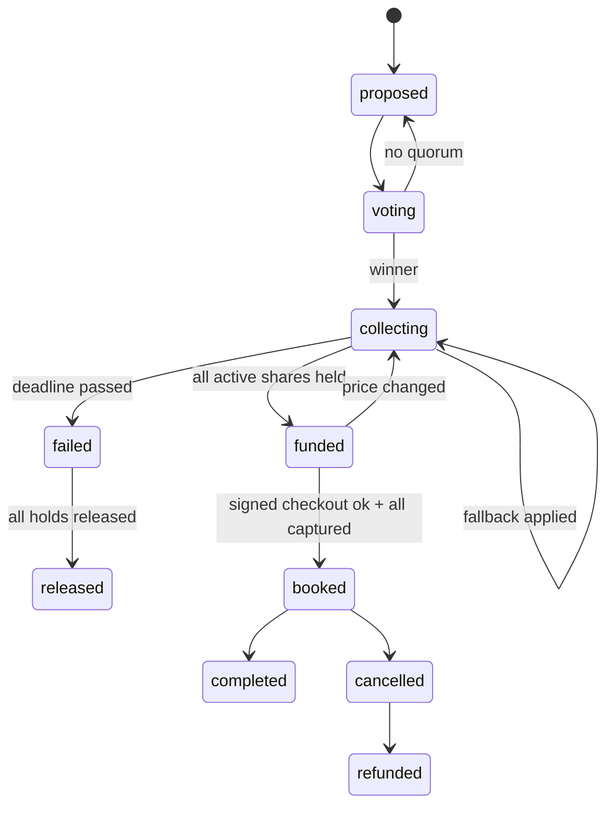

# Tandem: Coding Agent Brief for Rishab (Merchant + Signer + Dashboard + Pitch)

## AGENT START HERE

You are the coding agent working for **Rishab** on **Tandem**. Rishab owns: the **mock merchants** (PineStay, SummitPass, CouchCo, GameHub) that independently **verify TAP-style Ed25519 agent signatures**; the **signer** Eshaan's rules engine calls; the **demo attacks** (tampered price, replay, expired, unsigned); the React **group status / trip dashboard** and **comparison view**; **Heroku deploys** (after Eshaan's first deploy); and the **Devpost write-up, pitch, demo script, and video script** in `docs/`.

**Read order:**
1. This file, top to bottom.
2. `TANDEM_SPEC.md` sections: §1, §2 (problem, verified evidence, research plan, competitors), §4 (stage map), §8.1 and §8.2 (principles, palette, type, icons), **§8.5 (dashboard, build it exactly)**, **§8.6 (comparison view)**, §8.7, §8.8, §8.10 to §8.12, §12.1 and §12.4 (honesty labels, judge-facing event log), **§13 (mock merchants, signing, demo attacks)**, §14.2 (threat model), §16 to §19 (demo script, judging, Devpost outline, roadmap), §20 (risks).
3. `PHASE_0.md` is the scaffold Eshaan already ran; its contracts are copied into §3 here.

**Conflicts:** the contracts in §3 of this file are copied from `PHASE_0.md` §6 and **win over `TANDEM_SPEC.md`**. In the spec, ignore §15 (team plan and schedule), §22.3 (repo layout; use the one in this file), §12.6 (Visa Acceptance sandbox: not used, everything is simulated), and any names, paths, fields, or endpoints in §9.5, §11.4, §11.5, §12.2, §12.3 that differ from this file. Spec labels P1, P2, P3, P4 mean Eshaan, Ani, Aryan, Rishab.

**Preconditions (verify before writing any code):**
```bash
git checkout main && git pull --rebase origin main
for f in manage.py tandem/settings.py tandem/urls.py core/models.py core/events.py core/crypto.py \
         purchases/models.py purchases/states.py purchases/urls.py payments/gateway.py payments/simulated.py \
         agent/tools.json agent/fakes.py chat/adapters/base.py chat/adapters/web.py merchant/models.py \
         merchant/signing.py core/management/commands/seed_demo.py frontend/vite.config.ts frontend/src/App.tsx \
         Procfile .env.example requirements.txt; do test -e "$f" || echo "MISSING $f"; done
python3.12 -m venv .venv 2>/dev/null; source .venv/bin/activate && pip install -r requirements.txt
cp -n .env.example .env
# Fill these 3 local-only secrets in .env (generate locally, never commit, never paste in chat):
python -c "import secrets; print('DJANGO_SECRET_KEY=' + secrets.token_urlsafe(50))"
python -c "from cryptography.fernet import Fernet; print('FIELD_ENCRYPTION_KEY=' + Fernet.generate_key().decode())"
python -c "import base64,os; print('AGENT_SIGNING_KEY_B64=' + base64.b64encode(os.urandom(32)).decode())"
# Local dev without Redis: set CELERY_EAGER=1 in .env (already the default in .env.example)
python manage.py migrate && python manage.py seed_demo && python manage.py test
npm --prefix frontend ci && npm --prefix frontend run build
python manage.py runserver 8000 & sleep 3; curl -s localhost:8000/api/health; kill %1
```
Expected: no `MISSING` lines, all tests pass, the health JSON has `"status": "ok"` (Redis may show an error locally; that is fine), and the frontend builds. **If anything fails, stop.** Do not fix files you don't own. Report to the human: `Scaffold check failed: <command> <output>`.

Also check: `curl -s localhost:8000/.well-known/tandem-agent-keys` returns one Ed25519 public key, and `heroku apps:info -a <app>` works for you (you created the app). If Heroku access is missing, ask the human.

**Then do milestones M1 to M8 in order.** When something you depend on is not on `main` yet, use the named fake and continue; never wait idle.

**Ask the human only for:** (1) a contract change (draft the exact message `CONTRACT CHANGE: <file> <change> <why>` for them to post in team chat, then continue with the current contract), (2) secrets or access (`XAI_API_KEY`, Heroku access, Photon credentials), (3) a dependency that is still missing **after** you finished every milestone you can do with fakes, (4) opening or merging a PR if you can't (`gh` not available or no permission). Do not ask for anything else; make a reasonable assumption, note it in the PR description, and continue.

**Git per milestone:** start from fresh main (`git checkout main && git pull --rebase origin main && git checkout -b <person>/<milestone-slug>`), keep the diff small (aim under ~300 lines), run the milestone's test commands plus `python manage.py test` and `npm --prefix frontend run build`, check for secrets (`git diff main --stat` and `git diff main | grep -iE "xai-|api_key=|BEGIN PRIVATE|AGENT_SIGNING_KEY_B64="` must print nothing), commit with `<person>: Mx <summary>`, push, and open a PR (`gh pr create --fill --base main`). Then start the next milestone from fresh main (rebase your next branch if the PR isn't merged yet and you depend on it).

## 1. Project Context

**Tandem** is an AI agent that lives in a group chat and turns it into the checkout for **large group purchases** (group trips, roommates buying furniture, big group gifts). Built by a 4-person team for the **Visa "Reimagine Shopping" track at DubHacks '26**. Rubric: Functionality 30%, Track applicability 30%, Design 20%, Creativity 20%. Judges may be Visa Acceptance engineers or product/recruiter folks.

**Problem:** checkout assumes one buyer with one card, but big purchases are often made by groups. One friend fronts the money, carries the risk if someone drops or pays late, and chases payments for weeks. Group purchases stall between "we're all in" and someone actually paying, and good listings sell out while the chat argues.

**What Tandem does:** (1) learns preferences from chat plus private budget cards, (2) a deterministic consensus engine ranks options and Grok explains "why this pick" with per-person cost, (3) in-chat vote, (4) each member opens a private consent link and places a **hold for only their share** under a **mandate** (cap, merchant + listing lock, expiry), (5) **all-or-nothing**: nobody is charged unless everyone is held; then Tandem books via **TAP-style Ed25519-signed agent checkout**, (6) post-purchase expense splitting and split refunds.

**Core safety model:** the LLM only **proposes** tool calls. A deterministic rules engine (`purchases/rules.py`) enforces caps, votes, deadlines, consent, and all-or-nothing before anything reaches the payment gateway. **Nothing in `agent/` or `chat/` imports `payments/`.**

**Visa is fully SIMULATED.** Visa agentic APIs (Visa Intelligent Commerce, agentic tokens, Trusted Agent Protocol checkout) have no public access, so every Visa call goes through `SimulatedVisaAgentGateway`. Every gateway response has `"simulated": true`; every money surface shows a `SIMULATED` badge. Ed25519 signing and merchant verification are **real**. All listings and prices are **demo data**. Never invent statistics or user quotes; use `[SOURCE NEEDED]`.

**Demo scenario:** 6-person Tahoe trip chat (Maya organizer, Priya, Sam, Leo, Jordan, Alex), trip Nov 14 to 16, about $150 to $200 each, lowest private cap $190. Tandem suggests Pinecrest A-Frame ($175pp/6), Lakeview Bungalow ($178pp/6), Cedar Hollow ($162pp/6). The group votes Pinecrest, consent links go out, 5 holds clear, Jordan taps "Not for me", Tandem offers fallbacks (split the gap $210, Juniper Loft $185pp/5, invite replacement at $175), the group picks Juniper, 5 re-confirm, Tandem books via signed simulated agent checkout, a tampered price is rejected on screen (401 `digest_mismatch`), then Priya's $60 groceries split live ($12.00 each). Closing line: "Checkout was built for one. Tandem is built for us."

| Person | Role |
|---|---|
| Eshaan | Backend + rules engine; owns all models and migrations; ran the Phase 0 scaffold alone |
| Ani | Simulated `VisaAgentGateway` + React payment/consent page |
| Aryan | Grok tool-calling loop, React web chat + cards, agent copy, Photon adapter later |
| Rishab | Mock merchant + TAP-style signer/verifier + React dashboard + Devpost/pitch/video; Heroku deploy owner after the first deploy |

**Repo:** https://github.com/AniAravind/Tandem-DubHacks2026.git . Submission checkpoints (Devpost draft and final) are tracked by the humans, not by you.

## 2. Your Role and Ownership

### Files you own (only you edit these)
- `merchant/signing.py`, `merchant/verify.py`, `merchant/nonce_store.py`, `merchant/demo_hooks.py`, `merchant/views.py`, `merchant/urls.py`, `merchant/management/commands/`, `merchant/tests/`
- `frontend/src/dashboard/`, `frontend/src/compare/`, `frontend/src/App.tsx`, `frontend/src/main.tsx`, `frontend/src/styles/tokens.css`, `frontend/vite.config.ts`, `frontend/package.json`
- `Procfile`, root `package.json`, `.python-version`, the Heroku app, add-ons, config vars, and deploys
- `docs/` (`devpost.md`, `demo-script.md`, `video-script.md`, `research.md`, `checkins.md`, `screenshots/`)

### Do not touch
Any `models.py`/migrations (Eshaan owns `merchant/models.py` too; request fields), `purchases/`, `core/`, `tandem/` (Eshaan; you may draft static/whitenoise/Heroku-only settings changes as a REQUEST), `payments/`, `frontend/src/consent/` (Ani), `agent/`, `chat/`, `frontend/src/chat/`, `frontend/src/types/contracts.ts`, `frontend/src/api/client.ts` (Aryan, import only).

## 3. Locked Contracts (copied from PHASE_0.md §6; win over TANDEM_SPEC.md)

### 6.9 TAP-style signing contract (Rishab; `merchant/signing.py`)

Modeled on publicly documented Trusted Agent Protocol behavior: RFC 9421 HTTP Message Signatures with Ed25519 over `@authority` and `@path`, with `created`, `expires`, `keyid`, `alg`, `nonce`, and `tag` (`agent-browser-auth` to browse, `agent-payer-auth` to pay). **Tandem extension:** checkout and cancel also cover `content-digest` (RFC 9530, SHA-256 of the body) so price tampering breaks the signature.

Headers sent by the signer:
```http
Content-Digest: sha-256=:<base64 sha256(body)>:
Idempotency-Key: <sha256(purchase_id:checkout:version)>
Signature-Input: sig2=("@authority" "@path" "content-digest");created=1792285202;expires=1792285682;keyid="tandem-agent-2026-10";alg="ed25519";nonce="<b64 random 32 bytes>";tag="agent-payer-auth"
Signature: sig2=:<base64 ed25519 signature>:
```

```python
import base64, hashlib, os, secrets, time
from cryptography.hazmat.primitives.asymmetric.ed25519 import Ed25519PrivateKey, Ed25519PublicKey
from cryptography.exceptions import InvalidSignature

KEY_ID = os.getenv("AGENT_KEY_ID", "tandem-agent-2026-10")
MAX_WINDOW_S = 480


def _priv() -> Ed25519PrivateKey:
    return Ed25519PrivateKey.from_private_bytes(base64.b64decode(os.environ["AGENT_SIGNING_KEY_B64"]))


def public_key_b64() -> str:
    from cryptography.hazmat.primitives import serialization as s
    return base64.b64encode(_priv().public_key().public_bytes(s.Encoding.Raw, s.PublicFormat.Raw)).decode()


def content_digest(body: bytes) -> str:
    return f"sha-256=:{base64.b64encode(hashlib.sha256(body).digest()).decode()}:"


def _params(components: list[str], created: int, expires: int, nonce: str, tag: str, keyid: str) -> str:
    comps = " ".join(f'"{c}"' for c in components)
    return f'({comps});created={created};expires={expires};keyid="{keyid}";alg="ed25519";nonce="{nonce}";tag="{tag}"'


def signature_base(authority: str, path: str, digest: str | None, params: str) -> bytes:
    lines = [f'"@authority": {authority}', f'"@path": {path}']
    if digest:
        lines.append(f'"content-digest": {digest}')
    lines.append(f'"@signature-params": {params}')
    return "\n".join(lines).encode()


def sign_request(authority: str, path: str, body: bytes | None, tag: str, ttl_s: int = 300) -> dict:
    created = int(time.time())
    nonce = base64.b64encode(secrets.token_bytes(32)).decode()
    digest = content_digest(body) if body is not None else None
    comps = ["@authority", "@path"] + (["content-digest"] if digest else [])
    params = _params(comps, created, created + ttl_s, nonce, tag, KEY_ID)
    sig = base64.b64encode(_priv().sign(signature_base(authority, path, digest, params))).decode()
    headers = {"Signature-Input": f"sig2={params}", "Signature": f"sig2=:{sig}:"}
    if digest:
        headers["Content-Digest"] = digest
    return headers
```

Verifier (merchant side) checks, in order, and rejects with exactly these codes (dashboard and tests depend on them):

| Order | Check | 401 `reason` |
|---|---|---|
| 1 | `Signature-Input` and `Signature` present | `signature_missing` |
| 2 | `tag` is `agent-payer-auth` for checkout/cancel, `agent-browser-auth` for listings/quotes | `wrong_tag` |
| 3 | `created <= now + 30` and `now < expires` and `expires - created <= 480` | `expired` |
| 4 | Nonce unused (Redis `SET nonce:{keyid}:{nonce} 1 NX EX <ttl>`) | `nonce_replayed` |
| 5 | `keyid` known (from `/.well-known/tandem-agent-keys`) | `unknown_agent` |
| 6 | Recomputed `Content-Digest` equals header | `digest_mismatch` |
| 7 | Ed25519 verify of rebuilt signature base | `signature_invalid` |
| 8 | Quote valid, `amount_cents == quote.amount_cents` (409) | `quote_mismatch` |

`merchant/views.py` (public key endpoint):
```python
import base64
from django.http import JsonResponse
from cryptography.hazmat.primitives import serialization
from merchant.signing import KEY_ID, _priv


def agent_keys(request):
    raw = _priv().public_key().public_bytes(serialization.Encoding.Raw, serialization.PublicFormat.Raw)
    x = base64.urlsafe_b64encode(raw).rstrip(b"=").decode()
    return JsonResponse({"keys": [{"kty": "OKP", "crv": "Ed25519", "kid": KEY_ID, "x": x, "use": "sig"}],
                         "simulated_directory": True})
```

`/.well-known/tandem-agent-keys` response:
```json
{"keys": [{"kty": "OKP", "crv": "Ed25519", "kid": "tandem-agent-2026-10", "x": "<base64url public key>", "use": "sig"}], "simulated_directory": true}
```

---

### 6.3 API contract (stub views return these exact shapes in Phase 0)

All endpoints are under `/api/v1/` except `/api/health`. JSON only. IDs are UUID strings. Money is `*_cents` integers. Error envelope everywhere:
```json
{"error": {"code": "cap_exceeded", "message": "Share $210.00 exceeds cap $200.00", "request_id": "req_01HF..."}}
```

| Method | Path | Owner | Auth (Phase 0 / later) | Purpose |
|---|---|---|---|---|
| GET | `/api/health` | Eshaan | public | Liveness: DB, Redis, gateway mode |
| POST | `/api/v1/chat/web` | Aryan | demo member header / member session | Send a web chat message |
| GET | `/api/v1/groups/{gid}/messages?after_seq=` | Aryan | member | Poll chat messages (2s) |
| GET | `/api/v1/groups/{gid}` | Eshaan | member | Group + members (status only, never budgets) |
| GET/PUT | `/api/v1/groups/{gid}/members/me/preferences` | Eshaan | member | Private budget + must-haves |
| GET | `/api/v1/groups/{gid}/options` | Eshaan | member | Ranked options + explanation facts |
| POST | `/api/v1/votes/{vid}/ballots` | Eshaan | member | Cast or change vote |
| GET | `/api/v1/purchases/{pid}` | Eshaan | member | Funding status for dashboard and cards |
| GET | `/api/v1/consent/{token}` | Ani | signed consent token | Consent page payload |
| POST | `/api/v1/consent/{token}/tokenize` | Ani | consent token | Sim card field to agent token |
| POST | `/api/v1/consent/{token}/approve` | Ani | consent token + passkey/OTP | Accept mandate, place hold |
| POST | `/api/v1/consent/{token}/decline` | Ani | consent token | Decline (private reason) |
| POST | `/api/v1/shares/{sid}/leave` | Eshaan | member | Leave, release hold, trigger fallback |
| POST | `/api/v1/shares/{sid}/reconfirm` | Ani | member + passkey | Confirm a share change within cap |
| POST | `/api/v1/groups/{gid}/expenses` | Eshaan | member | Add expense |
| GET | `/api/v1/groups/{gid}/ledger` | Eshaan | member | Expenses + balances |
| GET | `/api/v1/groups/{gid}/events?after_seq=` | Eshaan | member | Event log (dashboard) |
| POST | `/api/v1/demo/{action}` | Eshaan (Rishab drives the UI) | `X-Demo-Key` + `DEMO_MODE=1` | `simulate_decline`, `tamper_next`, `replay_last`, `fast_forward`, `reset_seed` |
| GET | `/merchants/{slug}/listings` | Rishab | signed `agent-browser-auth` | Search listings |
| POST | `/merchants/{slug}/quotes` | Rishab | signed `agent-browser-auth` | Lock a quote (15 min) |
| POST | `/merchants/{slug}/agent/checkout` | Rishab | signed `agent-payer-auth` + Content-Digest | Book |
| POST | `/merchants/{slug}/agent/cancel` | Rishab | signed `agent-payer-auth` | Cancel, return refund amount |
| GET | `/.well-known/tandem-agent-keys` | Rishab | public | Agent public keys (simulated agent directory) |

**Phase 0 auth shortcut (demo only):** web requests send `X-Tandem-Member: <member uuid>`. Phase 1 replaces this with a signed session. Never ship without `DEMO_MODE=1` gating this header.

**Example payloads**

`GET /api/health`
```json
{"status": "ok", "db": "ok", "redis": "ok", "gateway": "simulated", "simulated": true, "release": "v12"}
```

`POST /api/v1/chat/web`
```json
// request
{"group_id": "8c1a...", "text": "@tandem can you find us a cabin? like 150-200 each"}
// response 202
{"message_id": "0f3e...", "seq": 41, "status": "queued"}
```

`GET /api/v1/groups/{gid}/messages?after_seq=40`
```json
{"messages": [
  {"id": "0f3e...", "seq": 41, "direction": "in", "member": {"id": "a1...", "display_name": "Maya"},
   "text": "@tandem can you find us a cabin? like 150-200 each", "card": null, "quick_replies": [], "created_at": "2026-10-17T21:01:12Z"},
  {"id": "77b2...", "seq": 42, "direction": "out", "member": null,
   "text": "On it. Tahoe, Fri Nov 14 to Sun Nov 16, 6 people, about $150 to $200 each.",
   "card": {"type": "PreferenceRequest", "data": {"url": "/p/8c1a..."}}, "quick_replies": [], "created_at": "2026-10-17T21:01:14Z"}
]}
```

`GET /api/v1/groups/{gid}`
```json
{"id": "8c1a...", "name": "Tahoe weekend", "channel": "web", "timezone": "America/Los_Angeles",
 "organizer_id": "a1...",
 "members": [{"id": "a1...", "display_name": "Maya", "role": "organizer", "status": "active", "verified": true}]}
```

`GET /api/v1/groups/{gid}/options`
```json
{"options": [
  {"id": "op1...", "rank": 1, "title": "Pinecrest A-Frame", "merchant_slug": "pinestay", "listing_ref": "pinecrest-a-frame",
   "total_cents": 105000, "per_person_cents": 17500, "group_size": 6, "capacity": 6,
   "features": ["hot_tub", "kitchen", "separate_beds", "parking"], "score": 92,
   "explanation_facts": [
     {"kind": "fits_all_budgets", "per_person_cents": 17500, "lowest_cap_cents": 19000},
     {"kind": "must_have_count", "feature": "hot_tub", "count": 4},
     {"kind": "drive_min", "to": "Heavenly", "minutes": 12},
     {"kind": "tradeoff", "text": "1 bunk room"}],
   "meta": {"demo_data": true, "cancellation": "Free until Nov 7", "photo_url": "/static/demo/pinecrest.jpg"}}
]}
```

`POST /api/v1/votes/{vid}/ballots`
```json
// request
{"choice_key": "1"}
// response
{"vote_id": "v1...", "status": "open", "tally": {"1": 4, "2": 1, "3": 0}, "voted": 5, "quorum": 4, "your_choice": "1"}
```

`GET /api/v1/purchases/{pid}`
```json
{"id": "pur_7c...", "state": "collecting", "option": {"title": "Pinecrest A-Frame", "merchant_slug": "pinestay"},
 "total_cents": 105000, "held_cents": 70000, "deadline_at": "2026-10-18T02:00:00Z", "version": 1, "simulated": true,
 "shares": [
   {"id": "sh1...", "member": {"id": "a1...", "display_name": "Maya"}, "amount_cents": 17500, "status": "held"},
   {"id": "sh5...", "member": {"id": "a5...", "display_name": "Jordan"}, "amount_cents": 17500, "status": "viewing"},
   {"id": "sh6...", "member": {"id": "a6...", "display_name": "Alex"}, "amount_cents": 17500, "status": "invited"}],
 "counts": {"held": 4, "viewing": 1, "invited": 1, "out": 0, "active": 6}}
```

`GET /api/v1/consent/{token}`
```json
{"member": {"id": "a5...", "display_name": "Jordan"}, "invited_by": "Maya", "group_name": "Tahoe weekend",
 "purchase": {"id": "pur_7c...", "version": 1, "title": "Pinecrest A-Frame", "merchant_name": "PineStay Rentals",
              "merchant_slug": "pinestay", "dates": "Nov 14 to 16", "total_cents": 105000, "split_count": 6,
              "photo_url": "/static/demo/pinecrest.jpg"},
 "share_cents": 17500, "default_cap_cents": 20000, "deadline_at": "2026-10-18T02:00:00Z",
 "can": ["Hold $175.00 now (not a charge)", "Charge it only if all 6 are in", "Book only Pinecrest A-Frame via PineStay"],
 "can_never": ["Charge more than $200.00", "Pay any other merchant",
               "Charge you if the group is not fully in by Sat 7:00 PM", "See or store your card number"],
 "consent_text_version": "v1", "consent_text_sha256": "3f9a...", "simulated": true, "offers": []}
```

`POST /api/v1/consent/{token}/tokenize`
```json
// request (from the simulated secure card field; the full PAN never reaches Django)
{"transient_card_token": "tt_sim_1111_9b2c"}
// response
{"agent_token_id": "atk_sim_J8d2", "card": {"brand": "visa", "last4": "1111"}, "simulated": true}
```

`POST /api/v1/consent/{token}/approve`
```json
// request
{"agent_token_id": "atk_sim_J8d2", "cap_cents": 20000, "consent_text_sha256": "3f9a...",
 "assertion": {"method": "passkey", "credential_id": "cred_...", "client_data_json": "...", "signature": "..."}}
// response 200 (held)
{"share_status": "held", "hold": {"hold_id": "auth_sim_8f2a", "amount_cents": 17500, "status": "AUTHORIZED"},
 "mandate_id": "mdt_sim_Q19", "group_counts": {"held": 5, "active": 6}, "simulated": true}
// response 402 (card declined, deterministic: card ending 0002)
{"error": {"code": "card_declined", "message": "Your bank didn't approve this hold. Nothing was charged.", "decline_code": "do_not_honor", "request_id": "req_..."}}
```

`POST /api/v1/consent/{token}/decline`
```json
{"reason": "prefer_not_to_say"}    // too_expensive | dates | other | prefer_not_to_say (private, never shown to group)
// -> {"share_status": "declined"}
```

`POST /api/v1/groups/{gid}/expenses`
```json
// request
{"payer_id": "a2...", "amount_cents": 6000, "description": "Groceries", "split": {"mode": "equal", "member_ids": ["a1...","a2...","a3...","a4...","a6..."]}}
// response 201
{"expense_id": "ex1...", "splits": [{"member_id": "a1...", "amount_cents": 1200}], "balances_net_cents": 0}
```

`GET /api/v1/groups/{gid}/ledger`
```json
{"expenses": [{"id": "ex1...", "description": "Groceries", "payer": "Priya", "amount_cents": 6000, "split_mode": "equal", "split_count": 5}],
 "balances": [{"member_id": "a2...", "display_name": "Priya", "net_cents": 4800},
              {"member_id": "a1...", "display_name": "Maya", "net_cents": -1200}],
 "net_total_cents": 0}
```

`GET /api/v1/groups/{gid}/events?after_seq=100`
```json
{"events": [
  {"seq": 101, "at": "2026-10-17T23:03:40.118Z", "actor": "gateway", "type": "gateway.hold_authorized", "simulated": true,
   "summary": "Hold authorized: Maya $175.00", "payload": {"hold_id": "auth_sim_8f2a", "amount_cents": 17500, "member_id": "a1..."},
   "hash": "c41e..."}],
 "chain_ok": true}
```

`POST /merchants/pinestay/agent/checkout` (signed; see 6.9)
```json
// request body
{"quote_id": "q_pinestay_88", "listing_ref": "juniper-loft", "check_in": "2026-11-14", "check_out": "2026-11-16",
 "guests": 5, "amount_cents": 92500, "currency": "USD",
 "payment": {"type": "group_mandates", "mandate_ids": ["mdt_sim_a", "mdt_sim_b", "mdt_sim_c", "mdt_sim_d", "mdt_sim_e"], "simulated": true},
 "agent": {"name": "Tandem", "purchase_id": "pur_7c..."}}
// 201
{"booking_ref": "PS-4K7Q", "amount_cents": 92500, "status": "confirmed", "verified_agent": "tandem-agent-2026-10"}
// 401
{"error": {"code": "digest_mismatch", "message": "Body does not match signed Content-Digest"}}
```

Phase 0 stub URL files (each owner commits theirs, so `tandem/urls.py` imports cleanly):
```python
# purchases/urls.py (Eshaan)
from django.urls import path
from purchases import api
urlpatterns = [
    path("groups/<uuid:gid>", api.group_detail),
    path("groups/<uuid:gid>/members/me/preferences", api.my_preferences),
    path("groups/<uuid:gid>/options", api.options),
    path("votes/<uuid:vid>/ballots", api.cast_ballot),
    path("purchases/<uuid:pid>", api.purchase_detail),
    path("shares/<uuid:sid>/leave", api.leave_share),
    path("groups/<uuid:gid>/expenses", api.add_expense),
    path("groups/<uuid:gid>/ledger", api.ledger),
    path("groups/<uuid:gid>/events", api.events),
    path("demo/<str:action>", api.demo_action),
]
# payments/urls.py (Ani): consent/<str:token>, consent/<str:token>/tokenize|approve|decline, shares/<uuid:sid>/reconfirm
# chat/urls.py (Aryan): chat/web, groups/<uuid:gid>/messages
# merchant/urls.py (Rishab): <slug:slug>/listings, <slug:slug>/quotes, <slug:slug>/agent/checkout, <slug:slug>/agent/cancel
```

Stub view pattern (return the example JSON until the real logic lands):
```python
from rest_framework.decorators import api_view
from rest_framework.response import Response

@api_view(["GET"])
def purchase_detail(request, pid):
    return Response(FIXTURES["purchase_detail"])   # purchases/fixtures.py holds the JSON above
```

### 6.7 EventLog event types (`core/events.py`, Eshaan; everyone writes through it)

```python
import hashlib, json
from django.db import transaction
from django.db.models import Max
from django.utils import timezone


class EventType:
    GROUP_CREATED = "group.created"
    MEMBER_JOINED = "member.joined";              MEMBER_VERIFIED = "member.verified";   MEMBER_LEFT = "member.left"
    PREFS_UPDATED = "prefs.updated"               # payload never contains budget values
    OPTIONS_RANKED = "options.ranked"
    VOTE_OPENED = "vote.opened";                  BALLOT_CAST = "vote.ballot_cast";      VOTE_CLOSED = "vote.closed"
    PURCHASE_CREATED = "purchase.created";        PURCHASE_STATE_CHANGED = "purchase.state_changed"
    SHARE_STATE_CHANGED = "share.state_changed"
    CONSENT_ACCEPTED = "consent.accepted";        CONSENT_DECLINED = "consent.declined"
    FALLBACK_PROPOSED = "fallback.proposed";      FALLBACK_APPLIED = "fallback.applied"
    # gateway.* (simulated=True): agent_token_provisioned, agent_token_revoked, spend_controls_set, mandate_created,
    # mandate_revoked, hold_authorized, hold_declined, hold_rejected, hold_adjusted, hold_released, captured, refunded
    SIGNER_REQUEST_SIGNED = "signer.request_signed"
    MERCHANT_ACCEPTED = "merchant.request_accepted"; MERCHANT_REJECTED = "merchant.request_rejected"  # payload.reason (6.9)
    BOOKING_CONFIRMED = "booking.confirmed";      BOOKING_CANCELLED = "booking.cancelled"
    EXPENSE_ADDED = "expense.added"
    AGENT_TOOL_CALLED = "agent.tool_called";      AGENT_TOOL_REJECTED = "agent.tool_rejected"; AGENT_MESSAGE_SENT = "agent.message_sent"
    REMINDER_SENT = "reminder.sent"
    AUTH_OTP_VERIFIED = "auth.otp_verified";      AUTH_DENIED = "auth.denied"
    DEMO_ACTION = "demo.action"


@transaction.atomic
def log_event(type: str, actor: str, group_id=None, purchase_id=None, payload: dict | None = None, simulated=False):
    from core.models import EventLog
    last = EventLog.objects.select_for_update().order_by("-seq").first()
    seq = (last.seq if last else 0) + 1
    prev = last.hash if last else ""
    body = {"seq": seq, "type": type, "actor": actor, "group_id": str(group_id or ""), "purchase_id": str(purchase_id or ""),
            "payload": payload or {}, "simulated": simulated, "at": timezone.now().isoformat()}
    h = hashlib.sha256((prev + json.dumps(body, sort_keys=True, default=str)).encode()).hexdigest()
    return EventLog.objects.create(group_id=group_id, purchase_id=purchase_id, actor=actor, type=type,
                                   payload=payload or {}, simulated=simulated, seq=seq, prev_hash=prev, hash=h)


def log_event_simulated(type: str, payload: dict):
    """Hook for SimulatedVisaAgentGateway. Rules engine passes group/purchase via payload['_ctx'] when known."""
    ctx = payload.pop("_ctx", {}) if isinstance(payload, dict) else {}
    log_event(type, actor="gateway", group_id=ctx.get("group_id"), purchase_id=ctx.get("purchase_id"),
              payload=payload, simulated=True)
```
Rule: **never** put PAN, full phone numbers, OTP codes, or budget values in `payload`.

### 6.2 State machines (Eshaan, `purchases/states.py`)

```python
from django.db import transaction
from django.utils import timezone
from core.events import log_event, EventType
from purchases.models import Purchase, Share

P = Purchase.State
S = Share.Status

PURCHASE_TRANSITIONS: dict[str, set[str]] = {
    P.PROPOSED:   {P.VOTING},
    P.VOTING:     {P.PROPOSED, P.COLLECTING},          # no quorum / tie -> re-vote
    P.COLLECTING: {P.COLLECTING, P.FUNDED, P.FAILED},  # self-loop = fallback applied (version bump)
    P.FUNDED:     {P.BOOKED, P.COLLECTING},            # checkout rejected for price change -> back to vote
    P.BOOKED:     {P.COMPLETED, P.CANCELLED},
    P.CANCELLED:  {P.REFUNDED},
    P.FAILED:     {P.RELEASED},
    P.COMPLETED: set(), P.RELEASED: set(), P.REFUNDED: set(),
}

SHARE_TRANSITIONS: dict[str, set[str]] = {
    S.INVITED:     {S.VIEWING, S.DECLINED, S.RELEASED},
    S.VIEWING:     {S.HELD, S.DECLINED, S.CARD_FAILED, S.RELEASED},
    S.CARD_FAILED: {S.VIEWING, S.DECLINED, S.RELEASED},   # retry allowed up to 3 times (rules.py enforces)
    S.HELD:        {S.CAPTURED, S.RELEASED},
    S.CAPTURED:    {S.REFUNDED},
    S.DECLINED: set(), S.RELEASED: set(), S.REFUNDED: set(),
}


class IllegalTransition(Exception):
    pass


@transaction.atomic
def transition_purchase(purchase_id, to: str, actor: str, **payload) -> Purchase:
    p = Purchase.objects.select_for_update().get(pk=purchase_id)
    if to not in PURCHASE_TRANSITIONS[p.state]:
        raise IllegalTransition(f"purchase {p.state} -> {to}")
    frm, p.state = p.state, to
    if to == P.FUNDED:
        p.funded_at = timezone.now()
    if to == P.BOOKED:
        p.booked_at = timezone.now()
    p.save(update_fields=["state", "funded_at", "booked_at", "updated_at"])
    log_event(EventType.PURCHASE_STATE_CHANGED, actor=actor, group_id=p.group_id, purchase_id=p.id,
              payload={"from": frm, "to": to, **payload})
    return p


@transaction.atomic
def transition_share(share_id, to: str, actor: str, **payload) -> Share:
    s = Share.objects.select_for_update().select_related("purchase").get(pk=share_id)
    if to not in SHARE_TRANSITIONS[s.status]:
        raise IllegalTransition(f"share {s.status} -> {to}")
    frm, s.status = s.status, to
    s.save(update_fields=["status", "updated_at"])
    log_event(EventType.SHARE_STATE_CHANGED, actor=actor, group_id=s.purchase.group_id,
              purchase_id=s.purchase_id, payload={"share_id": str(s.id), "from": frm, "to": to, **payload})
    return s
```



**Invariants that Phase 1 rules must keep** (the full list R1 to R13 is in spec §11.1):
- `FUNDED` only if every active share (not superseded, not declined/released) is `HELD` **and** the sum of held amounts equals `total_cents`.
- `capture` is only ever called from the `FUNDED -> BOOKED` path. **Nothing in `agent/` imports `payments/`.**
- Any share increase requires the member's re-confirm. Above the cap, or a new listing, means a new Mandate + Consent.

Test to commit in Phase 0 (`purchases/tests/test_states.py`):
```python
from django.test import TestCase
from purchases.states import PURCHASE_TRANSITIONS, SHARE_TRANSITIONS, P, S

class StateTableTest(TestCase):
    def test_terminal_states(self):
        for t in (P.COMPLETED, P.RELEASED, P.REFUNDED):
            self.assertEqual(PURCHASE_TRANSITIONS[t], set())

    def test_no_capture_before_hold(self):
        self.assertNotIn(S.CAPTURED, SHARE_TRANSITIONS[S.VIEWING])
        self.assertIn(S.CAPTURED, SHARE_TRANSITIONS[S.HELD])

    def test_every_state_has_entry(self):
        self.assertEqual(set(PURCHASE_TRANSITIONS), set(P.values))
        self.assertEqual(set(SHARE_TRANSITIONS), set(S.values))
```

### 6.8 Seed data (Eshaan; `python manage.py seed_demo`, idempotent, all DEMO DATA)

Demo scenario: 6-person Tahoe trip, Nov 14 to 16, 2026, about $150 to $200 each. Lowest private cap is $190.

| Member | Role | Private cap | Must-haves | Demo card (sim) | Demo behavior |
|---|---|---|---|---|---|
| Maya | organizer | $250 | hot_tub | 1111 | Holds first |
| Priya | member | $220 | kitchen, hot_tub | 1111 | Holds, later pays $60 groceries |
| Sam | member | $190 | separate_beds | 1111 | Lowest cap |
| Leo | member | $230 | hot_tub | 1111 | Sends prompt-injection message |
| Jordan | member | $200 | (none) | 0002 | Taps "Not for me" (card 0002 available for decline demo) |
| Alex | member | $210 | hot_tub, parking | 1111 | Holds |

| Merchant | Listing ref | Title | Total | Capacity | Per person | Notes |
|---|---|---|---|---|---|---|
| pinestay | pinecrest-a-frame | Pinecrest A-Frame | $1,050 | 6 | **$175 / 6** | hot tub, 12 min to Heavenly, free cancel until Nov 7 |
| pinestay | lakeview-bungalow | Lakeview Bungalow | $1,068 | 7 | $178 / 6 | no hot tub, 18 min |
| pinestay | cedar-hollow | Cedar Hollow | $972 | 6 | $162 / 6 | no hot tub, 25 min, non-refundable |
| pinestay | juniper-loft | Juniper Loft | $925 | 5 | **$185 / 5** | hot tub, 8 min; fallback option only |
| summitpass | lift-2day | 2-day lift pass | $98 per person | 50 | $98 | demo offer 5% back |
| couchco | sofa-3seat | 3-seat sofa | $1,199 | 4 | $299.75 / 4 | roommates demo |
| gamehub | console-bundle | Console bundle (gift) | $549 | 8 | $68.63 x5 + $68.62 x3 | gift demo |

Fallback math (dropout to 5): split the gap = $1,050 / 5 = **$210** (over Sam's $190, so Sam needs a new mandate). Cheaper = Juniper Loft **$185** (within all 5 remaining caps). Invite replacement = stay at $175, deadline +12h. Groceries $60 / 5 = **$12.00**.

`core/management/commands/seed_demo.py`
```python
import hashlib, uuid
from django.core.management.base import BaseCommand
from django.db import transaction
from core.models import Group, Member
from merchant.models import Merchant, Listing

NS = uuid.UUID("7a3f1c2e-0000-4000-8000-000000000000")
uid = lambda name: uuid.uuid5(NS, name)            # stable demo ids
phone_hash = lambda p: hashlib.sha256(p.encode()).hexdigest()

MEMBERS = [  # name, role, cap_cents, must_haves, demo_card_last4
    ("Maya", "organizer", 25000, ["hot_tub"], "1111"),
    ("Priya", "member", 22000, ["kitchen", "hot_tub"], "1111"),
    ("Sam", "member", 19000, ["separate_beds"], "1111"),
    ("Leo", "member", 23000, ["hot_tub"], "1111"),
    ("Jordan", "member", 20000, [], "0002"),
    ("Alex", "member", 21000, ["hot_tub", "parking"], "1111"),
]
MERCHANTS = [("pinestay", "PineStay Rentals", "rental", "7011"), ("summitpass", "SummitPass", "passes", "7999"),
             ("couchco", "CouchCo", "furniture", "5712"), ("gamehub", "GameHub", "electronics", "5732")]
LISTINGS = [  # merchant, ref, title, total_cents, unit_cents, capacity, features, meta
    ("pinestay", "pinecrest-a-frame", "Pinecrest A-Frame", 105000, None, 6, ["hot_tub", "kitchen", "separate_beds", "parking"],
     {"drive_min": 12, "to": "Heavenly", "cancellation": "Free until Nov 7", "beds": "3 bd, 1 bunk room"}),
    ("pinestay", "lakeview-bungalow", "Lakeview Bungalow", 106800, None, 7, ["kitchen", "separate_beds", "parking"],
     {"drive_min": 18, "to": "Heavenly", "cancellation": "Free until Nov 10"}),
    ("pinestay", "cedar-hollow", "Cedar Hollow", 97200, None, 6, ["kitchen", "separate_beds"],
     {"drive_min": 25, "to": "Heavenly", "cancellation": "Non-refundable"}),
    ("pinestay", "juniper-loft", "Juniper Loft", 92500, None, 5, ["hot_tub", "kitchen", "separate_beds", "parking"],
     {"drive_min": 8, "to": "Heavenly", "cancellation": "Free until Nov 10"}),
    ("summitpass", "lift-2day", "2-day lift pass", 9800, 9800, 50, ["lift_pass"], {"offer": "5% back (demo)"}),
    ("couchco", "sofa-3seat", "3-seat sofa", 119900, None, 4, ["delivery"], {}),
    ("gamehub", "console-bundle", "Console bundle (gift)", 54900, None, 8, ["gift_wrap"], {}),
]


class Command(BaseCommand):
    help = "Load the Tahoe demo (DEMO DATA). Safe to re-run."

    @transaction.atomic
    def handle(self, *args, **opts):
        group, _ = Group.objects.update_or_create(id=uid("group:tahoe"), defaults={"name": "Tahoe weekend", "channel": "web"})
        for i, (name, role, cap, musts, last4) in enumerate(MEMBERS):
            m, _ = Member.objects.update_or_create(id=uid(f"member:{name}"), defaults={
                "group": group, "display_name": name, "role": role, "status": "active",
                "phone_e164_hash": phone_hash(f"+1206555010{i}"), "phone_last4": f"010{i}",
                "prefs": {"must_haves": musts, "dealbreakers": ["shared_beds"], "flexibility": "firm",
                          "demo_card_last4": last4}})
            m.budget_cap_cents = cap
            m.save()
            if role == "organizer":
                group.organizer = m
                group.save(update_fields=["organizer"])
        for slug, name, cat, mcc in MERCHANTS:
            Merchant.objects.update_or_create(slug=slug, defaults={"name": name, "category": cat, "mcc": mcc})
        for slug, ref, title, total, unit, cap, feats, meta in LISTINGS:
            Listing.objects.update_or_create(merchant=Merchant.objects.get(slug=slug), ref=ref, defaults={
                "title": title, "total_cents": total, "unit_price_cents": unit, "capacity": cap,
                "features": feats, "meta": {**meta, "demo_data": True}, "available": True})
        self.stdout.write(self.style.SUCCESS(f"Seeded DEMO group {group.id} with {len(MEMBERS)} members"))
```
`reset_seed` (demo action) deletes the group's purchases, votes, options, expenses, messages, and events, then calls this command. Group and member ids stay the same, so demo links and scripts keep working.

### Merchant models (Eshaan owns; excerpt from PHASE_0 §6.1)

`merchant/models.py` (mock merchants keep their own tables and do not trust Tandem's)
```python
from django.db import models
from core.models import TimeStamped


class Merchant(TimeStamped):
    slug = models.SlugField(unique=True)                    # pinestay | summitpass | couchco | gamehub
    name = models.CharField(max_length=80)
    category = models.CharField(max_length=24)
    mcc = models.CharField(max_length=4, blank=True)        # demo value


class Listing(TimeStamped):
    merchant = models.ForeignKey(Merchant, on_delete=models.CASCADE, related_name="listings")
    ref = models.SlugField()                                # "pinecrest-a-frame"
    title = models.CharField(max_length=120)
    total_cents = models.BigIntegerField()                  # per stay / per bundle
    unit_price_cents = models.BigIntegerField(null=True, blank=True)  # per-person items (passes)
    capacity = models.PositiveIntegerField()
    features = models.JSONField(default=list)
    meta = models.JSONField(default=dict)                   # {"demo_data": true, "drive_min": 12, ...}
    available = models.BooleanField(default=True)

    class Meta:
        constraints = [models.UniqueConstraint(fields=["merchant", "ref"], name="uniq_listing_ref")]


class Quote(TimeStamped):
    listing = models.ForeignKey(Listing, on_delete=models.CASCADE)
    quote_id = models.CharField(max_length=64, unique=True) # "q_pinestay_88"
    amount_cents = models.BigIntegerField()
    guests = models.PositiveIntegerField()
    check_in = models.DateField(null=True, blank=True)
    check_out = models.DateField(null=True, blank=True)
    expires_at = models.DateTimeField()
    used = models.BooleanField(default=False)


class SignedRequest(TimeStamped):
    """Audit trail for every TAP-style signed request (written by signer and verifier)."""
    purpose = models.CharField(max_length=16)               # browse | checkout | cancel
    method = models.CharField(max_length=8)
    authority = models.CharField(max_length=255)
    path = models.CharField(max_length=255)
    keyid = models.CharField(max_length=64)
    nonce = models.CharField(max_length=128, db_index=True)
    created = models.BigIntegerField()
    expires = models.BigIntegerField()
    tag = models.CharField(max_length=32)                   # agent-browser-auth | agent-payer-auth
    content_digest = models.CharField(max_length=128, blank=True)
    signature_b64 = models.TextField()
    response_code = models.PositiveSmallIntegerField(null=True)
    verified = models.BooleanField(default=False)
    reject_reason = models.CharField(max_length=32, blank=True)   # see 6.9


class MerchantBooking(TimeStamped):
    listing = models.ForeignKey(Listing, on_delete=models.PROTECT)
    quote = models.OneToOneField(Quote, on_delete=models.PROTECT)
    booking_ref = models.CharField(max_length=16, unique=True)    # "PS-4K7Q"
    amount_cents = models.BigIntegerField()
    status = models.CharField(max_length=16, default="confirmed") # confirmed | cancelled
    idempotency_key = models.CharField(max_length=128, unique=True)
```

### Card data types (Aryan owns `frontend/src/types/contracts.ts`; from PHASE_0.md §6.6)

Card `data` shapes (`frontend/src/types/contracts.ts`, Aryan owns; Ani and Rishab import):
```ts
export type Cents = number;
export type ShareStatus = "invited" | "viewing" | "held" | "declined" | "card_failed" | "released" | "captured" | "refunded";
export type PurchaseState = "proposed" | "voting" | "collecting" | "funded" | "booked" | "completed" | "failed" | "released" | "cancelled" | "refunded";

export interface OptionCardData { option_id: string; rank: number; title: string; merchant_name: string;
  per_person_cents: Cents; total_cents: Cents; capacity: number; features: string[];
  why: string[]; tradeoff?: string; fit_score: number; cancellation: string; photo_url?: string; demo_data: true; }
export interface VoteCardData { vote_id: string; closes_at: string; quorum: number; voted: number;
  choices: { key: string; label: string; per_person_cents: Cents; count: number }[]; your_choice?: string; winner_key?: string; }
export interface FundingCardData { purchase_id: string; title: string; total_cents: Cents; held_cents: Cents;
  deadline_at: string; members: { id: string; initials: string; display_name: string; status: ShareStatus }[]; simulated: true; }
export interface FallbackCardData { purchase_id: string; vote_id: string;
  options: { key: "split_gap" | "cheaper" | "replacement"; label: string; per_person_cents: Cents; delta_cents: Cents; cap_impact: string }[]; }
export interface BookingConfirmedData { title: string; dates: string; booking_ref: string; per_person_cents: Cents;
  signature_verified: boolean; simulated: true; dashboard_url: string; }
export interface ExpenseCardData { expense_id: string; description: string; payer: string; amount_cents: Cents; split_count: number; per_person_cents: Cents; }
```

### Repo layout (from PHASE_0.md §4)
```
Tandem-DubHacks2026/
├── .python-version              # 3.12
├── .gitignore
├── .env.example                 # all config vars, no secrets
├── Procfile                     # release / web / worker
├── package.json                 # root: Node 20 engines + heroku build script for /frontend
├── requirements.txt
├── manage.py
├── tandem/                      # Django project
│   ├── settings.py
│   ├── urls.py
│   ├── celery.py
│   ├── views.py                 # health + SPA index view
│   └── wsgi.py
├── core/                        # Group, Member, InviteLink, EventLog, events.py, crypto.py, seed_demo
│   ├── models.py
│   ├── events.py
│   ├── crypto.py
│   └── management/commands/seed_demo.py
├── purchases/                   # Option, Vote, Ballot, Purchase, Share, Booking, Expense, ExpenseSplit, Refund
│   ├── models.py
│   ├── states.py                # state machines (Eshaan)
│   ├── rules.py                 # rules engine (Eshaan, Phase 1)
│   ├── consensus.py             # scorer (Eshaan, Phase 1)
│   ├── api.py                   # DRF views (Eshaan)
│   └── tests/
├── payments/                    # AgentToken, Mandate, Consent, Hold, IdempotencyRecord + gateway
│   ├── models.py                # (Eshaan edits)
│   ├── gateway.py               # Protocol (Ani)
│   ├── simulated.py             # SimulatedVisaAgentGateway (Ani)
│   └── tests/test_simulated_gateway.py
├── agent/                       # Grok loop (Aryan)
│   ├── tools.json
│   ├── llm.py
│   ├── orchestrator.py          # Phase 1
│   ├── fakes.py                 # FakeRulesEngine for Phase 1
│   └── prompts/system.md
├── chat/                        # ChatMessage + adapters (Aryan)
│   ├── models.py                # (Eshaan edits)
│   ├── adapters/base.py
│   ├── adapters/web.py
│   ├── adapters/photon.py       # stub, later
│   └── api.py
├── merchant/                    # mock merchants + TAP-style signer/verifier (Rishab)
│   ├── models.py                # Merchant, Listing, Quote, SignedRequest (Eshaan edits)
│   ├── signing.py
│   ├── views.py                 # /merchants/<slug>/...
│   └── urls.py
├── scripts/xai_smoke.py
└── frontend/                    # Vite + React + TS
    ├── package.json
    ├── vite.config.ts
    └── src/
        ├── main.tsx  App.tsx
        ├── api/client.ts  types/contracts.ts
        ├── styles/tokens.css
        ├── chat/      (Aryan)
        ├── consent/   (Ani)
        └── dashboard/ (Rishab)
```

## 3b. Setup and Heroku (copied from PHASE_0.md §3 and §5)

### Decisions (locked)

| Topic | Decision | Why |
|---|---|---|
| Python | **3.12** via `.python-version` | Heroku's Python buildpack reads `.python-version`. `runtime.txt` is deprecated there, so we do **not** add it (avoids conflicting pins). |
| Django | **5.2 LTS** + DRF 3.16 | Stable LTS, current DRF |
| Node | **20 LTS, 20.19 or newer** (`engines` in both `package.json` files) | Team-agreed. Current Vite releases need Node 20.19+. Check with `node -v`. |
| Frontend | React + TypeScript via **Vite**, in `/frontend` | Fast dev, static build output |
| Hosting | **One Heroku app**: Django serves API **and** the React build (whitenoise). Add-ons: Heroku Postgres, Heroku Redis. Dynos: `web` + `worker` (Celery, with beat embedded). | **One URL for judges**, **no CORS** (same origin), one deploy, one set of config vars, cheaper on credits. The mock merchant also lives in this app under `/merchants/<slug>/`. |
| LLM | **Grok 4.7** via xAI's OpenAI-compatible API (`https://api.x.ai/v1`). Key in `XAI_API_KEY`, model id in `XAI_MODEL`. | Tool calling only. **Verify the exact model id string in the xAI console** (Aryan) and put it in `XAI_MODEL`. Don't hardcode it. |
| Chat | **React web chat** for Phase 0+. `ChatAdapter` interface so Photon (iMessage) plugs in later. | Aryan tests Photon separately. Nothing in Phase 0 depends on it. |
| Visa | **Fully simulated** `SimulatedVisaAgentGateway`. No Visa Acceptance sandbox. | Visa agentic APIs are not publicly accessible. We label every simulated surface. |
| Money | Integer cents everywhere (`*_cents` BigInteger). Never floats. | No rounding bugs |
| IDs | UUID primary keys. Seed uses deterministic `uuid5` so demo IDs are stable. | Repeatable demo script |
| Time | Store UTC, display `America/Los_Angeles` | Avoids deadline bugs |

---

### 5.4 Frontend (Eshaan scaffolds in M0; Rishab owns afterward)

```bash
npm create vite@latest frontend -- --template react-ts
cd frontend && npm install && npm install react-router-dom && cd ..
```

`frontend/vite.config.ts`:
```ts
import { defineConfig } from "vite";
import react from "@vitejs/plugin-react";

export default defineConfig({
  plugins: [react()],
  base: "/static/",                       // Django/whitenoise serves dist/ under /static/
  server: { proxy: { "/api": "http://localhost:8000", "/merchants": "http://localhost:8000" } },
});
```

Add to `frontend/package.json`: `"engines": { "node": "20.x" }`.

Root `package.json` (makes Heroku's Node buildpack build the React app before the Python buildpack runs `collectstatic`):
```json
{
  "name": "tandem-root",
  "private": true,
  "engines": { "node": "20.x" },
  "scripts": {
    "build": "npm --prefix frontend ci && npm --prefix frontend run build"
  }
}
```

`frontend/src/App.tsx` (shell with the 3 owned routes):
```tsx
import { BrowserRouter, Routes, Route, Link } from "react-router-dom";
import "./styles/tokens.css";

const Sim = () => <span className="sim-badge">🧪 SIMULATED PAYMENTS</span>;
const Chat = () => <main><h1>Web chat</h1><Sim /></main>;          // Aryan replaces
const Consent = () => <main><h1>Consent</h1><Sim /></main>;        // Ani replaces
const Dashboard = () => <main><h1>Trip dashboard</h1><Sim /></main>; // Rishab replaces

export default function App() {
  return (
    <BrowserRouter>
      <Routes>
        <Route path="/" element={<main><h1>tandem</h1><Link to="/chat/demo">Open demo chat</Link><Sim /></main>} />
        <Route path="/chat/:groupId" element={<Chat />} />
        <Route path="/c/:token" element={<Consent />} />
        <Route path="/g/:groupId" element={<Dashboard />} />
      </Routes>
    </BrowserRouter>
  );
}
```

`frontend/src/styles/tokens.css` (from spec §8.2):
```css
:root{
  --ink-900:#111827; --ink-600:#4B5563; --ink-300:#D1D5DB; --canvas:#F7F7FB; --surface:#FFFFFF;
  --tandem-600:#4F46E5; --tandem-50:#EEF2FF;
  --funded-700:#047857; --funded-50:#ECFDF5; --pending-700:#B45309; --pending-50:#FFFBEB;
  --decline-700:#B91C1C; --decline-50:#FEF2F2; --sunrise-400:#FBBF24;
  --sim-700:#6D28D9; --sim-50:#F5F3FF; --radius:16px;
  font-family: Inter, system-ui, sans-serif; color: var(--ink-900); background: var(--canvas);
}
.sim-badge{color:var(--sim-700);background:var(--sim-50);border-radius:999px;padding:2px 10px;font-weight:600;font-size:12px}
.money{font-variant-numeric:tabular-nums}
:focus-visible{outline:2px solid var(--tandem-600);outline-offset:2px}
```

### 5.5 `Procfile` and `.env.example`

`Procfile`:
```procfile
release: python manage.py migrate --noinput
web: gunicorn tandem.wsgi --workers ${WEB_CONCURRENCY:-3} --timeout 30 --log-file -
worker: celery -A tandem worker --beat --loglevel=info --concurrency=2
```
- `--workers 3` matters: the signer calls the mock merchant **in the same app** over HTTP. With a single worker that self-call would deadlock.
- `--beat` inside the worker saves a dyno. Run only **one** worker dyno so beat isn't duplicated.

`.env.example` (commit this; copy to `.env` locally):
```dotenv
# Django
DJANGO_SECRET_KEY=change-me-locally
DEBUG=1
ALLOWED_HOSTS=localhost,127.0.0.1
CSRF_TRUSTED_ORIGINS=http://localhost:8000,http://localhost:5173
PUBLIC_BASE_URL=http://localhost:8000
WEB_CONCURRENCY=3

# Data (Heroku sets these automatically from add-ons)
DATABASE_URL=
REDIS_URL=redis://localhost:6379/0
CELERY_EAGER=1

# LLM (Aryan supplies the key; NEVER commit it)
XAI_API_KEY=
XAI_BASE_URL=https://api.x.ai/v1
XAI_MODEL=grok-4.7        # VERIFY exact id string in the xAI console
XAI_TIMEOUT_S=8

# Agent signing (TAP-style, Ed25519)
AGENT_SIGNING_KEY_B64=         # generate with the command in 5.6
AGENT_KEY_ID=tandem-agent-2026-10
MERCHANT_BASE_URL=http://localhost:8000/merchants

# Privacy
FIELD_ENCRYPTION_KEY=          # Fernet key, generate with the command in 5.6

# Payments (fully simulated)
PAYMENTS_GATEWAY=simulated
SIM_LATENCY_MS=400
SIM_HOLD_TTL_DAYS=7
SIM_FORCE_DECLINE_MEMBERS=     # optional comma-separated member ids to force-decline in demo

# Chat
CHAT_ADAPTER=web               # web | photon (later)
PHOTON_API_KEY=                # later, Aryan
PHOTON_WEBHOOK_SECRET=         # later, Aryan

# Demo
DEMO_MODE=1
DEMO_SCRIPTED=0
DEMO_ADMIN_KEY=change-me
```

Local run:
```bash
python manage.py migrate && python manage.py seed_demo
python manage.py runserver                 # API + built SPA on :8000
npm --prefix frontend run dev              # optional hot reload on :5173 (proxies /api)
python manage.py test                      # all tests
```

### 5.6 Heroku commands (you run up to and including `config:set` and `access:add`; Eshaan runs the first deploy; you run all later deploys)
```bash
heroku login
heroku create tandem-dubhacks26              # if the name is taken, pick another and tell the team
heroku buildpacks:add --index 1 heroku/nodejs
heroku buildpacks:add --index 2 heroku/python
heroku addons:create heroku-postgresql:essential-0
heroku addons:create heroku-redis:mini

# Generate secrets locally (do not paste them in chat or commit them)
python -c "import secrets; print(secrets.token_urlsafe(50))"                        # DJANGO_SECRET_KEY
python -c "from cryptography.fernet import Fernet; print(Fernet.generate_key().decode())"   # FIELD_ENCRYPTION_KEY
python -c "import base64; from cryptography.hazmat.primitives.asymmetric.ed25519 import Ed25519PrivateKey as K; \
from cryptography.hazmat.primitives import serialization as s; \
print(base64.b64encode(K.generate().private_bytes(s.Encoding.Raw, s.PrivateFormat.Raw, s.NoEncryption())).decode())"  # AGENT_SIGNING_KEY_B64

APP_URL=$(heroku apps:info -s | grep web_url | cut -d= -f2 | sed 's:/*$::')   # e.g. https://tandem-dubhacks26-abc123.herokuapp.com
heroku config:set DJANGO_SECRET_KEY=... FIELD_ENCRYPTION_KEY=... AGENT_SIGNING_KEY_B64=... \
  DEBUG=0 ALLOWED_HOSTS=${APP_URL#https://} CSRF_TRUSTED_ORIGINS=$APP_URL PUBLIC_BASE_URL=$APP_URL \
  MERCHANT_BASE_URL=$APP_URL/merchants AGENT_KEY_ID=tandem-agent-2026-10 \
  PAYMENTS_GATEWAY=simulated SIM_LATENCY_MS=400 SIM_HOLD_TTL_DAYS=7 CHAT_ADAPTER=web \
  DEMO_MODE=1 DEMO_SCRIPTED=0 DEMO_ADMIN_KEY=... WEB_CONCURRENCY=3 \
  XAI_BASE_URL=https://api.x.ai/v1 XAI_MODEL=grok-4.7 XAI_TIMEOUT_S=8

# Aryan sets the key himself from his laptop:
heroku config:set XAI_API_KEY=... -a tandem-dubhacks26

git push heroku main                         # or connect GitHub auto-deploy from main in the dashboard
heroku ps:scale web=1 worker=1
heroku run python manage.py seed_demo
curl -s $APP_URL/api/health && heroku logs --tail
```

---

## 4. Milestones

### Before the scaffold lands (human prep, no repo)
While Eshaan builds M0, Rishab: (1) reads §3 contracts and sends any `CONTRACT CHANGE` requests to Eshaan before he locks them; (2) **prepares Heroku** (decision: **Rishab creates the app and add-ons and sets config vars; Eshaan does the first deploy; Rishab owns every deploy after that**):
```bash
heroku create tandem-dubhacks26            # pick another name if taken; tell the team the app name and URL
heroku buildpacks:add --index 1 heroku/nodejs -a <app>
heroku buildpacks:add --index 2 heroku/python -a <app>
heroku addons:create heroku-postgresql:essential-0 -a <app>
heroku addons:create heroku-redis:mini -a <app>
# generate secrets locally (commands in §3b 5.6), then:
heroku config:set -a <app> DJANGO_SECRET_KEY=... FIELD_ENCRYPTION_KEY=... AGENT_SIGNING_KEY_B64=... DEBUG=0 \
  ALLOWED_HOSTS=<app-host> CSRF_TRUSTED_ORIGINS=https://<app-host> PUBLIC_BASE_URL=https://<app-host> \
  MERCHANT_BASE_URL=https://<app-host>/merchants AGENT_KEY_ID=tandem-agent-2026-10 PAYMENTS_GATEWAY=simulated \
  SIM_LATENCY_MS=400 SIM_HOLD_TTL_DAYS=7 CHAT_ADAPTER=web DEMO_MODE=1 DEMO_SCRIPTED=0 DEMO_ADMIN_KEY=... \
  WEB_CONCURRENCY=3 XAI_BASE_URL=https://api.x.ai/v1 XAI_MODEL=grok-4.7 XAI_TIMEOUT_S=8
heroku access:add <eshaan-email> -a <app>
heroku access:add <aryan-email> -a <app>     # Aryan sets XAI_API_KEY himself
```
(3) sketches the dashboard from TANDEM_SPEC §8.5 in `~/tandem-scratch/rishab/` against the 6.3 fixtures; (4) starts the Devpost draft text (outline in TANDEM_SPEC §18) in scratch; (5) starts collecting real user quotes with consent (script in TANDEM_SPEC §2.4). Nothing from scratch is committed directly; M1 ports it.

### M1: Verifier and nonce store
**Files:** `merchant/verify.py`, `merchant/nonce_store.py`, `merchant/tests/test_verify.py`; port scratch dashboard into `frontend/src/dashboard/` (fixtures only) in the same or a separate PR.
**Behavior:** `verify_request(request, expected_tag) -> VerifyResult(ok, reason, keyid, nonce)` implementing the 8 ordered checks and exact reject codes in 6.9: parse `Signature-Input` (`sig2=(...);created=...;expires=...;keyid="...";alg="ed25519";nonce="...";tag="..."`), rebuild the signature base with **exactly** the same line format as `merchant/signing.py::signature_base`, verify Ed25519 with the public key for `keyid` (same-process lookup of `public_key_b64()` is fine; it stands in for the agent directory), nonce store `SET nonce:{keyid}:{nonce} 1 NX EX <ttl>` on Redis with an in-memory fallback when Redis is unreachable locally. Every verification writes a `SignedRequest` row and a `merchant.request_accepted` or `merchant.request_rejected` event (payload `reason`).
**Tests:** valid accepted; `signature_missing`, `wrong_tag`, `expired`, `nonce_replayed`, `unknown_agent`, `digest_mismatch`, `signature_invalid` each produced by a crafted request. `python manage.py test merchant`.
**PR:** `rishab/m1-verifier`.

### M2: Merchant endpoints
**Files:** `merchant/views.py`, `merchant/urls.py`, tests.
**Behavior:** `GET /merchants/{slug}/listings?group_size=&check_in=&check_out=` (tag `agent-browser-auth`; returns listings with `demo_data: true`), `POST /merchants/{slug}/quotes` (tag `agent-browser-auth`; creates `Quote` valid 15 minutes; returns `quote_id`, `amount_cents`), `POST /merchants/{slug}/agent/checkout` (function name `agent_checkout`; tag `agent-payer-auth`, `Content-Digest` required; quote valid, unused, `amount_cents == quote.amount_cents` else 409 `quote_mismatch`; creates `MerchantBooking` with ref like `PS-4K7Q`; idempotent on `Idempotency-Key`; 201 body as in 6.3), `POST /merchants/{slug}/agent/cancel` (signed; returns refund amount per the listing's cancellation policy). Merchants read **only** `Merchant`, `Listing`, `Quote`, `MerchantBooking`, never Tandem's purchase tables. Gunicorn runs 3 workers because the rules engine calls these endpoints in the same app.
**Tests:** signed checkout 201 with `sign_request`, idempotent retry returns the same booking, quote mismatch 409, unsigned 401.
**Acceptance:** Eshaan's checkout can switch from `MERCHANT_MODE=direct` to HTTP. **PR:** `rishab/m2-merchant-api`.

### M3: Demo attack hooks
**Files:** `merchant/demo_hooks.py`, `merchant/signing.py` (hook points only; keep the signing contract), `merchant/management/commands/demo_flag.py`, tests.
**Behavior (only when `DEMO_MODE=1`):** read flags from the Django cache keys `demo:tamper_next` and `demo:replay_last` (set by Eshaan's `/demo/{action}` endpoint, or by `python manage.py demo_flag tamper_next` until it exists). `tamper_next` mutates `amount_cents` 92500 to 9250 **after** signing (expect 401 `digest_mismatch`); `replay_last` resends the previous signed request verbatim (expect 401 `nonce_replayed`); also `expired` (sign with `expires` in the past) and an unsigned request (401 `signature_missing`). Flags clear after one use. Each rejection writes the red log event.
**Tests:** each attack yields the exact code and **no** booking.
**PR:** `rishab/m3-demo-attacks`.

### M4: Dashboard on fixtures (TANDEM_SPEC §8.5, exactly)
**Files:** `frontend/src/dashboard/DashboardPage.tsx`, `FundingRing.tsx`, `MemberList.tsx`, `Countdown.tsx`, `EventTimeline.tsx`, `ExpensesPanel.tsx`, `BalancesPanel.tsx`, `fixtures.ts`, `dashboard.css`.
**Behavior:** header with trip name, dates, `🧪 SIMULATED` pill; funding ring (SVG, `role="progressbar"`, `aria-valuenow`, label "4 of 6 shares held"; completes with one sunrise pulse, none under reduced motion); member avatars with initials + status glyph + text label (Invited, Deciding, Held not charged, Paid, Out, Released); countdown with absolute and relative time; event timeline with **Human / Raw JSON** toggle, violet `SIM` chips on simulated rows, red rows with a shield icon for `merchant.request_rejected`, "Log integrity ✓" from `chain_ok`; expenses and balances with "Net: $0.00 ✓". Mobile stacks Funding, Members, Deadline, Timeline, Expenses. Data from `fixtures.ts` (copied from the 6.3 examples).
**Commands:** `npm --prefix frontend run build`; axe no critical issues; 390px and 1280px checks.
**PR:** `rishab/m4-dashboard-fixtures`.

### M5: Dashboard live
**When:** Eshaan's read APIs are real (`/api/v1/purchases/{pid}` returns live data rather than the fixture: `grep -q "FIXTURES\[\"purchase_detail\"\]" purchases/api.py` fails). Until then stay on fixtures and continue with M6.
**Behavior:** poll `GET /purchases/{pid}`, `/groups/{gid}/events?after_seq=`, `/groups/{gid}/ledger` every 2s using `api/client.ts` if present (else a local helper in `frontend/src/dashboard/api.ts`); only append new events; updates within 2s of a hold.
**PR:** `rishab/m5-dashboard-live`.

### M6: Demo drawer and comparison view
**Files:** `frontend/src/dashboard/DemoDrawer.tsx`, `frontend/src/compare/ComparePage.tsx`, `App.tsx` route `/compare`.
**Behavior:** drawer visible only with `?demo=1`: Simulate decline (Jordan), Tamper next merchant request, Replay last request, Fast-forward deadline, Reset seed; each calls `POST /api/v1/demo/{action}` with `X-Demo-Key` (entered once, kept in `sessionStorage`); labeled as demo controls. If the demo endpoint is still a stub, show the action as disabled with "needs backend". Compare view per TANDEM_SPEC §8.6: per-person row first, sticky first column on mobile, recommended column highlighted with a text badge.
**PR:** `rishab/m6-drawer-compare`.

### M7: Devpost, pitch, demo, and video docs
**Files:** `docs/devpost.md`, `docs/demo-script.md`, `docs/video-script.md`, `docs/research.md`.
**Behavior:** `devpost.md` follows TANDEM_SPEC §18 section by section, including the **real vs simulated** table, "Tandem can never..." list, architecture summary, and screenshots list; it uses only verified evidence (TANDEM_SPEC §2.3) and leaves `[SOURCE NEEDED]` where a statistic would go. `research.md` is a template table (`quote, initials, context, consent`) with **no** invented entries; the human fills it. `demo-script.md` is TANDEM_SPEC §16 adapted to the built product (exact clicks, demo drawer actions, backup plan). `video-script.md` is a 2-minute condensed version with an on-screen caption "Visa agentic rails simulated" during payment. Never invent quotes, numbers, or Visa access claims.
**PR:** `rishab/m7-docs`.

### M8: Deploy routine and demo readiness
**Behavior:** after every merge to `main` that the team asks you to ship: `git push heroku main` (or GitHub auto-deploy), `curl -s https://<app-host>/api/health`, open `/`, `/chat/<tahoe id>`, `/g/<tahoe id>`, and post the health JSON for the human. Write `docs/demo-readiness.md` with the checklist from `team/COLLABORATION_PLAN.md` §6 and verify it on the deployed app.
**PR:** `rishab/m8-readiness` (docs only; deploys are not PRs).

## 5. Dependencies

| You need | From | Check it's on main | Fake until then |
|---|---|---|---|
| Real `/purchases/{pid}`, `/events`, `/ledger`, `/groups/{gid}` | Eshaan | Views no longer return `FIXTURES[...]` | `frontend/src/dashboard/fixtures.ts` |
| `/demo/{action}` endpoint | Eshaan | `demo_action` view is not a stub | `python manage.py demo_flag <flag>` (yours) |
| `api/client.ts` | Aryan | `test -f frontend/src/api/client.ts` | Local helper in `frontend/src/dashboard/api.ts` |
| Screenshots | Ani, Aryan | Files in `docs/screenshots/` | Placeholders listed in `devpost.md` |

| You provide | To | Milestone |
|---|---|---|
| Heroku app ready for the first deploy | Eshaan | Pre-scaffold prep |
| `verify_request`, merchant checkout `agent_checkout`, reject codes | Eshaan | M1, M2 |
| Demo attack hooks | Eshaan (demo endpoint), demo | M3 |
| Dashboard + judge event log | Everyone | M4, M5 |
| Devpost and demo docs | Humans (they submit) | M7 |

## 6. Security Requirements

- The Ed25519 private key exists only in `AGENT_SIGNING_KEY_B64` (Heroku config / local `.env`). The well-known endpoint publishes only the public key. Never log the private key.
- Verifier order and reject codes are a contract; never accept on partial checks. Expiry window max 480s, clock skew 30s.
- Nonce replay protection with TTL; idempotent checkout (`MerchantBooking.idempotency_key` unique).
- Merchants never trust Tandem's DB; they check their own quote and price.
- Demo hooks and the drawer work only when `DEMO_MODE=1` and the demo key matches.
- Heroku: `DEBUG=0`, hosts and CSRF origins set, HTTPS redirect, exactly one worker dyno (beat runs inside it).
- Public copy (Devpost, video, slides): label simulation, never claim real Visa API access, no invented stats or quotes, quotes only with consent (first name or initials).

## 7. Never Do

- Edit files outside "Files you own" (models and migrations are Eshaan's only, everywhere).
- Change any contract in §3 (models, API shapes, tool schemas, `VisaAgentGateway` Protocol, event types, signature headers and reject codes, card data types) without a human-approved `CONTRACT CHANGE`.
- Commit or print secrets (`XAI_API_KEY`, `AGENT_SIGNING_KEY_B64`, `FIELD_ENCRYPTION_KEY`, `DJANGO_SECRET_KEY`, Heroku tokens). `.env` stays untracked.
- Call real Visa, Cybersource, or Visa Acceptance APIs, or any real payment API. Everything payment-related is simulated.
- Use floats for money, naive datetimes, or put PAN, full phone numbers, OTP codes, or budget values in logs, events, API responses for other members, or LLM prompts.
- Invent statistics, user quotes, real merchant names/prices, or claim real Visa access.
- Push directly to `main` or force-push shared branches. (You do own deploys: deploy only what is on `main`.)
- Weaken a verifier check to make a demo pass, or let a tampered or replayed request produce a booking.
- Submit anything to Devpost yourself; you write `docs/devpost.md`, the human submits.

## 8. Definition of Done

- [ ] M1 to M8 merged; `python manage.py test merchant` green: valid 201; tamper 401 `digest_mismatch`; replay 401 `nonce_replayed`; expired 401 `expired`; unsigned 401 `signature_missing`; wrong tag 401 `wrong_tag`; price mismatch 409 `quote_mismatch`; idempotent retry returns the same booking.
- [ ] Deployed dashboard shows live funding, member statuses with icon + text, countdown, event log with SIM chips and red reject rows, ledger netting to $0.00; axe no critical issues; works at 390px.
- [ ] `docs/devpost.md` complete per TANDEM_SPEC §18 with the real-vs-simulated table and no invented claims; demo and video scripts written.
- [ ] Deployed app passes the demo-readiness checklist twice in a row after `make demo-reset`.

## Coding Conventions

- Python 3.12, Django 5.2, DRF 3.16, Celery 5.5 + Redis; SQLite locally is fine, Postgres on Heroku. Frontend React + TypeScript + Vite on Node 20.19+. One Heroku app: Django serves the built React app via whitenoise (same origin, no CORS).
- Integer cents (`*_cents`), UTC datetimes, UUID ids, `log_event()` for every state change, transitions only through `purchases/states.py`.
- Tests with every milestone (`python manage.py test <app>`); frontend must pass `npm --prefix frontend run build`.
- Frontend: WCAG 2.2 AA, status never color-only (icon + text), 44px touch targets, visible focus ring, `prefers-reduced-motion` respected, mobile-first at 390px. Use the tokens in `frontend/src/styles/tokens.css`. Fetch through `frontend/src/api/client.ts` once it exists (Aryan); until then a tiny local `fetch` helper inside your own directory.
- Label anything simulated; all prices are demo data.
